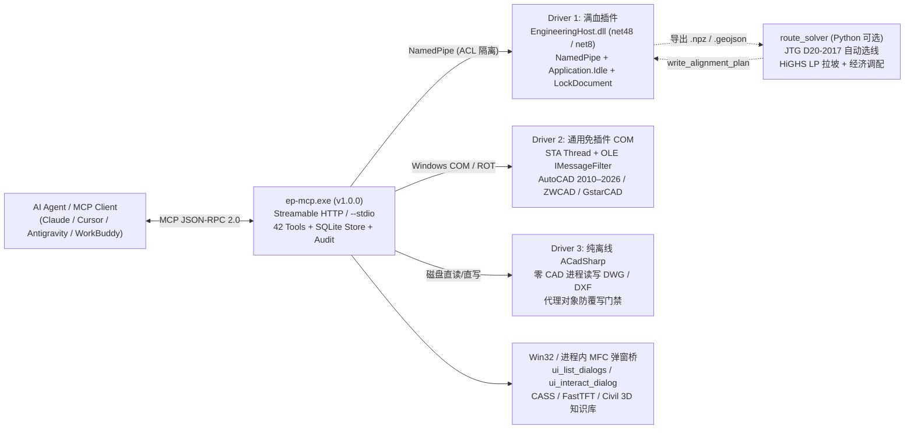

# Engineering Platform v1.0.0

> **全版本 AutoCAD / Civil 3D / 中望 CAD / 浩辰 CAD / 南方 CASS / 飞时达 FastTFT 一体化 AI 自主工程平台**

[](#)
[](#)
[](#)
[](#)
[](#源码构建与全量验证)

**Engineering Platform** 是一套面向工程勘察设计、道路交通与市政土建领域的 **MCP（Model Context Protocol）全自主 CAD 工程引擎**。它将 **单文件 C# 多驱动 MCP 网关（`ep-mcp.exe`）**、**全版本 CAD 进程内托管插件（`EngineeringHost.dll`，`.NET 4.8` + `.NET 8` 双目标 + Roslyn 内存编程引擎）** 与 **JTG D20-2017 自动选线与经济造价引擎（`route_solver`）** 深度融合，让任意支持 MCP 的 AI Agent 能够安全、精准、闭环地完成读图、体检、原生批量绘图、Civil 3D 路线与 BIM 建模、南方 CASS / 飞时达自动化操作以及无 CAD 离线 DWG/DXF 批处理。

---

## 目录

- [核心亮点](#核心亮点)
- [系统架构（一网关三驱动）](#系统架构一网关三驱动)
- [完整能力与 42 个 MCP 工具总览](#完整能力与-42-个-mcp-工具总览)
- [Civil 3D 专业能力与 JTG D20-2017 选线引擎](#civil-3d-专业能力与-jtg-d20-2017-选线引擎)
- [南方 CASS / 飞时达 FastTFT 全自动操作](#南方-cass--飞时达-fasttft-全自动操作)
- [安全边界与防崩设计](#安全边界与防崩设计)
- [快速开始（安装与 MCP 接入）](#快速开始安装与-mcp-接入)
- [原生批量绘图示例（`write_entities`）](#原生批量绘图示例write_entities)
- [项目目录结构](#项目目录结构)
- [源码构建与全量验证](#源码构建与全量验证)
- [许可与第三方声明](#许可与第三方声明)

---

## 核心亮点

1. **一网关三驱动，覆盖全部 CAD 形态**
   - **Driver 1 · 满血插件（NamedPipe）**：覆盖 Civil 3D 2019–2026 与 AutoCAD 2017–2026，支持全图语义读取、Civil 3D 12 大原生对象、原生事务批量建实体（`write_entities`）、Roslyn C# 内存编译（`write_eval_csharp`）、瞬态 3D 预览、进程内 MFC 弹窗桥。
   - **Driver 2 · 通用免插件 COM**：覆盖 AutoCAD 2010–2026、中望 ZWCAD、浩辰 GstarCAD，零 DLL 注入，专用 STA 线程 + OLE `IMessageFilter` 防忙碌拒绝，已保存大图自动切换 ACadSharp 离线加速。
   - **Driver 3 · 纯离线原生引擎（ACadSharp）**：零 CAD 进程直接读写 R14–AC1032 原生 `.dwg` / `.dxf`，支持离线建实体、GeoJSON 导出、多图批处理，内置代理对象防覆写硬门禁保护 Civil 3D / 天正 / 鸿业扩展字典。
2. **结构化原生批量建实体（`write_entities`）**
   - 单次事务支持创建最多 **5,000** 个原生 CAD 实体（`line`、`polyline`、`rectangle`、`circle`、`arc`、`ellipse`、`text`、`mtext`、`point`），自动建图层、设 ACI 颜色、自动归一化椭圆长短轴比，**三驱动统一接口**，同步返回精确创建数、句柄列表、包围盒与失败明细，彻底告别 LISP `entmake` 静默丢图元。
3. **`write_command` 延迟 Idle 实景回执**
   - LISP 表达式自动包裹 `vl-catch-all-apply` + 原子 Undo 组，非 LISP 命令自动捕获 `LASTPROMPT`，命令执行完毕后于下一轮 `Application.Idle` 自动回读数据库实体/图层数量变化与真实报错信息，返回 `verified` / `beforeEntityCount` / `afterEntityCount` / `entityDelta` / `lispError`。
4. **高精度可视化核验与实时范围**
   - `read_preview` 支持 `LINE`、真开口 `ARC`、精确 `CIRCLE`、任意旋转/局部 `ELLIPSE` 与真字体 `TEXT`/`MTEXT` 渲染；`SemanticExtractor` 实时计算实体并集范围，删改图元立即收缩/扩张，无需补发 `ZOOM _E`；`DrawingFingerprint` 纳入实体类型计数，图元类型变更即刷新指纹。
   - `read_viewport_snapshot` 支持 20 ms 级实时视口截图，方便多模态 Agent 肉眼核验建模效果。
5. **纯 C# 单文件网关，零运行期依赖**
   - `ep-mcp.exe` 零 Python / 零 Node.js 依赖，同时支持 `--stdio` 与 `Streamable HTTP (127.0.0.1:18080/mcp)`，通过 MCP `initialize.instructions` 协议内聚下发完整操作规范。
   - 支持多开 CAD 实例自动 PID 去重，单次调用可附加 `targetPid` 或 `hostInstanceId` 精准路由目标窗口。
6. **一体化自包含安装器（`EngineeringPlatform-Setup.exe`）**
   - 自动扫描本机所有 AutoCAD / Civil 3D / 中望 / 浩辰版本，精准写入 `DemandLoad` 与 `Profiles\<name>\Variables\TRUSTEDPATHS`，支持 NTFS 占用热重命名替换与代码签名信任，零启动弹窗阻塞。

---

## 系统架构（一网关三驱动）



---

## 完整能力与 42 个 MCP 工具总览

`ep-mcp.exe` 统一暴露 **42 个标准化 MCP 工具**（37 个 CAD 领域工具 + 5 个进程外 UI/命令行/专业命令目录工具），`sys_capabilities.tools` 与 `tools/list` 严格 100% 同源：

| 域 | 数量 | 工具列表 | 核心用途 |
| :--- | :---: | :--- | :--- |
| **系统与诊断 (`sys`)** | 6 | `sys_ping`、`sys_status`、`sys_version`、`sys_health`、`sys_capabilities`、`sys_list_instances` | 活性探针、主线程泵送监控、多驱动实例发现与能力自检 |
| **只读与感知 (`read`)** | 12 | `read_overview`、`read_layers`、`read_query`、`read_describe`、`read_preview`、`read_anomalies`、`read_active_selection`、`read_viewport_snapshot`、`read_object_xdata`、`read_civil_list`、`read_civil_object`、`read_civil_surfaces`、`read_civil_alignments`（含 Civil 专读） | 图纸总览、图层统计、条件/属性/空间过滤查询、图面体检、结构示意图预览、实时视口截图、框选区感知、XData/XRecord 读取、Civil 3D 原生对象解析 |
| **无损导出 (`export`)** | 2 | `export_surface_grid`、`export_layer_geojson` | Civil 3D TIN 曲面高程格网 `.npz`/`.json` 无损导出、图层实体 RFC 7946 GeoJSON 导出 |
| **写入与建模 (`write`)** | 10 | `write_entities`、`write_insert_points`、`write_command`、`write_eval_csharp`、`write_alignment_plan`、`write_surface_breakline`、`write_object_xdata`、`write_undo`、`write_preview`、`write_approve` | 结构化批量建实体、坐标放点、带实景回执的命令/LISP 执行、Roslyn C# 内存编译执行、平纵方案原生落盘、曲面断裂线、元数据写入、精准事务撤销、可选人工审批链 |
| **瞬态预览 (`preview`)** | 1 | `preview_transient` | 基于 `TransientManager` 的非破坏性 3D 视口预览，不改图纸修订号 |
| **跨图批处理 (`batch`)** | 1 | `batch_side_database` | 无界面后台批量 `inspect` / `export_layers` / `find_replace_text` |
| **任务控制 (`task`)** | 4 | `task_status`、`task_list`、`task_cancel`、`task_reconcile` | 长任务状态查询、取消与对账 |
| **UI 与专业目录 (`ui`)** | 5 | `ui_list_dialogs`、`ui_wait_dialog`、`ui_interact_dialog`、`ui_read_cmdline`、`ui_cass_commands` | MFC 模态框控件树读取与自动交互、命令行 `CMDACTIVE`/`LASTPROMPT` 读取、南方 CASS / 飞时达 / Civil 3D 命令与避坑目录检索 |

---

## Civil 3D 专业能力与 JTG D20-2017 选线引擎

### Civil 3D 深度集成
- **12 大原生对象感知**：支持 TIN 曲面（`TinSurface`）、体积曲面（`TinVolumeSurface` 挖填净方量）、路线（`Alignment`）、纵断面（`Profile`）、三维道路（`Corridor`）、装配（`Assembly`）、纵断面视图（`ProfileView`）、采样线编组（`SampleLineGroup`）、管网（`PipeNetwork`）、点编组（`PointGroup`）、场地（`Site`）、桥梁与图框组。
- **平滑抛物线竖曲线**：`write_alignment_plan` 原生调用 `AddFreeSymmetricParabolaByPVIAndCurveLength` 自动生成光滑抛物线竖曲线，纯 AutoCAD 环境下自动降级为 3D/2D 多段线。
- **LOD 300 BIM 闭环**：结合 `write_eval_csharp`（180 秒重计算支持）可全自动完成曲面凹包裁剪、山区限宽放坡（`DaylightMaxWidth`）、重力式挡墙/桥梁/护栏布置、体积曲面两事务土方统计与 `Corridor.ExportSolids` 实体导出。

### 外置自动选线与经济引擎（`route_solver/`）
- 支持 **20 / 30 / 40 / 60 / 80 / 100 km/h** 公路等级规范预设（含山岭盘山公路 30 km/h）。
- **平面搜索**：16 邻域等高线贴坡 A* 搜索 + 障碍物/禁建区/房屋/水体/农田多分类代价场。
- **纵断面优化**：地形转折点自适应布设 + 横坡半挖半填偏置 + **HiGHS 全局凸 LP** + JTG D20-2017 表 8.2.5 最大坡长/缓和坡段自动插入 + 连续 3 km 均坡 `<= 5.5%` + 隧道 `<= 3.0%` + 平包竖协调核验。
- **经济比选与报表**：`route_solver/economics.py` 内置公路概算单价库、LP 最小运费土石方纵向调配模型与纬地 HintCAD 报表导出。

---

## 南方 CASS / 飞时达 FastTFT 全自动操作

- **内置专业命令与避坑知识库（`ui_cass_commands`）**：按中文关键词（如「方格网」「土方」「自然标高」「挡墙」「廊道」）秒查真实命令名、交互步骤与防卡死注意事项。
- **双引擎 MFC 弹窗驱动**：优先使用本地 `Win32DialogDriver` 枚举控件树并执行填参、切 Tab（`select_tab`）、点 `[...]` 浏览文件（`browse_file`）；遇 UIPI 隔离时自动穿透 NamedPipe 由 CAD 进程内后台线程直接驱动。
- **交互命令协同**：`ui_read_cmdline` 实时读取 `CMDACTIVE` / `CMDNAMES` / `LASTPROMPT` / `OSMODE` / `CLAYER`，配合 `write_command(allowDuringCommand=true / sendEnter=true / cancelCommand=true)` 实现零点击闭环。

---

## 安全边界与防崩设计

1. **永不擅自落盘**：所有在线写工具均不自动保存图纸，硬拒 `SAVE` / `QSAVE` / `SAVEAS` / `QUIT` / `PLOT` / `PURGE` 等破坏性命令，全部修改受 `Undo` 保护，支持 `write_undo` 随时回滚。
2. **主线程隔离与显式文档锁**：全部数据库写入在 `Application.Idle` 串行执行并强制加 `DocumentLock`（`doc.LockDocument()`），杜绝 `eLockViolation` 与并发崩溃；后台看门狗监控模态框阻塞（`E1004`）。
3. **防跨站窃图（Streamable HTTP）**：强制校验 `Host` 白名单（仅允许 `127.0.0.1` / `localhost`）、拦截任何携带 `Origin` 头的浏览器跨域请求（403）、强制常量时间 `Authorization: Bearer` 鉴权（401）。
4. **NamedPipe ACL 隔离**：管道仅授权当前登录用户与 `SYSTEM`，拒绝其它用户访问。
5. **离线代理对象防覆写硬门禁**：`OfflineDwgDriver` 对含 Civil 3D / 天正 / 鸿业等自定义类或代理对象的既有 DWG 严禁原地覆写（`proxy_overwrite_blocked`），防止破坏专业扩展字典。
6. **灵活审批策略**：默认配置为全自主静默写模式（`write.autoApprove = true`，并在响应和 SQLite 审计日志中显式记录 `autoApproved`）；对外或受控环境可在 `%LOCALAPPDATA%\EngineeringPlatform\config.json` 中设为 `false`（或安装时传 `--no-auto-write`），启用「摘要预览 → CAD 模态框物理点击确认 → 一次性令牌」硬审批链。

---

## 快速开始（安装与 MCP 接入）

### 方式一：一键安装（源码构建后运行 `EngineeringPlatform-Setup.exe`）

```powershell
# 1. 打开图形化安装向导（推荐，自动扫描本机全部 CAD）
.\installer\dist\EngineeringPlatform-Setup.exe

# 2. 静默 CLI 批量部署
.\installer\dist\EngineeringPlatform-Setup.exe --list --json
.\installer\dist\EngineeringPlatform-Setup.exe --plugin-only
.\installer\dist\EngineeringPlatform-Setup.exe --all --autostart
```

### 方式二：接入任意 MCP 客户端

安装完成后会自动生成 `%LOCALAPPDATA%\EngineeringPlatform\mcp-client-config.json`，支持以下两种模式：

**1) Stdio 模式（推荐给 Claude Desktop / Cursor / Antigravity / WorkBuddy）**
```json
{
  "mcpServers": {
    "engineering-platform": {
      "command": "%LOCALAPPDATA%\\EngineeringPlatform\\bin\\ep-mcp.exe",
      "args": ["--stdio", "--backend", "auto"]
    }
  }
}
```

**2) Streamable HTTP 模式**
```powershell
ep-mcp.exe --port 18080 --token "<YOUR_SECRET_TOKEN>" --backend auto
# 端点：http://127.0.0.1:18080/mcp
# 健康检查：GET http://127.0.0.1:18080/health
```

### 可选：安装 `route_solver` 选线引擎 Python 依赖
```powershell
pip install -r route_solver\requirements.txt
```

---

## 原生批量绘图示例（`write_entities`）

一次调用即可在单事务内创建全部常用图元（插件、COM、离线三驱动完全通用；离线模式只需附加 `"dwgPath"`）：

```json
{
  "layer": "EP-GEOM",
  "zoomExtents": true,
  "entities": [
    { "type": "line", "start": [0, 0, 0], "end": [100, 0, 0], "color": 1 },
    { "type": "polyline", "points": [[0, 10], [50, 30], [100, 10]], "closed": false, "color": 2 },
    { "type": "rectangle", "p1": [10, 40], "p2": [60, 80], "layer": "EP-RECT", "color": 3 },
    { "type": "circle", "center": [50, 50], "radius": 20, "color": 4 },
    { "type": "arc", "center": [50, 50], "radius": 30, "startAngle_deg": 0, "endAngle_deg": 180, "color": 5 },
    { "type": "ellipse", "center": [120, 50], "majorRadius": 25, "minorRadius": 12, "rotation_deg": 15, "color": 6 },
    { "type": "text", "text": "K0+100", "position": [10, 90], "height": 3.5 },
    { "type": "mtext", "text": "Bridge Pier\\PNo.1", "position": [60, 90], "height": 3.0, "width": 40 },
    { "type": "point", "position": [0, 0, 12.5] }
  ]
}
```

返回确定性回执（含精确创建数、失败明细、十六进制句柄与三维包围盒）：
```json
{
  "requestedCount": 9,
  "createdCount": 9,
  "failedCount": 0,
  "failedItems": [],
  "layer": "EP-GEOM",
  "byType": { "line": 1, "polyline": 1, "rectangle": 1, "circle": 1, "arc": 1, "ellipse": 1, "text": 1, "mtext": 1, "point": 1 },
  "handles": ["2A1", "2A2", "..."],
  "extents": { "min": [0, 0, 0], "max": [144.3, 93.5, 12.5] },
  "autoApproved": true,
  "saved": false
}
```

---

## 项目目录结构

```text
engineering-platform/
├── gateway/               # 单文件 C# .NET 8 MCP 网关 (ep-mcp.exe)
│   ├── McpServer.cs       #   MCP JSON-RPC 2.0 (HTTP + stdio) 与协议内聚指令
│   ├── BackendRouter.cs   #   一网关三驱动统一路由器 (Plugin / COM / Offline)
│   ├── PipeHostClient.cs  #   NamedPipe 宿主客户端与过期实例自动清理
│   ├── ComCadDriver.cs    #   STA 通用 COM 驱动 + OLE IMessageFilter + 混合加速
│   ├── OfflineDwgDriver.cs#   ACadSharp 离线 DWG/DXF 读写与代理防覆写门禁
│   ├── Win32DialogDriver.cs#  MFC 模态框控件树解析与自动交互引擎
│   ├── CassCommandCatalog.cs# 南方 CASS / 飞时达 / Civil 3D 命令知识库
│   └── ResultStore.cs     #   SQLite 结果落库与审计日志
├── host/                  # AutoCAD / Civil 3D 托管插件 (net48 + net8.0-windows)
│   ├── Tools/             #   读/写/导出/预览/批处理/系统/任务工具处理器
│   ├── Semantic/          #   语义抽取、Civil 3D 12 模块读取、异常扫描与缓存
│   ├── Preview/           #   GDI+ 结构示意图渲染器 (线/弧/圆/椭圆/真文字)
│   ├── Roslyn/            #   Roslyn (.NET 8) + CodeDom (.NET 4.8) 内存 C# 引擎
│   ├── Fingerprint/       #   含类型签名的图纸指纹计算
│   ├── Scheduling/        #   Application.Idle 主线程调度器 + 延迟回执 + 看门狗
│   ├── Protocol/          #   统一契约、JSON 编解码、参数校验与分帧
│   └── Pipe/              #   隔离层 NamedPipe 服务端（零 Autodesk 引用）
├── setup/                 # 一体化 WinForms + CLI 自包含安装配置中心
│   ├── MainForm.cs        #   单页图形向导 UI
│   ├── CadDiscovery.cs    #   多版本 CAD 注册表与跨提权进程发现
│   ├── CadInstallerEngine.cs# DemandLoad / TRUSTEDPATHS / 证书信任 / 热替换部署
│   └── build_setup.ps1    #   一键构建、签名、打包全流程脚本
├── route_solver/          # JTG D20-2017 自动选线、HiGHS 拉坡与经济调配引擎
├── protocol/              # 唯一真相源：tools.schema.json / errors.json
├── mockhost/              # 无 CAD 宿主替身（用于全链路自动化验证）
├── tests/                 # 1,563+ 项协议、契约一致性、静态审查、E2E 与多驱动测试
└── docs/                  # 使用指南、架构图与设计文档
```

---

## 源码构建与全量验证

### 环境要求
- Windows 10/11 x64
- [.NET 8 SDK](https://dotnet.microsoft.com/)（用于编译 `gateway`、`setup` 与 `host`）
- 本机安装 AutoCAD / Civil 3D（编译 `host` 时自动探测或通过 `EP_ACAD2024_ROOT` / `EP_ACAD2025_ROOT` 环境变量指定托管 DLL 路径）
- Python 3.10+（运行自动化测试与 `route_solver`）

### 一键构建与签名
```powershell
powershell -ExecutionPolicy Bypass -File setup\build_setup.ps1
```
产物输出至 `installer/dist/EngineeringPlatform-Setup.exe`（自动包含 `net48` + `net8` 插件、`ep-mcp.exe`、`route_solver` 与文档）。

### 运行全量回归测试
```powershell
python tests\run_all.py                          # 11 套件：1,563 passed / 0 failed（含 408 项静态审查与 178 项契约一致性）
python tests\test_v3_e2e.py                      # 42 工具目录、HTTP 安全门禁、NamedPipe + SQLite、sys_capabilities 同源校验
python tests\test_v31_multidriver.py             # 离线 ACadSharp 9 类实体生成 DXF/DWG 回读、COM 诊断、Auto 路由去重
python tests\qa\qa_write_domain.py               # 36 项写域安全门禁校验
python -m unittest discover -s route_solver\tests -v  # JTG D20-2017 选线与经济调配单测
```

---

## 许可与第三方声明

- 原始代码权利声明详见 [LICENSE](LICENSE)；
- 第三方开源组件清单与许可证归档详见 [THIRD-PARTY-NOTICES.md](THIRD-PARTY-NOTICES.md)；
- 本仓库不包含、不分发任何 Autodesk 官方二进制文件或商标素材，运行宿主插件需由使用者自行安装合法授权的 AutoCAD / Civil 3D。
