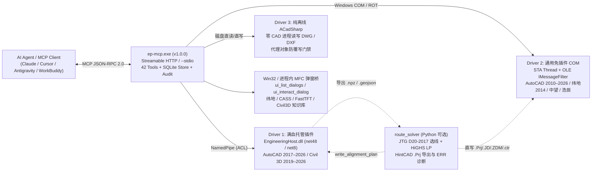

# Engineering Platform v1.0.0

> **全版本 AutoCAD / Civil 3D / 纬地 HintCAD V8 / 南方 CASS / 飞时达 FastTFT / 中望 / 浩辰 一体化 AI 自主工程平台**

[](#)
[](#)
[](#)
[](#)
[](#源码构建与全量验证)

**Engineering Platform** 是一套面向 **公路交通、市政道路、岩土勘察与土建设计** 领域的 **MCP（Model Context Protocol）全自主 CAD 工程引擎**。

它将 **纯 C# 单文件多驱动 MCP 网关（`ep-mcp.exe`）**、**全版本 CAD 进程内托管插件（`EngineeringHost.dll`，`.NET 4.8` + `.NET 8` 双目标 + Roslyn 内存编程引擎）** 与 **JTG D20-2017 自动选线 / 经济调配 / 纬地 HintCAD 工程读写诊断引擎（`route_solver`）** 深度融合，让任意支持 MCP 的 AI Agent（Claude / Cursor / Antigravity / WorkBuddy 等）能够安全、精准、闭环地完成：

- **读图感知与体检**（语义总览、条件查询、实景视口截图、高保真线/弧/圆/椭圆/真文字示意图预览）；
- **原生事务批量绘图与实景回执**（`write_entities` 三驱动批量建 9 类实体、`write_command` 延迟 Idle 实景回执与 LISP 报错捕获、`write_eval_csharp` 内存 C# 直编）；
- **Civil 3D 设计院级平纵横与 LOD 300 BIM 建模**；
- **纬地 HintCAD V8.0 全流程数据生成、COM+MFC 协同操作与 `ERR*.txt` 自动诊断**；
- **南方 CASS 10/11 与飞时达 FastTFT V15.x 零点击土方闭环**；
- **无 CAD 进程离线原生 DWG/DXF 读写与批处理**。

---

## 目录

- [核心亮点](#核心亮点)
- [系统架构（一网关三驱动）](#系统架构一网关三驱动)
- [42 个标准化 MCP 工具总览](#42-个标准化-mcp-工具总览)
- [纬地 HintCAD V8 全流程协同与纯文本工程引擎](#纬地-hintcad-v8-全流程协同与纯文本工程引擎)
- [Civil 3D 专业能力与 JTG D20-2017 自动选线引擎](#civil-3d-专业能力与-jtg-d20-2017-自动选线引擎)
- [南方 CASS / 飞时达 FastTFT 零点击自动化](#南方-cass--飞时达-fasttft-零点击自动化)
- [安全边界与工程防崩机制](#安全边界与工程防崩机制)
- [快速开始（安装与 MCP 接入）](#快速开始安装与-mcp-接入)
- [典型调用示例](#典型调用示例)
- [项目目录结构](#项目目录结构)
- [源码构建与全量验证](#源码构建与全量验证)
- [许可与第三方声明](#许可与第三方声明)

---

## 核心亮点

1. **一网关三驱动，通吃 2010–2026 全版本与国产 CAD**
   - **Driver 1 · 满血托管插件（NamedPipe）**：覆盖 AutoCAD 2017–2026 与 Civil 3D 2019–2026，支持 Civil 3D 12 大原生对象、单事务 5,000 图元 `write_entities`、Roslyn/CodeDom 内存 C# 直编、瞬态 3D 预览、进程内 MFC 弹窗桥。
   - **Driver 2 · 通用免插件 COM**：覆盖 AutoCAD 2010–2026（含运行纬地 V8 的 **AutoCAD 2014**）、中望 ZWCAD、浩辰 GstarCAD，零 DLL 注入，专用 STA 线程 + OLE `IMessageFilter` 防忙碌拒绝，已保存大图自动切换 ACadSharp 离线加速。
   - **Driver 3 · 纯离线原生引擎（ACadSharp）**：零 CAD 进程直接读写 R14–AC1032 `.dwg`/`.dxf`，支持离线建实体、GeoJSON 导出、跨图批处理，内置代理对象防覆写硬门禁保护 Civil 3D / 纬地 / 天正 / 鸿业扩展字典。
2. **原生批量建实体（`write_entities`）+ 命令实景回执（`write_command`）**
   - `write_entities` 单事务支持创建最多 **5,000** 个原生实体（`line` / `polyline` / `rectangle` / `circle` / `arc` / `ellipse` / `text` / `mtext` / `point`），自动建图层设颜色、归一化椭圆长短轴比，**三驱动统一契约**，同步返回创建数、句柄、包围盒与失败明细，告别 LISP `entmake` 静默丢图元。
   - `write_command` 内置延迟 `Application.Idle` 哨兵回执：LISP 自动用 `vl-catch-all-apply` 捕获真实报错，非 LISP 自动捕获 `LASTPROMPT`，返回 `verified` / `beforeEntityCount` / `afterEntityCount` / `entityDelta` / `lispError`。
3. **四大工程专业软件深度知识库与闭环工具链**
   - 内置 **纬地 HintCAD V8.0**、**Autodesk Civil 3D 2019–2026**、**南方 CASS 10/11**、**飞时达 FastTFT V15.x** 全功能命令目录与避坑规则（`ui_cass_commands`），并通过 MCP `initialize.instructions` 自动下发给 AI Agent。
   - `route_solver/hintcad_io.py` 可直接将 JTG D20-2017 选线结果导出为纬地 V8 标准纯文本工程（`.Prj` / `_JD_import.txt` / `.ZDM` / `.DMX` / `.sta` / `.ctr` / `.wid`），自动处理 `(E,N) <-> (N,E)` 大地坐标互换，并支持一键解析既有 `.Prj` 与自动诊断 `Lst/ERR*.txt` 报错日志。
4. **高保真可视化核验与实时范围**
   - `read_preview` 支持 `LINE`、真开口 `ARC`、精确 `CIRCLE`、任意旋转/局部 `ELLIPSE` 与真字体 `TEXT`/`MTEXT` 渲染；`SemanticExtractor` 实时累加实体并集包围盒，删改图元后预览范围立即收缩/扩张，无需补发 `ZOOM _E`；`DrawingFingerprint` 纳入实体类型计数，图元类型变更即刷新指纹。
   - `read_viewport_snapshot` 20 ms 级实时视口截图，支持多模态 Agent 肉眼核验建模效果。
5. **零依赖单文件网关与一体化安装器**
   - `ep-mcp.exe` 纯 C# 单文件，零 Python / 零 Node.js 运行期依赖，支持多开 CAD 自动 PID 去重与 `targetPid` / `hostInstanceId` 精准路由。
   - `EngineeringPlatform-Setup.exe` 自动扫描本机全部 CAD、精准写入 `DemandLoad` 与 `Profiles\<name>\Variables\TRUSTEDPATHS`、导入代码签名消除启动弹窗，并支持 NTFS 占用热重命名替换。

---

## 系统架构（一网关三驱动）



---

## 42 个标准化 MCP 工具总览

`ep-mcp.exe` 统一暴露 **42 个 MCP 工具**（37 个 CAD 领域工具 + 5 个进程外 UI/命令行/专业命令目录工具），`sys_capabilities.tools` 与 `tools/list` 强制 100% 同源：

| 域 | 数量 | 工具清单 | 核心能力 |
| :--- | :---: | :--- | :--- |
| **系统与实例 (`sys`)** | 6 | `sys_ping`、`sys_status`、`sys_version`、`sys_health`、`sys_capabilities`、`sys_list_instances` | 活性探针、主线程泵送监控、三驱动多开实例发现与能力自检 |
| **只读与感知 (`read`)** | 13 | `read_overview`、`read_layers`、`read_query`、`read_describe`、`read_preview`、`read_anomalies`、`read_active_selection`、`read_viewport_snapshot`、`read_object_xdata`、`read_civil_list`、`read_civil_object`、`read_civil_surfaces`、`read_civil_alignments` | 图纸总览、图层统计、条件/属性/空间查询、图面体检、高保真结构预览、实时视口截图、框选区感知、XData/XRecord 读取、Civil 3D 原生对象解析 |
| **无损导出 (`export`)** | 2 | `export_surface_grid`、`export_layer_geojson` | Civil 3D TIN 曲面高程格网 `.npz`/`.json` 无损导出、图层 RFC 7946 GeoJSON 导出 |
| **写入与建模 (`write`)** | 10 | `write_entities`、`write_insert_points`、`write_command`、`write_eval_csharp`、`write_alignment_plan`、`write_surface_breakline`、`write_object_xdata`、`write_undo`、`write_preview`、`write_approve` | 结构化批量建 9 类实体、坐标放点、带实景回执命令/LISP 执行、Roslyn C# 内存直编、平纵方案落盘、曲面断裂线、元数据写入、精准撤销、可选审批链 |
| **瞬态预览 (`preview`)** | 1 | `preview_transient` | 基于 `TransientManager` 的非破坏性 3D 预览，不改图纸修订号 |
| **跨图批处理 (`batch`)** | 1 | `batch_side_database` | 无界面后台批量 `inspect` / `export_layers` / `find_replace_text` |
| **任务控制 (`task`)** | 4 | `task_status`、`task_list`、`task_cancel`、`task_reconcile` | 长任务状态查询、取消与对账 |
| **UI 与专业目录 (`ui`)** | 5 | `ui_list_dialogs`、`ui_wait_dialog`、`ui_interact_dialog`、`ui_read_cmdline`、`ui_cass_commands` | MFC 模态框控件树读取与自动交互、命令行状态读取、**纬地 / CASS / FastTFT / Civil 3D** 全功能命令与避坑目录检索 |

---

## 纬地 HintCAD V8 全流程协同与纯文本工程引擎

针对国内公路设计院最普及的 **纬地道路交通辅助设计系统 V8.0**（及配套路基 V5.0 / 涵洞 V4.0 / 隧道 V4.0 / 挡土墙 V5.0 / 数模 / BIM），平台采用 **「纯文本工程直写 + COM/MFC 协同驱动 + ERR 日志自动诊断」** 混合架构：

### 1. 纯文本工程一键读写与故障诊断（`route_solver/hintcad_io.py`）
```powershell
# 1) 将 route_solver 自动选线方案一键导出为纬地 V8 标准工程包
#    自动生成 .Prj / _JD_import.txt / .ZDM / .DMX / .sta / .ctr / .wid
#    并自动完成 AutoCAD (X=东E, Y=北N) -> 纬地大地坐标 (X=北N, Y=东E) 精确互换
python -m route_solver.hintcad_io export --plan plan_1.json --out-dir ./hint_out --name Route1

# 2) 解析既有纬地 .Prj 工程（还原分段指标、变坡点、地面线、土方断面与关联文件）
python -m route_solver.hintcad_io parse --prj "path/to/project.Prj"

# 3) 自动诊断纬地 Lst/ERR*.txt 日志（GBK 编码），按故障类型归类并输出修复命令
python -m route_solver.hintcad_io diagnose --path "path/to/HintCAD/Lst"
```

### 2. 纬地 V8 核心命令链与内建避坑规则（已内置于 `ui_cass_commands`）
- **标准工程链**：`NEWDTM`/`READDWG` → `CHECKNET`（查 `SortPt.err` 清飞点）→ `TRI` → `HDTM_OPT_BOUND` → `JDPM`/`JDZB_IN` → `GETDMX`/`GETHDM` → `ZDMSJ` → `CHECK_HDM_DMX` → **`LJSJ`（必跑生成 `.lj`）** → `HDM_NEW` → `ZDMT` / `PMCT`+`TRIM_PMT` / `LJSJB` / `CALZPB`。
- **四大高频工程避坑**：
  1. **坐标互换铁律**：纬地 `.JD`/`.pm`/交点导入表与逐桩坐标表中 `X=北坐标(N), Y=东坐标(E)`，与 AutoCAD 图形空间 `(X=东E, Y=北N)` 互换；
  2. **缺 `.lj` 报错**：凡改动平面/纵断/超高/加宽/桩号，必须先 `CHECK_HDM_DMX` 再重跑 `LJSJ`，否则 `HDM_NEW` 必报「该断面缺少路基设计中间数据」；
  3. **边坡/排水沟不交地面线**：通过 `diagnose_hintcad_errors` 定位超宽桩号，用 `HDTM_EXHDM` 补测加宽 `.HDM`，或在 `CTREDIT`（`.ctr`）中设挡土墙/桥梁/调整排水沟起设填高；
  4. **AutoCAD 2014 协同**：通过 `ep-mcp.exe` Driver 2（通用 COM + `Win32DialogDriver`）驱动，需与纬地 `acad.exe` 保持同权限同桌面；禁止 ACadSharp 原地覆写含 `HINTCAD_HHDM*` 自定义对象的图纸。

---

## Civil 3D 专业能力与 JTG D20-2017 自动选线引擎

### Civil 3D 2019–2026 深度集成
- **12 大原生对象全感知**：TIN 曲面、体积曲面（`TinVolumeSurface` 挖填净方量）、路线（`Alignment`）、纵断面（`Profile`）、三维道路（`Corridor`）、装配（`Assembly`）、纵断面视图（`ProfileView`）、采样线编组（`SampleLineGroup`）、管网（`PipeNetwork`）、点编组（`PointGroup`）、场地（`Site`）、桥梁与图框组。
- **设计院级 + LOD 300 BIM 闭环**：曲面凹包长边裁剪 → `write_alignment_plan` 自动调用 `AddFreeSymmetricParabolaByPVIAndCurveLength` 生成平滑抛物线竖曲线 → 山区限宽放坡 `DaylightMaxWidth` + 重力式挡墙/桥梁/护栏 → 两事务 `TinVolumeSurface` 土方平衡 → `Corridor.ExportSolids` + PBR 材质 + `PropertySet`/IFC4.3 交付。

### 外置自动选线与经济造价引擎（`route_solver/`）
- 支持 **20 / 30 / 40 / 60 / 80 / 100 km/h** 公路等级规范预设（含山岭盘山公路 30 km/h）。
- **平面**：16 邻域等高线贴坡 A* 搜索 + 禁建区/房屋/水体/农田多分类约束代价场。
- **纵断面**：地形转折点自适应布设 + 横坡半挖半填偏置 + **HiGHS 全局凸 LP** + JTG D20-2017 表 8.2.5 最大坡长/缓和坡段自动插入 + 连续 3 km 均坡 `<= 5.5%` + 隧道 `<= 3.0%` + 平包竖协调核验。
- **经济比选与双软件导出**：`economics.py` 内置公路概算单价库与 LP 最小运费土石方纵向调配；每次求解同时产出 `plan_N.json`（对接 Civil 3D）、`economic_comparison.csv` 与 `hintcad_project/`（直接对接纬地 V8）。

---

## 南方 CASS / 飞时达 FastTFT 零点击自动化

- **南方 CASS 10/11**：覆盖方格网/三角网/两期间/等高线/断面土方、高程点展绘与导出、DTM 构网与等高线、里程断面、地籍宗地、拓扑质检与 SHP/KML/VCT 互转，内置 `.dat` 坐标格式与 `SOUTH 202101` XData 规范。
- **飞时达 FastTFT V15.x**：完整覆盖 `GPFILETOLSD` → `TFCREATEREGION`（`OSMODE=0` + `D` 逐点跟踪描绘 + `N` 单区块）→ `TFAUTOFG` → `TFGATHERNATURE` → `TFDESIGNIMPORT` → `TFFGCALVOL` → `TFFGCOLLECT`/`TFFGSTATTABLE` 零点击方格网闭环及三角网/田块/断面/边坡全链。
- **双引擎 MFC 弹窗驱动**：本地 `Win32DialogDriver` + 进程内 NamedPipe 后台线程兜底，支持读取完整控件树、`set_text`、`select_tab`、点击 `[...]` 自动走二级文件框（`browse_file`）与关闭二次结果提示框。

---

## 安全边界与工程防崩机制

1. **永不擅自落盘**：在线写工具永不自动保存图纸，硬拒 `SAVE` / `QSAVE` / `SAVEAS` / `QUIT` / `PLOT` / `PURGE` 等破坏性命令，全部修改受 `Undo` 事务保护，随时可 `write_undo` 回滚。
2. **主线程串行 + 显式文档锁**：所有在线数据库修改在 `Application.Idle` 串行执行并强制 `using (doc.LockDocument())`，杜绝 `eLockViolation` 与并发崩溃；后台看门狗实时监控模态框阻塞（`E1004`）。
3. **防跨站窃图（Streamable HTTP）**：强制校验 `Host` 白名单（仅 `127.0.0.1` / `localhost`）、拦截任何带 `Origin` 头的浏览器跨域请求（403）、常量时间校验 `Authorization: Bearer`（401）。
4. **NamedPipe ACL 隔离**：管道仅授权当前登录用户与 `SYSTEM`。
5. **离线代理对象防覆写硬门禁**：`OfflineDwgDriver` 对含 Civil 3D / 纬地 / 天正 / 鸿业等代理对象或自定义类的既有 DWG 严禁原地覆写（`proxy_overwrite_blocked`）。
6. **灵活审批模式**：默认全自主静默写（`write.autoApprove = true`，并在响应和 SQLite 审计日志中回显 `autoApproved`）；对外或受控场景可在 `%LOCALAPPDATA%\EngineeringPlatform\config.json` 中设为 `false`（或安装传 `--no-auto-write`），启用「预览摘要 → CAD 模态框物理点击确认 → 一次性令牌」硬审批链。

---

## 快速开始（安装与 MCP 接入）

### 1. 一键安装部署
```powershell
# 图形向导安装（自动扫描本机全部 CAD 版本）
.\installer\dist\EngineeringPlatform-Setup.exe

# 静默 CLI 部署
.\installer\dist\EngineeringPlatform-Setup.exe --list --json
.\installer\dist\EngineeringPlatform-Setup.exe --plugin-only
.\installer\dist\EngineeringPlatform-Setup.exe --all --autostart
```

### 2. 接入任意 MCP 客户端
安装后自动生成 `%LOCALAPPDATA%\EngineeringPlatform\mcp-client-config.json`：

**Stdio 模式（推荐给 Claude Desktop / Cursor / Antigravity / WorkBuddy）**
```json
{
  "mcpServers": {
    "engineering-platform": {
      "command": "%LOCALAPPDATA%\\EngineeringPlatform\\bin\\ep-mcp.exe",
      "args": ["--stdio", "--backend", "auto"]
    }
  }
}
```

**Streamable HTTP 模式**
```powershell
ep-mcp.exe --port 18080 --token "<YOUR_SECRET_TOKEN>" --backend auto
# MCP 端点：http://127.0.0.1:18080/mcp
# 健康检查：GET http://127.0.0.1:18080/health
```

### 3. 安装可选 Python 选线与纬地引擎依赖
```powershell
pip install -r route_solver\requirements.txt
```

---

## 典型调用示例

### 示例 1：单事务原生批量创建 9 类实体（`write_entities`，三驱动通用）
```json
{
  "layer": "EP-GEOM",
  "zoomExtents": true,
  "entities": [
    { "type": "line", "start": [0, 0, 0], "end": [100, 0, 0], "color": 1 },
    { "type": "polyline", "points": [[0, 10], [50, 30], [100, 10]], "closed": false, "color": 2 },
    { "type": "rectangle", "p1": [10, 40], "p2": [60, 80], "layer": "EP-RECT", "color": 3 },
    { "type": "circle", "center": [50, 50], "radius": 20, "color": 4 },
    { "type": "arc", "center": [50, 50], "radius": 30, "startAngle_deg": 0, "endAngle_deg": 180, "color": 5 },
    { "type": "ellipse", "center": [120, 50], "majorRadius": 25, "minorRadius": 12, "rotation_deg": 15, "color": 6 },
    { "type": "text", "text": "K0+100", "position": [10, 90], "height": 3.5 },
    { "type": "mtext", "text": "Bridge Pier\\PNo.1", "position": [60, 90], "height": 3.0, "width": 40 },
    { "type": "point", "position": [0, 0, 12.5] }
  ]
}
```
> 离线无 CAD 场景只需在顶层附加 `"dwgPath": "C:\\out\\demo.dwg"`（或 `.dxf`），即可直接生成原生图纸。

### 示例 2：检索纬地 / CASS / 飞时达 / Civil 3D 专业命令与避坑指南
```json
// tools/call -> ui_cass_commands
{ "query": "纬地" }
```

---

## 项目目录结构

```text
engineering-platform/
├── gateway/               # 纯 C# .NET 8 单文件 MCP 网关 (ep-mcp.exe)
│   ├── McpServer.cs       #   MCP JSON-RPC 2.0 (HTTP + stdio) 与协议内聚自引导规范
│   ├── BackendRouter.cs   #   一网关三驱动统一路由器 (Plugin / COM / Offline)
│   ├── PipeHostClient.cs  #   NamedPipe 宿主客户端与过期实例自动清理
│   ├── ComCadDriver.cs    #   STA 通用 COM 驱动 + OLE IMessageFilter + ACadSharp 混合加速
│   ├── OfflineDwgDriver.cs#   ACadSharp 离线 DWG/DXF 读写与代理对象防覆写硬门禁
│   ├── Win32DialogDriver.cs#  MFC 模态框控件树解析与自动交互引擎
│   ├── CassCommandCatalog.cs# 纬地 V8 / 南方 CASS / 飞时达 FastTFT / Civil 3D 命令知识库
│   └── ResultStore.cs     #   SQLite 结果落库与审计日志
├── host/                  # AutoCAD / Civil 3D 托管插件 (net48 + net8.0-windows)
│   ├── Tools/             #   读/写/导出/预览/批处理/系统/任务工具处理器
│   ├── Semantic/          #   语义抽取、Civil 3D 12 模块读取、实时并集范围与异常扫描
│   ├── Preview/           #   GDI+ 结构示意图渲染器 (线/弧/圆/旋转椭圆/真字体文字)
│   ├── Roslyn/            #   Roslyn (.NET 8) + CodeDom (.NET 4.8) 内存 C# 编译引擎
│   ├── Fingerprint/       #   含实体类型签名的图纸指纹计算
│   ├── Scheduling/        #   Application.Idle 主线程调度器 + 延迟命令回执 + 看门狗
│   ├── Protocol/          #   统一契约、跨平台 JSON 编解码、参数校验与分帧
│   └── Pipe/              #   隔离层 NamedPipe 服务端（零 Autodesk 引用）
├── route_solver/          # JTG D20-2017 自动选线、经济造价与纬地工程读写引擎
│   ├── horizontal_solver.py#  16 邻域等高线贴坡 A* 平面选线
│   ├── vertical_solver.py #   HiGHS 全局凸 LP 拉坡 + 规范坡长/缓和坡段/平包竖审计
│   ├── economics.py       #   公路概算单价库与 LP 最小运费土石方纵向调配
│   ├── hintcad_io.py      #   纬地 V8 .Prj/.JD/.ZDM/.DMX/.ctr/.wid 导出解析与 ERR 诊断
│   └── tests/             #   选线、经济调配与纬地工程 I/O 单元测试
├── setup/                 # 一体化 WinForms + CLI 自包含安装配置中心
│   ├── MainForm.cs        #   单页图形安装向导
│   ├── CadDiscovery.cs    #   全版本 CAD 注册表与跨提权进程发现
│   ├── CadInstallerEngine.cs# DemandLoad / TRUSTEDPATHS / 证书信任 / NTFS 占用热替换
│   └── build_setup.ps1    #   一键编译、代码签名与单文件打包脚本
├── protocol/              # 唯一真相源：tools.schema.json / errors.json
├── mockhost/              # 无 CAD 宿主替身（用于全链路自动化回归）
├── tests/                 # 1,563+ 项协议、契约一致性、静态审查、E2E 与多驱动测试
└── docs/                  # 使用指南、架构图与设计文档
```

---

## 源码构建与全量验证

### 环境要求
- Windows 10/11 x64、[.NET 8 SDK](https://dotnet.microsoft.com/)、Python 3.10+
- 本机安装 AutoCAD / Civil 3D（编译 `host` 时自动探测，也可通过 `EP_ACAD2024_ROOT` / `EP_ACAD2025_ROOT` 指定路径）

### 一键编译、签名与打包
```powershell
powershell -ExecutionPolicy Bypass -File setup\build_setup.ps1
```
产物输出至 `installer/dist/EngineeringPlatform-Setup.exe`（自动内嵌 `net48` + `net8` 插件、`ep-mcp.exe`、`route_solver` 与文档）。

### 运行全量回归测试
```powershell
python tests\run_all.py                             # 11 套件：1,563 passed / 0 failed（含 408 项静态审查与 178 项契约一致性）
python tests\test_v3_e2e.py                         # 42 工具目录、HTTP 安全门禁、NamedPipe + SQLite、sys_capabilities 同源校验
python tests\test_v31_multidriver.py                # 离线 ACadSharp 9 类实体读写、COM 诊断、Auto 路由、CASS + 纬地目录校验
python tests\qa\qa_write_domain.py                  # 36 项写域安全门禁校验
python -m unittest discover -s route_solver\tests -v # JTG D20-2017 选线、经济调配与纬地 .Prj/ERR 诊断单测
```

---

## 许可与第三方声明

- 原始代码权利声明详见 [LICENSE](LICENSE)；
- 第三方开源组件清单与许可证归档详见 [THIRD-PARTY-NOTICES.md](THIRD-PARTY-NOTICES.md)；
- 本仓库不包含、不分发任何 Autodesk / 纬地 / 南方 CASS 官方二进制文件或商标素材，运行需由使用者自行安装合法授权的对应软件。
