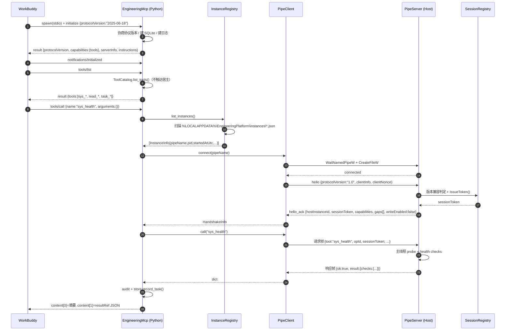
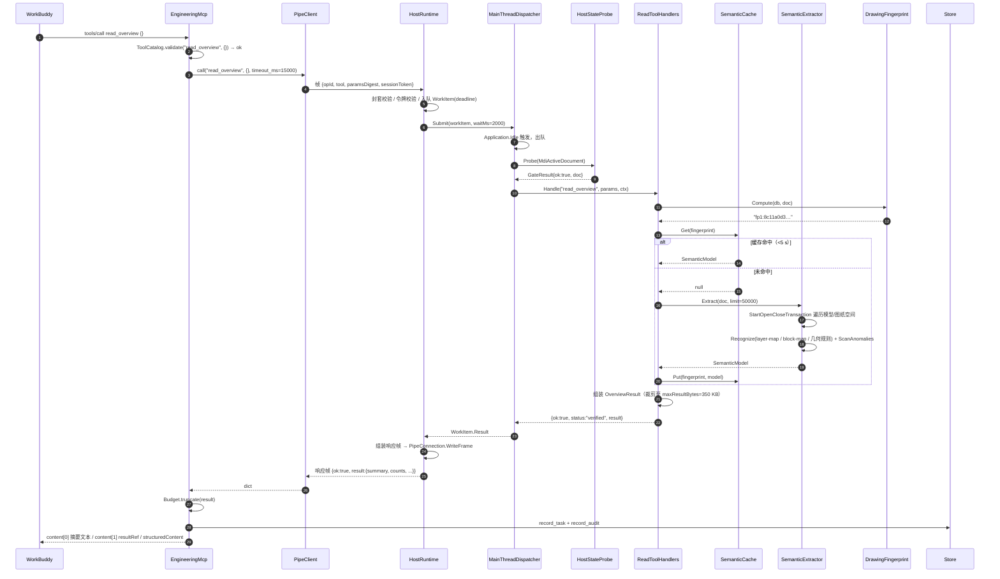
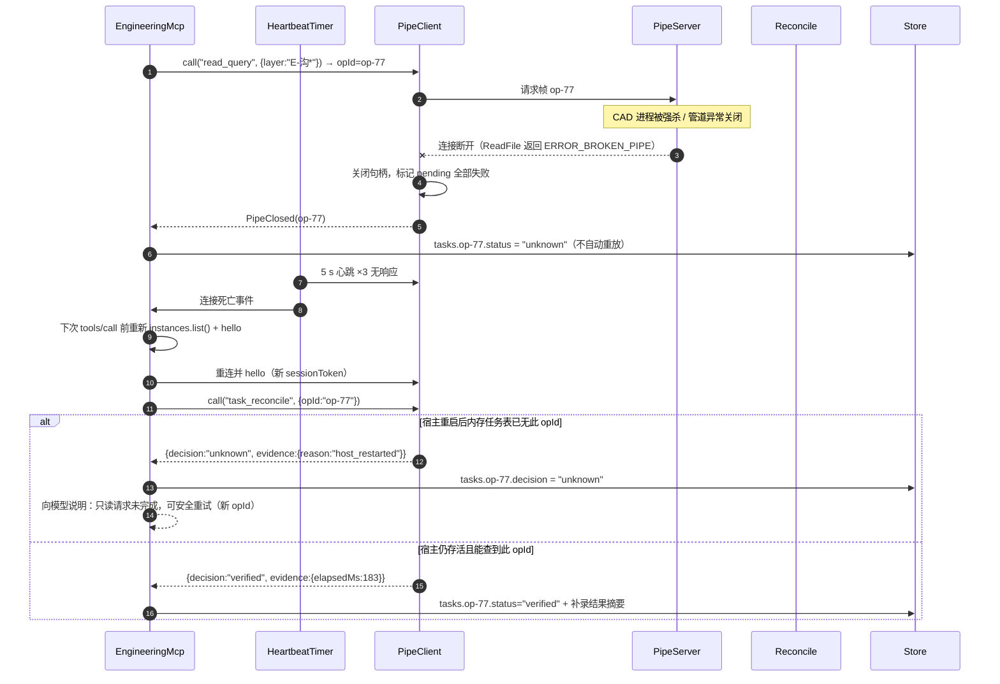
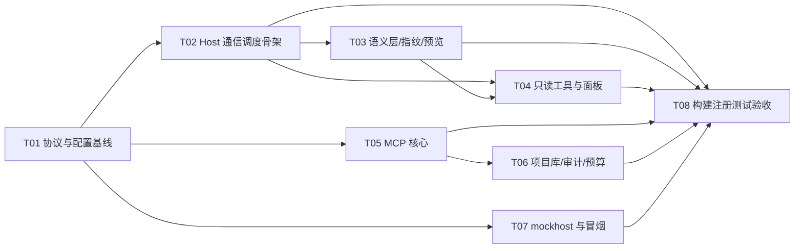

# M0 实施设计：打通「WorkBuddy → MCP → 命名管道 → Host」最小只读链路

- 文档版本：v1.0（设计冻结，供实现直接照做）
- 对应方案：《WorkBuddy AI 通用工程生成与执行平台 · 修订版执行方案》第 11 章「第一步：第 1–4 周」
- 里程碑：**M0**
- 验收标准（唯一判定）：在 WorkBuddy 中提问，**能得到图纸的语义摘要和预览图**
- 范围外（明确不做）：任何写入、Civil 3D 原生对象生成、动态 C# 编译、带外审批写入流程、Revit/Plant 3D 适配、批量任务、技能中心
- 硬约束来源：方案第 13/14/15/17/18 章，本文不改弱，只做「M0 裁剪」并显式标注裁剪点

---

## 0. 环境基线（已实测，不再侦察）

| 项 | 事实 | 对设计的影响 |
|---|---|---|
| OS | Windows 10/11 x64 | 命名管道、ctypes、WinForms 可用 |
| AutoCAD | 2022（R24.1），`C:\Program Files\Autodesk\AutoCAD 2022` | Host 必须 net48；`acmgd/acdbmgd/accoremgd` 用 `Private=false` 引用 |
| AutoCAD 产品注册键 | `HKCU\Software\Autodesk\AutoCAD\R24.1\` 下存在 `ACAD-5101:804`（含 `AEC` 子树）与 `ACAD-6101:804` | 自加载注册脚本必须**枚举** `R24.1\*\Applications`，不得硬编码产品键 |
| Civil 3D | **未安装**（仅有 `AecCore.crx` 与 2019 Object Enabler） | 所有 `civil_*` 能力记缺口；Civil 对象只会以 `ACAD_PROXY_ENTITY` 出现，语义层标 `unsupported`，置信度 0 |
| 构建 | `dotnet` SDK 10.0.302 / 8.0.419；`Microsoft.NETFramework.ReferenceAssemblies` 1.0.3 编译 net48 实测通过（约 11 s）；无 VS 完整 IDE、无独立 `msbuild` | 构建脚本只用 `dotnet build`；<br>**语言级别固定 C# 7.3**（禁用 `record`/`init`/文件作用域 namespace/可空引用类型） |
| Python | 3.13.14，**零第三方库** | MCP 侧只用标准库；`Win32` 调用走 `ctypes`（`sqlite3`/`json`/`base64`/`hashlib`/`threading`/`subprocess` 均为标准库） |
| 工作目录 | `%USERPROFILE%\WorkBuddy\2026-11-21-13-56-43` | 项目根：`engineering-platform\` |

---

## 1. 模块划分与完整文件清单

### 1.1 目录总览

```
engineering-platform/
├─ docs/            设计与验收文档
├─ protocol/        协议契约（JSON Schema + 错误码表），宿主与 MCP 双方唯一真相源
├─ host/            C# net48 AutoCAD 2022 插件（只读实现）
├─ mcp/             Python 零依赖 MCP stdio 服务
├─ mockhost/        Python 模拟宿主（同一管道协议，无 CAD 也能测全链路）
├─ config/          配置样例（运行时配置在 %LOCALAPPDATA%）
├─ tests/           协议级与端到端测试
└─ tools/           构建、注册、冒烟脚本
```

### 1.2 完整文件清单

> 「估算行数」用于排期与任务粒度校验；「归属」= 第 5 节任务号。

#### docs/

| 相对路径 | 职责 | 行数 | 归属 |
|---|---|---|---|
| `docs/00-M0-实施设计.md` | 本设计文档（唯一实现依据） | ~900 | —（已交付） |
| `docs/01-M0-验收清单.md` | 可勾选的验收步骤：环境检查 → 起 AutoCAD → NETLOAD → 起 MCP → WorkBuddy 提问 → 断言摘要与预览图 | ~120 | T08 |
| `docs/class-diagram.mermaid` / `docs/sequence-diagram.mermaid` | 类图/时序图源文件（便于后续 diff 与文档站渲染） | ~120 | —（已交付） |

#### protocol/（双方共享契约，改动需双端同步）

| 相对路径 | 职责 | 行数 | 归属 |
|---|---|---|---|
| `protocol/README.md` | 契约说明：分帧、封套、握手、版本规则、命名风格、变更流程 | ~150 | —（已交付） |
| `protocol/envelope.schema.json` | 请求/响应/错误封套 JSON Schema（含 `$defs`） | ~260 | —（已交付） |
| `protocol/handshake.schema.json` | `hello` / `hello_ack` / `bye` 三类帧 | ~90 | —（已交付） |
| `protocol/errors.json` | 错误码表（E1xxx–E6xxx + MCP 侧 C1xxx），含 `retriable` / `httpLikeMeaning` / `userAdvice` | ~120 | —（已交付） |
| `protocol/tools.schema.json` | 工具目录：每个只读工具的 `inputSchema` / `outputSchema` / `annotations` / 读写域 | ~420 | —（已交付） |

#### host/（C# net48，AutoCAD 2022 插件）

| 相对路径 | 职责 | 行数 | 归属 |
|---|---|---|---|
| `host/EngineeringPlatform.Host.csproj` | net48 类库；引用 `acmgd/acdbmgd/accoremgd`（`Private=false`）+ `System.Web.Extensions` + `System.Drawing` + `System.Windows.Forms` + `Microsoft.NETFramework.ReferenceAssemblies` | ~55 | T02 |
| `host/Directory.Build.props` | 统一 `LangVersion=7.3`、`PlatformTarget=x64`、`AutoCADDir` 属性、输出目录 `build/host/`、确定性构建 | ~25 | T02 |
| `host/ExtensionApplication.cs` | `IExtensionApplication`：`Initialize` 启 Runtime、挂 `Application.Idle`、`QuitWillStart` 清理；全程 try/catch 不向 CAD 抛异常 | ~120 | T02 |
| `host/HostRuntime.cs` | 进程内单例：装配 PipeServer / Dispatcher / Session / ToolRouter / Cache，暴露 `Start()` `Stop()` `Submit(WorkItem)` | ~200 | T02 |
| `host/Pipe/Framing.cs` | 4 字节小端长度前缀帧：`WriteFrame` / `ReadFrame` / 1 MiB 上限判定 / 超限丢弃 | ~130 | T02 |
| `host/Pipe/PipeName.cs` | 管道名与实例发现文件名生成（与 Python 侧同规则，含用户哈希） | ~60 | T02 |
| `host/Pipe/PipeServer.cs` | `NamedPipeServerStream` 建管道、仅当前用户 ACL、接受循环、单会话语义、断开清理 | ~230 | T02 |
| `host/Pipe/PipeConnection.cs` | 单连接：读线程只收帧入队、写线程独占写、非法帧处理 | ~210 | T02 |
| `host/Protocol/Json.cs` | JSON 封装（`JavaScriptSerializer`），`GetDict/GetStr/GetInt/GetBool/GetList` 安全取值，`MaxJsonLength` 提升 | ~150 | T02 |
| `host/Protocol/Envelope.cs` | 封套 POCO + 构造器：`RequestEnvelope` / `ResponseEnvelope` / `ErrorEnvelope` | ~180 | T02 |
| `host/Protocol/ErrorCodes.cs` | 错误码常量 + 工厂 `Error.Of(code, detail, field)` | ~90 | T02 |
| `host/Protocol/Handshake.cs` | `hello` 处理：版本兼容判定、下发 `sessionToken`、返回能力与缺口清单 | ~140 | T02 |
| `host/Protocol/ParamsDigest.cs` | 参数摘要：键排序 + 紧凑序列化 + SHA256，双端同算法 | ~70 | T02 |
| `host/Protocol/ToolCatalog.cs` | 只读工具目录（与 `protocol/tools.schema.json` 对齐），`tools/list` 快照、按域名过滤 | ~180 | T03 |
| `host/Protocol/ToolRouter.cs` | 工具名 → handler 分派；写域/未知工具一律拒绝（E2003/E2001） | ~110 | T04 |
| `host/Scheduling/MainThreadDispatcher.cs` | 主线程队列：`Application.Idle` 泵送、`Submit` 带超时等待、调度超时→E1004 | ~170 | T02 |
| `host/Scheduling/HostStateProbe.cs` | 主线程侧门禁检查：无文档 / `CMDACTIVE` 非零 / 只读 / 事务中 → 对应错误码 | ~110 | T02 |
| `host/Session/SessionRegistry.cs` | `hostInstanceId` 生成、会话令牌签发与校验、令牌随连接生命周期失效、实例发现文件写删 | ~140 | T02 |
| `host/Semantic/SemanticModel.cs` | 语义模型数据结构：`Overview/LayerSummary/ObjectRef/ObjectDetail/Anomaly` | ~200 | T03 |
| `host/Semantic/SemanticExtractor.cs` | 采集：模型/图纸空间、块表、图层表、DXF 名、句柄、`Bounds`、文字与标注、块属性、外部参照 | ~320 | T03 |
| `host/Semantic/SemanticRecognizer.cs` | 识别：图层映射 → 块映射 → 几何/文字规则 → 推断；产出工程含义 + 置信度 + 依据 | ~230 | T03 |
| `host/Semantic/LayerMapping.cs` | 企业映射表加载（图层/块/术语），通配匹配与版本号 | ~140 | T03 |
| `host/Semantic/AnomalyScanner.cs` | 异常：重复点、零长度/退化几何、极值坐标、单位缺失、代理对象、空属性 | ~170 | T03 |
| `host/Semantic/SemanticCache.cs` | 以指纹为键的缓存，5 s TTL，`DocumentActivated` 失效 | ~90 | T03 |
| `host/Semantic/Redactor.cs` | 脱敏：路径取 basename+哈希、用户名替换、文字截断长度、涉密文字仅计数 | ~90 | T03 |
| `host/Fingerprint/DrawingFingerprint.cs` | 图纸指纹：路径 + `Handseed` + 对象数 + 关键句柄集合哈希 + 最近保存时间 | ~130 | T03 |
| `host/Preview/PreviewRenderer.cs` | `System.Drawing` 由语义模型绘制结构示意图 PNG（图元 + 图例 + 比例尺 + 水印） | ~280 | T03 |
| `host/Preview/PreviewCache.cs` | 预览图落盘与命中，路径 `%LOCALAPPDATA%\...\cache\preview` | ~70 | T03 |
| `host/Tools/ReadToolHandlers.cs` | `read_overview/layers/query/describe/anomalies/preview` 六个只读工具实现 | ~380 | T04 |
| `host/Tools/SysToolHandlers.cs` | `sys_ping/status/version/health/capabilities/list_instances` | ~180 | T04 |
| `host/Tools/TaskToolHandlers.cs` | `task_status/task_list/task_cancel/task_reconcile`（M0 只读控制语义） | ~150 | T04 |
| `host/Diagnostics/Log.cs` | 文件日志：分级、轮转 10 MB×7、只记摘要不记图纸内容、令牌打码 | ~120 | T02 |
| `host/LocalPanel/LocalPanelForm.cs` | 降级面板：状态、任务列表、取消、日志导出（无 AI、无生成、无写入） | ~180 | T04 |
| `host/LocalPanel/PanelCommands.cs` | `EPPANEL` / `EPSTATUS` 命令；`[CommandClass]` 注册 | ~60 | T04 |
| `host/Resources/layer-map.default.json` | 默认图层映射（通用图元类别，非工程语义），可被企业映射覆盖 | ~80 | T03 |
| `host/Resources/block-map.default.json` | 默认块名映射（`图框/指北针/标高`等常见块） | ~60 | T03 |

#### mcp/（Python 3.13，零第三方依赖）

| 相对路径 | 职责 | 行数 | 归属 |
|---|---|---|---|
| `mcp/engineering_mcp.py` | 入口：stdin 行分帧 → JSON-RPC 分发 → stdout 写回；`initialize/tools/list/tools/call/ping/notifications` | ~300 | T05 |
| `mcp/jsonrpc.py` | JSON-RPC 2.0 基础：错误码常量、`RpcError`、请求/通知识别、结果封装 | ~90 | T05 |
| `mcp/config.py` | 配置加载（默认值 + `%LOCALAPPDATA%` 文件 + 环境变量覆盖）、路径白名单校验 | ~160 | T05 |
| `mcp/pipeclient.py` | `ctypes` 命名管道客户端：`WaitNamedPipeW`/`CreateFileW`/`ReadFile`/`WriteFile`、四字节分帧、读线程、按 `opId` 配对、心跳 | ~340 | T05 |
| `mcp/instances.py` | 枚举实例发现目录、活性探测、单实例/多实例选择、歧义时报候选 | ~130 | T05 |
| `mcp/tools_catalog.py` | 工具目录（Python 侧副本，由 `protocol/tools.schema.json` 驱动校验） | ~260 | T05 |
| `mcp/store.py` | SQLite 项目库：建表/迁移、`tasks/objects/attributes/results/audit` 写入与查询、WAL | ~300 | T06 |
| `mcp/audit.py` | 审计与运行日志：JSONL 追加、轮转、字段脱敏、`opId` 贯穿 | ~140 | T06 |
| `mcp/budget.py` | 返回体预算：字符上限、数组按项截断、`truncated` + `drilldown` 下钻建议 | ~130 | T06 |
| `mcp/preview.py` | 预览图桥：白名单校验 → 读 PNG → base64 → MCP `image` 内容；超限请求更小尺寸 | ~110 | T06 |
| `mcp/reconcile.py` | 对账：按 `opId` 查宿主任务态，落库并判定 `verified/failed/unknown`（M0 只读版） | ~120 | T06 |

#### mockhost/（Python 模拟宿主）

| 相对路径 | 职责 | 行数 | 归属 |
|---|---|---|---|
| `mockhost/mock_host.py` | `ctypes` 命名管道服务端（`CreateNamedPipeW` 等），实现同一封套/握手/分帧，供无 CAD 环境跑通全链路 | ~330 | T07 |
| `mockhost/mock_drawing.py` | 内置脱敏样例「图纸」：图元树、图层、文字、块、含 2 个故意异常项 | ~220 | T07 |
| `mockhost/mock_tools.py` | `read_*` / `sys_*` / `task_*` 的假实现（返回结构与真实宿主同构） | ~280 | T07 |

#### config/（样例，运行时复制到 `%LOCALAPPDATA%`）

| 相对路径 | 职责 | 行数 | 归属 |
|---|---|---|---|
| `config/config.example.json` | MCP + 宿主共用配置样例（含白名单、预算、心跳、实例发现） | ~60 | T01 |
| `config/mcp.snippet.json` | 注册到 WorkBuddy 的 MCP 片段样例（**不自动写入**，见第 8 节待明确 D1） | ~25 | T01 |
| `config/layer-map.example.json` | 企业图层映射表样例（道路/场地/排水三类） | ~50 | T01 |

#### tests/

| 相对路径 | 职责 | 行数 | 归属 |
|---|---|---|---|
| `tests/test_framing.py` | 双端分帧一致性：超长帧拒绝、空帧、非法 UTF-8、半包重发 | ~150 | T08 |
| `tests/test_pipe_e2e.py` | 起 mockhost → 握手 → 六工具调用 → 断线重连 → 令牌失效 | ~220 | T08 |
| `tests/test_mcp_stdio.py` | 以子进程方式驱动 `engineering_mcp.py`，校验 `initialize/tools/list/tools/call/ping` 与错误分支 | ~200 | T08 |
| `tests/test_store.py` | 建表、迁移幂等、审计字段完整性、不落图纸原文 | ~120 | T08 |
| `tests/fixtures/sample_overview.json` | `read_overview` 标准答案（与 mock 图纸一致） | ~60 | T08 |

#### tools/

| 相对路径 | 职责 | 行数 | 归属 |
|---|---|---|---|
| `tools/build.ps1` | 一键构建：`dotnet build host` → 校验产物 → 打印 NETLOAD 路径；失败给明确诊断 | ~100 | T08 |
| `tools/build.sh` | Git Bash 版包装（同样的 `dotnet build`） | ~40 | T08 |
| `tools/smoke_mcp.py` | 无 CAD 冒烟：起 mockhost + MCP，跑「摘要 + 预览图」两条断言 | ~160 | T07 |
| `tools/register_mcp.ps1` | 生成/校验 WorkBuddy MCP 配置片段；`-Apply` 才写 `~/.workbuddy/mcp.json`（需用户确认） | ~110 | T08 |
| `tools/netload_autocad.ps1` | 生成 `NETLOAD` 指令文本；可选写 `R24.1\*\Applications` 自加载键（`-Apply`） | ~90 | T08 |

**合计**：72 个文件、约 11,900 行（其中业务代码 C# 约 5,500 行、Python 约 3,200 行；其余为契约、测试、脚本与文档）。单人约 14 人日；**若只为「最小可演示」**（砍掉 `sys_status`/`sys_version` 的精细字段、降级面板与三级截断），可压到约 9 人日。

---

## 2. 协议契约

### 2.1 两个传输，两种分帧（必须区分，别混）

| 传输 | 分帧方式 | 依据 |
|---|---|---|
| WorkBuddy ↔ MCP（stdio） | **行分隔**（一行一条 JSON，UTF-8，行内不得含裸换行，单行上限 8 MiB） | MCP 规范强制：stdio 传输以换行分隔消息，消息内不得内嵌换行 |
| MCP ↔ Host（命名管道） | **4 字节小端长度前缀 + UTF-8 JSON** | 见下 |

**为什么管道选长度前缀而不是行分隔**：

1. **能在读取前判定超限**。1 MiB 上限是硬约束，长度前缀让接收方在分配缓冲前就知道大小，可直接流式丢弃并回 `E1001 message_too_large`，而不用先吃到内存里再判断。
2. **二进制安全，为后续文件通道/预览字节留路**。行分隔天然只能承载文本；预览图后续可能走同一条管道传二进制帧，前缀帧不需要改协议版本。
3. **半包/粘包处理确定**。`read_exact(4)` → `read_exact(n)`，逻辑唯一且可测；行分隔需处理跨读边界的换行扫描与 CRLF 归一化。
4. **C# 与 Python 都有对称的天然实现**（`BinaryReader.ReadInt32` / `struct.unpack('<I')`），无需自写扫描器。

```
+----------+---------------------------+
| len: u32 |  payload: len bytes UTF-8 |
|    LE    |        JSON object        |
+----------+---------------------------+
len 取值 (0, 1048576]；len == 0 → 协议违规，关连接
```

- 每帧 **必须是单个 JSON object**（不允许数组、不允许批量）。批量在 MCP 层已被 2025-06-18 规范移除，管道层一并不支持。
- 尾随空白允许，尾随垃圾不允许（严格解析后必须 EOF）。
- 超限：不发错误也要先把 `len` 字节读完丢弃（否则流错位），随后发 `opId:null` 的错误帧；同一连接继续可用。

> **注（第二轮实测修正 · 偏差 1）：两端管道句柄必须用 overlapped（异步）I/O。**
> 本节只规定了「怎么分帧」，没规定「用什么 I/O 模型」，而同步句柄在物理上跑不通：
> ① 同步管道句柄会串行化同一句柄上的 I/O —— 读线程阻塞在 `ReadFile` 时，同一个句柄上的 `WriteFile` 也发不出去（请求永远回不去）；
> ② `CloseHandle` / `DisconnectNamedPipe` 会等待挂起的 I/O 完成 —— 停止宿主时永久阻塞（实测死锁，`faulthandler` 抓到现场）。
> 因此实现为：Win32 侧 `FILE_FLAG_OVERLAPPED` + `OVERLAPPED`/`GetOverlappedResult` + 停止时 `CancelIoEx`；
> C# 侧 `NamedPipeServerStream(..., PipeOptions.Asynchronous)`。
> 分帧格式、上限、错误码一律不变，本节其余内容仍然有效。

### 2.2 封套（Envelope）

字段命名全局统一 **camelCase**。理由：方案第 13.2 节的字段表本身是 camelCase（`protocolVersion`/`sessionToken`/`hostInstanceId`/`opId`/`idempotencyKey`/`paramsDigest`/`targetFingerprint`/`approvalToken`/`timeoutMs`/`cancelable`），MCP 协议字段同样是 camelCase（`protocolVersion`/`serverInfo`/`inputSchema`/`readOnlyHint`）；只有**工具名**用 `snake_case`（`read_overview`），因为它是「域名_动作」的可读标识，不是字段。全项目只允许这一种组合。

**请求帧**

```json
{
  "protocolVersion": "1.0",
  "sessionToken": "9f2c…（64 hex）",
  "hostInstanceId": "acad-3f7c1a92",
  "opId": "op-20261121T140312-a41f",
  "idempotencyKey": "read_overview|fp1:8c11…|r1",
  "tool": "read_overview",
  "params": { "drawingRef": null },
  "paramsDigest": "sha256:6b1d0f…",
  "targetFingerprint": "fp1:8c11a0d3…",
  "approvalToken": null,
  "timeoutMs": 15000,
  "cancelable": true
}
```

| 字段 | 类型 | M0 约束 |
|---|---|---|
| `protocolVersion` | string | 固定 `"1.0"`；主版本不等直接 `E4001` |
| `sessionToken` | string\|null | `hello` 帧为 `null`，其余帧必填 |
| `hostInstanceId` | string\|null | `hello` 可为 `null` 表示「任选」（客户端已按发现文件选定，故实际总是填） |
| `opId` | string | 客户端生成，全链路唯一；服务端原样回填 |
| `idempotencyKey` | string\|null | 只读工具可为 `null`；`read_*` 推荐用「工具+指纹+查询摘要」，便于缓存命中统计 |
| `tool` | string | snake_case，必须在 `tools.schema.json` 中 |
| `params` | object | 必须通过该工具 `inputSchema`（宿主侧**再校验一次**，不只信 MCP） |
| `paramsDigest` | string | `sha256:` + 64 hex；规范化规则见 §2.6 |
| `targetFingerprint` | string\|null | 只读工具可 `null`（由宿主现算），响应回填实际值 |
| `approvalToken` | string\|null | **M0 恒为 `null`**；非 null 时返回 `E1006`（写入通道未开，不接受旧令牌） |
| `timeoutMs` | int | 500–60000，缺省 15000；超过 60000 截断并告警 |
| `cancelable` | bool | 只读工具恒 `true` |

**响应帧**

```json
{
  "protocolVersion": "1.0",
  "sessionToken": "9f2c…",
  "hostInstanceId": "acad-3f7c1a92",
  "opId": "op-20261121T140312-a41f",
  "tool": "read_overview",
  "status": "verified",
  "ok": true,
  "startedAt": "2026-11-21T14:03:12.418Z",
  "elapsedMs": 183,
  "paramsDigest": "sha256:6b1d0f…",
  "targetFingerprint": "fp1:8c11a0d3…",
  "result": { "…工具自定义…" },
  "warnings": [{ "code": "W1001", "message": "civil_api_absent" }],
  "error": null
}
```

`status` 用方案第 13.3 节状态机的**线上枚举**：

| 线上值 | 中文态 | M0 是否出现 |
|---|---|---|
| `validated` | 已校验 | 是（中间态，一般不外发） |
| `queued` | 已排队 | 是（中间态） |
| `running` | 执行中 | 是（中间态） |
| `committed` | 已提交 | 否（无写入） |
| `saved` | 已保存 | 否 |
| `verified` | 已验证 | 是（成功终态） |
| `failed` | 失败 | 是 |
| `cancelled` | 已取消 | 是 |
| `unknown` | 结果不明 | 是（超时/断线） |

只读工具的成功终态用 `verified`（含义：结果已由宿主回读/重算确认，不是「推测」）。

**错误帧**（`ok:false`，`result:null`）

```json
{
  "protocolVersion": "1.0", "sessionToken": "9f2c…",
  "hostInstanceId": "acad-3f7c1a92", "opId": "op-…", "tool": "read_query",
  "status": "failed", "ok": false,
  "startedAt": "2026-11-21T14:03:12.418Z", "elapsedMs": 21,
  "paramsDigest": "sha256:…", "targetFingerprint": null,
  "result": null, "warnings": [],
  "error": {
    "code": "E1001",
    "message": "参数无效：limit 超出范围",
    "field": "params.limit",
    "detail": "limit must be in [1,100], got 500",
    "retriable": false,
    "userAdvice": "把 limit 改到 1–100 之间，或改用 cursor 翻页"
  }
}
```

错误码表以 `protocol/errors.json` 为唯一真相源；M0 实际会返回的集合：

| 码 | M0 触发场景 |
|---|---|
| `E1001` | 参数校验失败；`message_too_large`；`invalid_json` |
| `E1003` | `CMDACTIVE != 0`（有命令在跑） |
| `E1004` | 主线程调度超时（模态对话框未泵送消息） |
| `E1005` | 无打开文档 / 文档只读 |
| `E1006` | 收到非空 `approvalToken` |
| `E2001` | 工具名不在目录（含拼错的 `read_*`） |
| `E2003` | 调用写域工具（`cad_*`/`civil_*`/`dyn_*`/`file_*`）→ `detail: write_channel_disabled_m0` |
| `E3002` | 请求超过 `timeoutMs`，工作仍在主线程执行 → 进 `unknown` |
| `E4001` | `protocolVersion` 主版本不符 / `sessionToken` 未知或过期 |
| `E5001` | 预览图落盘失败（磁盘满/无权限） |

### 2.3 握手时序

```
MCP                                    Host (AutoCAD 主线程外的管道线程)
 |  connect \\.\pipe\engineering-platform.v1.<userHash>.<app>.<instance>
 |--------------------------------------->|
 |  hello {protocolVersion, clientInfo, clientNonce, requestedFeatures[]}
 |--------------------------------------->|
 |                                        | 版本兼容判定（主版本相等 && 客户端次版本 ≤ 宿主次版本）
 |                                        | 签发 sessionToken（32 byte 随机 → 64 hex）
 |                                        | 写实例发现文件（含 pid/version/startedAt/fingerprintHint）
 |  <-------------------------------------|  hello_ack {protocolVersion, hostVersion, hostInstanceId,
 |                                        |             sessionToken, serverTimeUtc, capabilities,
 |                                        |             gaps[], writeEnabled:false, protocolHash}
 |  bye（可选，客户端主动断开前发）
 |--------------------------------------->|
```

**`hello_ack.capabilities`（M0 固定值）**

```json
{
  "domains": ["sys", "read", "task"],
  "writeEnabled": false,
  "civilApi": { "available": false, "probe": "Type.GetType(Autodesk.Civil.ApplicationServices.CivilApplication, AeccDbMgd) == null" },
  "preview": { "formats": ["png"], "maxWidth": 2400, "maxHeight": 1600, "renderMode": "schematic" },
  "messageLimitBytes": 1048576,
  "heartbeat": { "intervalMs": 5000, "missLimit": 3 },
  "cancellation": true,
  "toolCatalogHash": "sha256:…（与 protocol/tools.schema.json 一致）"
}
```

`gaps[]` 直接来自「Civil 3D 未安装」这一事实，M0 必须返回（让 Agent 能诚实说「这条路走不通」）：

```json
[
  { "capability": "civil.roadway|corridor|surface|pipe_network", "status": "absent",
    "reason": "Civil 3D 本体未安装，仅存在 Object Enabler；相关对象以 ACAD_PROXY_ENTITY 出现",
    "nextAction": "安装 Civil 3D 2022 或改用 AutoCAD 原生图元 + 明确标注" }
]
```

> **注（第二轮实测修正 · 前提变更）：Civil 3D 本体已安装，本节的「未安装」不再是默认前提。**
> 本机实测三套宿主：Civil 3D 2024（`<AUTOCAD_2024_ROOT>`，R24.3）、
> Civil 3D 2019（`<AUTOCAD_2019_ROOT>`，R23.0）、AutoCAD 2022（`C:\Program Files\Autodesk\AutoCAD 2022`，R24.1）。
> Civil 3D 托管 API 不在根目录，而在 `<root>\C3D\`（`AeccDbMgd.dll` 等）。
> 所以 `hello_ack` 增加两个字段：`hostProduct`（`AutoCAD` / `Civil3D`）与 `hostRelease`（`R24.3` 等），
> `civilApi.available` 改由反射探测决定（探测得到才为 true），`gaps[]` 只在探测不到时才上报 civil 缺口。
> **`hostVersion` 语义不变**（仍是插件版本号，实例发现文件与 `mcp/instances.py` 依赖它），CAD 版本走 `hostRelease`。
> Civil 3D 原生对象以 `confidence=1.0` 收录，并在 `read_overview` 的 `civil3d` 段单列（曲面/路线/纵断面/管网/点编组）。
> 写操作一个都没实现，写通道仍是 `E2003 write_channel_disabled_m0`。

**兼容规则**
| 情况 | 行为 |
|---|---|
| 主版本不等（`2.x` vs `1.x`） | `E4001`，连接关闭 |
| 客户端次版本 > 宿主次版本 | 允许连接，`writeEnabled:false`，响应 `warnings: W1002 client_ahead` |
| 客户端次版本 ≤ 宿主次版本 | 正常 |
| 未知 `sessionToken` / 令牌过期 | `E4001` + `detail: session_expired` → 客户端重新 `hello` 一次，不重放原请求 |
| 未知 `tool` 出现在 `requestedFeatures` | 忽略并在 `capabilities.missingFeatures` 回报 |

### 2.4 心跳、超时与取消

| 机制 | 规则 |
|---|---|
| 心跳 | MCP 每 **5 s** 发 `sys_ping`（`timeoutMs=3000`）；连续 **3 次**超时或异常 → 判定连接断开 |
| 请求超时 | 单请求 `timeoutMs`（默认 15000）。宿主在被调度执行后才可能超时；若请求还在队列里等主线程，宿主立即回 `E1004`（见 §3.4） |
| 超时后 | 只读场景：回 `E3002` + `status:unknown`，并**不自动重放**；客户端把该 `opId` 记入对账表，由 `task_reconcile` 查一次宿主侧结果（只读无副作用，查得结果即判定，查不得即标 `unknown` 并提示重试需新版 `opId`） |
| 取消 | `notifications/cancelled`（MCP 侧）→ 客户端向宿主发 `task_cancel {opId}`（不带响应等待）→ 宿主在对应工作项上置取消位，handler 在每个对象批（默认 500 个）边界检查并抛 `OperationCanceledException` → 回 `E3002`/`cancelled` |
| 取消的落库 | `task_cancel` 本身也落一条 `tasks` 记录（`status=cancelled`），保证审计闭环 |

### 2.5 读工具入参/出参要点

完整 JSON Schema 在 `protocol/tools.schema.json`，此处列设计要点（工程师照表实现）。**所有返回值必须含 `summary`（≤ 400 字符的自然语言摘要）+ `resultRef`（详情引用）**，这是方案 13.6 的「摘要 + 结果引用」约定。

| 工具 | 入参要点 | 出参要点 |
|---|---|---|
| `read_overview` | 无必填；`refresh: bool=false`（绕过缓存） | `summary`、`software{name,version}`、`drawing{nameHash,modifiedUtc,readOnly}`、`units{insUnits,code,scaleToMeter}`、`coordinateSystem`、`extents{min[3],max[3]}`、`counts{entities,layers,blocks,paperSpaces,proxyEntities}`、`disciplines[{name,entityCount,confidence}]`、`topAnomalies[≤5]`、`fingerprint`、`civilApi` |
| `read_layers` | `disciplines?:[]`、`namePattern?:string`（通配）、`minEntities?:int=0`、`limit?:int=50 (1..200)`、`cursor?` | `layers[{name,entityCount,types{dxfName:count},recognizedAs,confidence,basis[]}]`、`total`、`nextCursor`、`truncated` |
| `read_query` | `layer?`、`dxfName?`、`extent?:[x0,y0,x1,y1]`、`textContains?`、`attrEquals?:{k:v}`、`meaning?`、`minConfidence?:float=0`、`limit?:int=20 (1..100)`、`cursor?` | `items[{handle,dxfName,type,layer,extents{min,max},meaning,confidence}]`、`total`、`nextCursor`、`truncated`、`drilldown[{tool,params,why}]` |
| `read_describe` | `handle`（必填，十六进制字符串） | `object{handle,dxfName,type,layer,linetype,colorIndex,visible,extents,geometry{},props{},texts[]}`、`meaning`、`confidence`、`basis[]`、`relations[]`、`anomalies[]` |
| `read_anomalies` | `types?:[]`（`duplicate_point`/`zero_length`/`extreme_coord`/`proxy_object`/`missing_unit`/`empty_attr`/`degenerate_extents`）、`layer?`、`severity?`、`limit?:int=30 (1..100)`、`cursor?` | `items[{code,severity,handle,layer,message,evidence{}}]`、`counts{code:count}`、`truncated` |
| `read_preview` | `extent?`（`"all"` 或 `[x0,y0,x1,y1]`）、`width?:int=1200 (200..2400)`、`height?:int=800 (200..1600)`、`highlightHandles?:[]`、`format:"png"` | `previewPath`（白名单内绝对路径）、`bytes`、`width`、`height`、`extents`、`legend[{color,label,count}]`、`note:"结构示意图，非出图成果"`、`fingerprint` |
| `sys_ping` | 无 | `{pong:true, serverTimeUtc, hostInstanceId}` |
| `sys_status` | 无 | 宿主运行态：启动时间、近 60 s 请求数、当前队列长度、主线程泵送是否正常、缓存命中率 |
| `sys_version` | 无 | `host{assembly,version,buildUtc}`、`autocad{product,release,version}`、`protocol{version}`、`dotnet{runtime}` |
| `sys_health` | 无 | `checks[{id,ok,detail}]`：管道、ACL、实例发现文件、日志可写、缓存目录可写、civil 探测、映射表加载 |
| `sys_capabilities` | 无 | 同 `hello_ack.capabilities` + `gaps[]` + `tools[]` 摘要 |
| `sys_list_instances` | 无 | 当前机器上的实例列表（来自发现目录，含活性标记） |
| `task_status` | `opId` | `{opId,status,tool,startedAt,elapsedMs,errorCode}` |
| `task_list` | `limit?:int=20`、`sinceUtc?` | 最近任务（内存环形缓冲 200 条 + 落库） |
| `task_cancel` | `opId`（通知语义，无响应体要求） | `{accepted:bool}` |
| `task_reconcile` | `opId` | `{opId,decision:"verified"\|"failed"\|"unknown",evidence{},checkedAt}` |

### 2.6 paramsDigest 规范化（双端必须字节一致）

```
canonical = JSON.stringify(sort_keys_recursive(params), separators=(",", ":"), ensure_ascii=False)
paramsDigest = "sha256:" + hex(sha256(utf8(canonical)))
```

- 键排序：按 Unicode 码点升序，递归到对象每层；数组保持原序。
- 数字：整型不带 `.0`；浮点用最短往返表示（Python `repr(float)`；C# 用 `R` 格式，且**参数中禁止传浮点**，schema 中凡需要小数的用整型放大（如 `confidencePct: int`）避免双端格式化差异）。
- 字符串：不得做 Unicode 归一化，原样 UTF-8。
- `params` 缺省时按 `{}` 计算。

> 这条规则在 M0 只用于审计与缓存键；但它必须是双端一致的，否则 M1 的审批令牌绑定会返工。

### 2.7 管道名与实例发现

```
管道名   = \\.\pipe\engineering-platform.v1.<userHash8>.<app>.<instanceId>
userHash8  = sha256(utf8(upper(USERDOMAIN + "\" + USERNAME))).hexdigest()[:8]   // 见 §7.3
app        ∈ { acad, civil, revit, p3d, mock }
instanceId = 8 hex（宿主启动时随机生成，进程生命周期内不变）

发现文件 = %LOCALAPPDATA%\EngineeringPlatform\instances\<userHash8>.<app>.<instanceId>.json
```

发现文件内容：`{pipeName, app, instanceId, pid, hostVersion, protocolVersion, startedAtUtc, documentNameHash, writeEnabled:false}`。宿主 `Initialize` 写、`Terminate` 删；异常退出残留由 MCP 侧做活性探测后忽略（探测 = 尝试连接，失败即判 stale 并只记日志，不删宿主文件，避免误删）。

**为什么用「发现文件 + 管道名」双轨**：管道名可猜（可被恶意进程抢先占用），发现文件带 pid 与版本，MCP 先读文件再连，能避免连到「冒名管道」；同时多实例场景有确定的选择依据（`startedAtUtc` 最新者优先，或配置指定 `preferredInstanceId`）。

### 2.8 ACL 与安全（M0）

- Host 侧 `PipeSecurity`：关闭继承（`SetAccessRuleProtection(true, false)`），仅加两条允许规则——当前用户 SID（`FullControl`）、`SYSTEM`（`FullControl`）。不添加 `Everyone`。
- `maxInstances = 4`（允许重连），但应用层单会话：已有活动会话时新 `hello` 返回 `E1003 detail:session_busy` 并关闭。
- `sessionToken` 不落日志（打码为前 4 位 + `***`）。
- 日志只记：`opId`、工具名、参数摘要（前 16 hex）、对象数量、状态、错误码、耗时。**不记**任何图元文字内容、不记完整路径（只记 basename + 路径哈希）。
- `read_query.textContains` 的匹配结果只回「是否命中 / 命中的对象句柄」，不回全文（除非单条 ≤ 80 字符且项目数据级别为「公开或脱敏」）。

---

## 3. Host 设计要点（C# net48）

### 3.1 装配与生命周期

```
ExtensionApplication.Initialize()
  ├─ Log.Init(%LOCALAPPDATA%\EngineeringPlatform\logs)
  ├─ Config 读取（host-config.json，缺省值内置）
  ├─ HostRuntime.Instance.Start()
  │    ├─ SessionRegistry.Init()          // 生成 hostInstanceId，写发现文件
  │    ├─ SemanticCache / PreviewCache    // 目录就绪检查
  │    ├─ MainThreadDispatcher.Start()    // 订阅 Application.Idle
  │    └─ PipeServer.Start()              // 后台线程 accept 循环
  ├─ Application.DocumentManager.DocumentActivated += (s,e) => SemanticCache.InvalidateAll()
  └─ Application.QuitWillStart += (s,e) => HostRuntime.Instance.Stop()
Terminate() → HostRuntime.Instance.Stop()（删发现文件、关管道、停线程、刷日志）
```

任何异常都在 `Initialize` 内 catch 并写日志 + 弹一次 `Application.ShowAlertDialog`（仅一次，避免刷屏）；**绝不让异常冒泡**，否则会卸载整个插件的其他命令。

### 3.2 分帧实现

```csharp
// Framing.cs
internal static class Framing {
    public const int MaxPayloadBytes = 1024 * 1024;
    public static byte[] ReadFrame(Stream s, out FrameStatus status);   // status: Ok/TooLarge/Empty/ProtocolViolation/Eof
    public static void WriteFrame(Stream s, byte[] payload);           // 前置检查长度，超限抛 FrameTooLargeException
}
```
- `ReadFrame` 必须先读满 4 字节；`TooLarge` 时循环 `Read` 到丢弃 `len` 字节后返回（不分配大缓冲，用 8 KB 暂存）。
- 只允许 `BitConverter.IsLittleEndian == true` 的平台（x64 Windows 恒成立），但仍显式写 `BinaryPrimitives` 等价逻辑以便后续 .NET 8 复用。
- 空帧（`len == 0`）→ `ProtocolViolation` → 关连接并记日志。

### 3.3 线程模型（方案 14.1 的 M0 实现）

```
[管道读线程]  只做：ReadFrame → JSON 解析 → 校验封套 → 生成 WorkItem → 入队 → 等结果事件
              绝不触碰 Document/Database/Application 的 API
[主线程]      Application.Idle 触发 → 逐个出队 → HostStateProbe.Probe() → handler 执行
              → 组装响应 → 交回 WorkItem 的结果槽 → 唤醒读线程
[写线程]      管道写由 PipeConnection 独占锁保护，可被读线程或心跳线程调用
[心跳线程]    每 5 s 检查最近一次成功收发时间，超 15 s 记 W1003 并主动关连接
```

- M0 **不并行执行只读命令**。理由：读也必须回主线程，串行没有吞吐损失，却彻底排除「读与写交叉」这一类缺陷（未来开写时不需要改这段代码）。
- 队列容量 64，满则回 `E1003 detail:queue_full`。
- `WorkItem` 带 `DeadlineUtc`；调度等待超时（默认 2000 ms）→ 回 `E1004 detail:idle_not_pumping`（**这就是模态对话框的可观测信号**：模态期间 `Application.Idle` 不触发）。

### 3.4 门禁检查（`HostStateProbe`，主线程）

| 检查 | 判据 | 结果 |
|---|---|---|
| 有活动文档 | `Application.DocumentManager.MdiActiveDocument != null` | 否 → `E1005 no_open_document` |
| 有命令在跑 | `(short)Application.GetSystemVariable("CMDACTIVE") != 0` | 是 → `E1003 cmdactive=0x{值}` |
| 文档只读/被锁 | `doc.IsReadOnly` | 是 → `E1005 document_read_only` |
| 图纸已变 | 计算指纹 ≠ 请求 `targetFingerprint`（非 null 时） | 是 → 仅告警 `W1004 fingerprint_drift`（只读不阻断） |
| 图形数据库未被占用 | `db.TransactionManager.NumberOfActiveTransactions == 0` 之外的判断不可靠，M0 不检 | — |

> **注（第二轮实测修正 · 门禁例外）：`ENG_SELFTEST` 需显式放行 CMDACTIVE 这一条。**
> 自检命令本身就是一条 AutoCAD 命令，执行期间 `CMDACTIVE=0x5` 恒成立，
> 若不放行则五个工具一律返回 `E1003 cmdactive=0x5`（实测踩到过，见 docs/05-验收记录「问题与修复」）。
> 放行方式是 `WorkItem.AllowCommandContext`（只有宿主内部命令会置位，管道请求恒为 false），
> 其余三条判据（文档存在 / 非只读 / 数据库可用）照常生效，且放行时写 `gate|cmdactive_bypassed` 审计日志。

### 3.5 语义读取层实现（方案第 15 章的 M0 子集）

**采集（`SemanticExtractor`）**

- 事务：`db.TransactionManager.StartOpenCloseTransaction()`（只读，开销小于 `StartTransaction`）。
- 遍历范围：模型空间 + 所有图纸空间布局（`LayoutDictionary` → `Layout.BlockTableRecordId`）。
- 逐图元取：`Handle`（hex 字符串）、`GetRXClass().DxfName`、`.NET 类型名`、`Layer`、`Linetype`、`ColorIndex`、`Visible`、`Bounds`（`Extents3d?`，为空则 `try { GeometryExtents } catch {}` 记 `degenerate_extents`）。
- 类型特化：
  - `Line` → 起终点 + 长度；`Arc/Circle` → 圆心/半径/起止角；`Polyline/LWPolyline` → 顶点数/是否闭合/长度；`DBPoint` → 坐标。
  - `DBText` → `TextString`（截断 80 字符）、`Height`、`Position`、`Rotation`。
  - `MText` → `Contents` 去格式码（`\P`、`\f…;`、`{}`）后截断；`TextHeight`。
  - `BlockReference` → `Name`（有效名）、`IsFromExternalReference`/`IsFromOverlayReference`、属性集合（`Tag`/`TextString`）。
  - `Dimension` → `DimensionText`、`Measurement`；`MLeader` → 文字。
  - `ProxyEntity` 或 `DxfName == "ACAD_PROXY_ENTITY"` → `proxy_object` 异常项，`meaning=null`，`confidence=0`，并统计到 `counts.proxyEntities`。
- 上限保护：单次采集最多 **50,000** 个图元（超限按句柄升序截断并置 `truncated=true`、给出下钻建议）；单次采集耗时 > 3 s 记 `W1005 slow_extract`。

**识别（`SemanticRecognizer`，置信度按方案 15.3）**

| 依据优先级 | 规则 | 基础置信度 |
|---|---|---|
| 1 | Civil 3D 原生对象（`Aecc*` 类型/`AeccDbMgd` 可解析） | 0.98（M0 不可达，恒走下一级） |
| 2 | 企业图层映射表命中 | 0.92 |
| 3 | 企业块名映射表命中 | 0.90 |
| 4 | 几何 + 文字特征规则（如「闭合多段线 + 面积 > X + 图层含边界」→ 候选「场地边界」） | 0.70 |
| 5 | 模型推断（仅给线索） | 0.45 |

- 阈值落库：`>=0.9 自动采用`（标 `auto`）/ `0.6–0.9 需确认`（标 `confirm`）/ `<0.6 仅线索`（标 `hint`）。M0 只**标注**，不做交互确认（确认流程属 M1），但字段必须存在：`confidence`、`confidenceBand`、`basis[]`（如 `{kind:"layer_map",ref:"layer-map@1.0",pattern:"E-*沟*"}`）。
- 拟合类结论（未来线元拟合）必须带 `fitError`；M0 无拟合，字段留空不上线。

**默认映射表**（`Resources/layer-map.default.json`）只做**通用图元类别**（`contour/terrain`、`structure`、`annotation`、`frame`、`hatch`、`unknown`），不含具体工程语义；工程语义必须由企业映射表提供（用户/工程师后续补），这体现「AI 不擅自推定专业规则」。

**摘要与预算**：语义模型在宿主内存中常驻（按指纹缓存 5 s），每次响应按工具裁剪；宿主侧也做一次硬截断（`maxResultBytes = 350 KB`），超限截断数组并置 `truncated`——避免把「1 MiB 帧上限」变成唯一防线。

**异常（`AnomalyScanner`）**：`duplicate_point`（同坐标点 > 1）、`zero_length`（长度 < 1e-6）、`extreme_coord`（绝对值 > 1e9）、`degenerate_extents`、`proxy_object`、`missing_unit`（`INSUNITS == 0`）、`empty_attr`（块属性空值）、`extremely_long_text`（> 500 字符，仅计数不返回内容）。

### 3.6 预览图（M0 明确选择「结构示意图 PNG」）

**决策**：M0 不调用 `PlotEngine`/`GraphicsInterface` 做真实渲染，而用 `System.Drawing` 把**语义模型里的几何**画成 PNG。

理由（必须向用户讲清楚，写进 `note` 字段）：真实 PLOT 渲染需要配置打印设备/PC3/CTB，在无人交互的主线程里极易卡住或被模态框打断（`E1004` 的一大来源）；且真实出图属「成果」范畴，M0 只是「让人和 Agent 都能确认读到的是哪张图」。结构示意图足以满足验收（能看到范围、主要线族、图层配色、指北/比例），且**完全确定性、零外部依赖、几十毫秒**。

实现要点：

- 世界坐标 → 图像坐标：按 `extent`（默认全图 `extents`）等比缩放，留 6% 边距，保持纵横比，Y 轴翻转。
- 图元降采样：最多 **20,000** 个绘制操作；超限按图层分层抽样（每层至少 1 个代表）。
- 颜色：按 `DxfName` 或图层名哈希分配到 8 色调色板（不用真实 ACI 颜色，避免黑底白线反色问题）。
- 叠加：左上角标题（`basename(dwg) + 指纹前 8 位 + "只读预览"`）、右下角比例尺（用 `extents` 宽度与图像宽度算数值）、底部水印「结构示意图 · 非出图成果 · 请以正式图纸为准」。
- 中文字体：优先 `Microsoft YaHei` → `SimHei` → `SimSun`，全部失败则英文（`GDI+ 字体缺失`时返回 `W1006 font_fallback`）。
- 输出：`%LOCALAPPDATA%\EngineeringPlatform\cache\preview\{fingerprint8}-{w}x{h}-{extentHash}.png`；`bytes > 1 MB` 时按 0.8 比例重试一次，仍超则只回路径并置 `oversize=true`。
- DPI：固定 96，`PixelFormat.Format32bppArgb`，PNG 无压缩优化（快优先）。

### 3.7 指纹（`DrawingFingerprint`）

```csharp
// 输入：Database db, Document doc
// 输出：string  形如 "fp1:8c11a0d3…"（32 hex）
string Compute(Database db, Document doc) {
  var parts = new List<string> {
    "v1",
    Redactor.PathHash(doc.Name),                    // 完整路径哈希，不落明文
    db.Handseed.ToString(),                        // 句柄种子
    modelSpaceEntityCount.ToString(),              // 对象总数（模型空间）
    JoinSortedKeyHandles(modelSpace, limit: 200),  // 关键对象集合
    File.GetLastWriteTimeUtc(doc.Name).ToString("O") // 最近保存时间
  };
  return "fp1:" + Sha256Hex(string.Join("\u0001", parts)).Substring(0, 32);
}
```
- 只读工具每次都现算（< 50 ms/万图元量级），所以不存在「跨命令持有内存 ObjectId」的隐患。
- 只用于「缓存键 / 审计 / 漂移告警」；M0 绝不因指纹变化阻断只读，只加 `W1004`。

### 3.8 降级面板（方案 14.8）

`EPPANEL` 命令打开 WinForms 面板，只有 4 个区块：① 宿主状态（实例 ID、管道名、版本、指纹、会话数）；② 最近 50 条任务（时间/工具/状态/耗时/错误码）；③ 「取消当前任务」按钮（对当前执行中的 `opId`）；④ 「导出日志」按钮（把日志目录压成 zip 到白名单导出目录）。**没有任何 AI、规划、生成、写入控件**。

### 3.9 C# 7.3 实现约束（避免工程师踩坑）

- 禁用：`record`、`init`、目标类型 `new()`、文件作用域 namespace、`switch` 表达式、可空引用类型、`using var`。
- 允许：`var`、字符串插值、表达式成员体、元组（需 `System.ValueTuple`，net48 已内置）、`async/await`（管道侧用，主线程侧不用）。
- JSON：`System.Web.Extensions.JavaScriptSerializer`（GAC 自带，零额外 DLL，避免与 AutoCAD 自带 `Newtonsoft.Json` 版本冲突）。统一封装在 `Protocol/Json.cs`，**只允许它被直接引用**，以便未来换 `System.Text.Json`。注意两点：`MaxJsonLength = 8 * 1024 * 1024`；**绝不序列化 `DateTime`**（会变成 `/Date(...)/`），时间一律先转 ISO 字符串。

---

## 4. MCP 层契约（stdio JSON-RPC 2.0）

### 4.1 支持的方法

| 方法 | 类型 | 行为 |
|---|---|---|
| `initialize` | 请求 | 版本协商 + 返回 capabilities/serverInfo/instructions |
| `notifications/initialized` | 通知 | 记录客户端就绪；此后才允许 `tools/call`（未就绪调用返回 `-32002`） |
| `tools/list` | 请求 | 返回只读域工具（`sys_/read_/task_`）；支持 `cursor`，M0 一次返回全部（≤ 20 个） |
| `tools/call` | 请求 | 校验参数 → 选实例 → 连接/复用管道 → 发请求帧 → 等响应 → 预算裁剪 → 落库审计 → 返回 content |
| `ping` | 请求 | 返回 `{}`；不触达宿主（纯进程内） |
| `notifications/cancelled` | 通知 | 映射到宿主 `task_cancel` |
| 其他 | — | 有 `id` → `-32601`；无 `id` 的通知 → 忽略（不报错） |

**JSON-RPC 错误码**

| 码 | 场景 |
|---|---|
| `-32700` | stdout 收到非 JSON 行 |
| `-32600` | 非 object / 缺 `jsonrpc` / 收到数组（2025-06-18 已移除批量） |
| `-32601` | 未知方法 |
| `-32602` | 参数不符合工具 `inputSchema` |
| `-32603` | MCP 内部异常（含 SQLite 失败） |
| `-32002` | 未 `initialize` 就调用 |
| `-32800` | 请求被取消 |

**工具执行失败 ≠ 协议错误**：宿主返回的 `E####` 一律包成 `tools/call` 的**成功响应** + `isError: true`，让模型能读到错误码并自我修正（这是 MCP 的设计意图）。

### 4.2 `initialize` 返回

```json
{
  "protocolVersion": "2025-06-18",
  "capabilities": { "tools": { "listChanged": false } },
  "serverInfo": { "name": "engineering-mcp", "title": "WorkBuddy 工程能力 MCP（M0 只读）", "version": "0.1.0" },
  "instructions": "本服务提供真实 CAD 图纸的只读语义访问。读取顺序固定：read_overview → read_layers → read_query → read_describe；需要看图时调用 read_preview。返回体受预算限制，出现 truncated 时按 drilldown 建议下钻。Civil 3D 原生能力本期不可用，若图纸含代理对象会以 anomalies 形式告知。禁止臆测未返回的工程参数。"
}
```

- 版本协商：客户端请求的 `protocolVersion` ∈ `{2024-11-05, 2025-03-26, 2025-06-18}` → 原样回；否则回 `2025-06-18`（客户端自行决定是否继续）。
- 不声明 `resources`/`prompts`/`logging` 能力（M0 不需要，声明了就必须实现）。
- `listChanged: false` → 不发 `notifications/tools/list_changed`。

### 4.3 工具描述的写法约定

`description` 必须**三段式**（≤ 500 字符），因为它直接决定模型选对工具：

```
[做什么] 一句话。 [入参关键约束] 单位/范围/上限。 [返回什么 + 摘要/引用约定] 摘要字段名 + 如何下钻 + 预算截断行为。
```

工具级别 `annotations`（MCP 标准，camelCase）：

```json
{ "readOnlyHint": true, "destructiveHint": false, "idempotentHint": true, "openWorldHint": false, "title": "图纸总览" }
```

`outputSchema` 只在确定性强的工具上声明（`read_overview`、`read_anomalies`、`sys_*`），`read_query`/`read_preview` 不声明（避免客户端严格校验卡住预览图这类多 content 返回）。

### 4.4 `tools/call` 返回结构（摘要 + 结果引用）

```json
{
  "content": [
    { "type": "text", "text": "【图纸总览】acad-3f7c1a92｜AutoCAD 2022 (24.1s)｜单位 mm｜范围 1200×800 m｜图元 18,432｜图层 67｜块引用 214｜代理对象 12（Civil 3D 未安装，无法识别为原生对象）｜顶层异常 3 项：重复点 2、退化几何 1。指纹 fp1:8c11a0d3。" },
    { "type": "text", "text": "{\"resultRef\":{\"tool\":\"read_overview\",\"opId\":\"op-…\",\"fingerprint\":\"fp1:8c11a0d3…\",\"storedAt\":\"projects/default.db#results/1841\"},\"truncated\":false,\"drilldown\":[{\"tool\":\"read_layers\",\"params\":{\"limit\":50},\"why\":\"按图层看识别结果与置信度\"},{\"tool\":\"read_anomalies\",\"params\":{\"limit\":30},\"why\":\"12 个代理对象需定性\"}]}" }
  ],
  "isError": false,
  "structuredContent": { "…与 resultRef 同级的机器可读摘要…" }
}
```

约定：
- `content[0]` 永远是**给人/给模型看的摘要文本**，≤ 1200 字符（受 `budget.maxSummaryChars` 控制）。
- `content[1]` 永远是**结果引用 JSON 文本**（含 `resultRef`/`truncated`/`drilldown`），保证「摘要不膨胀，详情可追溯」。
- `read_preview` 额外追加 `{ "type":"image", "data":"<base64 png>", "mimeType":"image/png" }`。**图片放在 text 之后**，因为部分客户端对首块是 image 的渲染不稳定。
- 失败时：`content[0].text` = 中文错误说明 + 错误码 + 修复建议；`isError: true`；不返回 `structuredContent`。

### 4.5 Token 预算与截断策略

| 项 | 默认 | 说明 |
|---|---|---|
| `budget.maxResultChars` | 6000 | 字符（非 token）。经验换算：中文 1 字 ≈ 1 token，英文 ≈ 4 字/ token，故 6000 字符 ≈ 1500–4000 token |
| `budget.maxSummaryChars` | 1200 | 摘要文本上限 |
| `budget.maxImageBytes` | 1048576 | 超过则请求宿主降尺寸重绘 |
| 截断顺序 | ① 删 `items[]` 到 `limit` 的一半 → ② 删到 3 条代表样本 → ③ 整体降级为 `counts` 分组统计 | 每步后重新序列化测长度 |
| 截断标注 | 置 `truncated: true` + `truncationLevel: 1\|2\|3` + `drilldown[]` | `drilldown` 必须是可直接执行的 `{tool, params, why}` |
| 硬保证 | 截断只在**数组元素边界**发生，绝不切字符串 → 结构永远合法 | 实现方式：裁剪后再 `json.dumps` 校验 |

### 4.6 实例选择与连接复用

```
tools/call
  ├─ 已有活跃连接且 hello_ack.hostInstanceId 匹配 → 复用
  ├─ 无连接 → instances.list()（扫描发现目录）
  │     ├─ 0 个 → isError, code=C1001 no_instance（提示：先在 AutoCAD 中 NETLOAD 插件）
  │     ├─ 1 个 → 连接
  │     └─ ≥2 → 取 config.preferredInstanceId；未配置则取 startedAtUtc 最新；
  │             若 latest 有两个同秒 → C1002 ambiguous_instance（回候选列表）
  ├─ 连接失败（管道不存在/拒绝）→ 重试 3 次（200/500/1000 ms 退避）→ C1003 host_unreachable
  └─ 连接中途断开 → 丢弃连接 → 该 opId 标 unknown → 下次调用重新握手（不重放）
```

`C####` 为本层自定义码（`protocol/errors.json` 中登记），与宿主 `E####` 严格分离，便于定位「是链路坏了还是 CAD 拒绝了」。

---

## 5. 类图与时序图

### 5.1 类图

```mermaid
classDiagram
  direction TB

  %% ---------- Python: MCP 层 ----------
  class EngineeringMcp {
    +main() int
    -_read_loop()
    -_dispatch(req) dict
    -_initialize(params) dict
    -_tools_list(params) dict
    -_tools_call(params) dict
  }
  class ToolCatalog {
    +TOOLS: dict
    +list_tools() list
    +schema(name) dict
    +validate(name, args) list
    +annotations(name) dict
  }
  class PipeClient {
    -_handle: HANDLE
    -_reader: Thread
    -_pending: dict
    +connect(timeout_ms)
    +handshake(client_info) HandshakeInfo
    +call(tool, params, timeout_ms) dict
    +cancel(op_id)
    +close()
  }
  class InstanceRegistry {
    +list_instances() list
    +pick(preferred) InstanceInfo
  }
  class Budget {
    +max_result_chars: int
    +truncate(payload) tuple
  }
  class PreviewBridge {
    +to_image_content(path) dict
  }
  class Store {
    +init_schema()
    +record_task(task)
    +record_audit(entry)
    +query_tasks(limit)
  }
  class Reconcile {
    +reconcile(op_id) dict
  }
  class AuditLog {
    +write(level, event, fields)
  }

  %% ---------- C#: Host 层 ----------
  class HostRuntime {
    +Instance: HostRuntime
    +Start()
    +Stop()
    +Submit(WorkItem) Result
  }
  class PipeServer {
    +Start()
    +Stop()
    -_acceptLoop()
    -_onConnection(PipeConnection)
  }
  class PipeConnection {
    +ReadLoop()
    +WriteFrame(bytes)
    +Close()
  }
  class Framing {
    +MaxPayloadBytes: int
    +ReadFrame(stream, outStatus) bytes
    +WriteFrame(stream, payload)
  }
  class MainThreadDispatcher {
    +Start()
    +Submit(WorkItem, waitMs) Result
    +OnIdle(sender, e)
  }
  class HostStateProbe {
    +Probe(doc) GateResult
  }
  class SessionRegistry {
    +HostInstanceId: string
    +IssueToken() string
    +Validate(token) bool
    +PublishDiscoveryFile()
    +RemoveDiscoveryFile()
  }
  class ToolRouter {
    +Dispatch(tool, params, opId) dict
    +RejectWriteDomain(tool) dict
  }
  class SemanticExtractor {
    +Extract(doc, limit) SemanticModel
  }
  class SemanticRecognizer {
    +Recognize(model, mapping) SemanticModel
  }
  class AnomalyScanner {
    +Scan(model) list
  }
  class SemanticCache {
    +Get(fingerprint) SemanticModel
    +Put(fingerprint, model)
    +InvalidateAll()
  }
  class LayerMapping {
    +Load(path) LayerMapping
    +MatchLayer(name) RecognizedMeaning
    +MatchBlock(name) RecognizedMeaning
  }
  class DrawingFingerprint {
    +Compute(db, doc) string
  }
  class PreviewRenderer {
    +Render(model, extent, w, h) PreviewResult
  }
  class LocalPanelForm
  class HostLog

  EngineeringMcp --> ToolCatalog
  EngineeringMcp --> PipeClient
  EngineeringMcp --> Budget
  EngineeringMcp --> Store
  EngineeringMcp --> AuditLog
  EngineeringMcp --> PreviewBridge
  PipeClient --> InstanceRegistry
  PipeClient ..> Framing : 4字节LE分帧
  Reconcile --> PipeClient
  Reconcile --> Store
  PreviewBridge --> Store

  HostRuntime *-- PipeServer
  HostRuntime *-- MainThreadDispatcher
  HostRuntime *-- SessionRegistry
  HostRuntime *-- ToolRouter
  HostRuntime *-- SemanticCache
  HostRuntime *-- PreviewRenderer
  PipeServer *-- PipeConnection
  PipeConnection --> Framing
  PipeConnection --> MainThreadDispatcher
  MainThreadDispatcher --> HostStateProbe
  ToolRouter --> SemanticExtractor
  ToolRouter --> PreviewRenderer
  ToolRouter --> AnomalyScanner
  SemanticExtractor --> DrawingFingerprint
  SemanticExtractor --> LayerMapping
  SemanticRecognizer --> LayerMapping
  SemanticCache --> SemanticExtractor
  MainThreadDispatcher ..> LocalPanelForm : 任务列表数据源
  HostRuntime --> HostLog
```



### 5.2 时序图 A：MCP 启动与握手



### 5.3 时序图 B：`read_overview` 全链路



### 5.4 时序图 C：管道断开 → 结果不明 → 只读对账



**只读场景为何仍需对账**：只读没有副作用，理论上「直接重试」是安全的；但方案第 13.1 节的硬规则是「不自动重放」。M0 的处理是：**记录 `unknown` → 查一次 → 由模型显式重试（新 `opId`）**。这样既守住「不自动重放」，又不让用户看到「玄学失败」。这也把 M1 写入对账的骨架提前落地（`task_reconcile` + `tasks` 表 + WAL 日志字段）。

---

## 6. 任务分解

> 粒度原则：一个任务 = 一个可独立验证的模块；同一任务内的文件由同一人一轮写完。依赖尽量扁平（绝大多数只依赖 T01）。
> 完成判据必须可执行（命令能跑 / 断言能过 / 文件存在且内容符合契约）。

### T01 协议契约与配置基线

- **依赖**：无
- **涉及文件**：`protocol/README.md`、`protocol/envelope.schema.json`、`protocol/handshake.schema.json`、`protocol/errors.json`、`protocol/tools.schema.json`、`config/config.example.json`、`config/mcp.snippet.json`、`config/layer-map.example.json`（协议 5 个文件已由架构师产出，本任务负责**校验 + 对齐 config 样例 + 用文本工具验证 schema 自身合法**）
- **完成判据**
  1. 5 个 schema 用 `python -c "import json,sys;json.load(open(p))"` 全部通过，且 `errors.json` 覆盖方案 13.4 全部 14 个错误码（E1001–E1006 / E2001–E2003 / E3001 / E3002 / E4001 / E5001 / E6001）+ 5 个 MCP 层码 C1001–C1005 + 9 条告警；
  2. `tools.schema.json` 中每个工具都有 `name/domain/readOnly/inputSchema/outputSchema/description/annotations`，且 `read_*` 的 `outputSchema` 必含 `summary`、`resultRef`；
  3. 3 个 config 样例 JSON 合法，且与第 8 节字段名逐一对齐；
  4. `protocol/README.md` 写清分帧、命名风格、版本规则、变更双端同步流程。
- **优先级**：P0

### T02 Host 通信与调度骨架（C#）

- **依赖**：T01
- **涉及文件**：`host/EngineeringPlatform.Host.csproj`、`host/Directory.Build.props`、`host/ExtensionApplication.cs`、`host/HostRuntime.cs`、`host/Pipe/Framing.cs`、`host/Pipe/PipeName.cs`、`host/Pipe/PipeServer.cs`、`host/Pipe/PipeConnection.cs`、`host/Protocol/Json.cs`、`host/Protocol/Envelope.cs`、`host/Protocol/ErrorCodes.cs`、`host/Protocol/Handshake.cs`、`host/Protocol/ParamsDigest.cs`、`host/Scheduling/MainThreadDispatcher.cs`、`host/Scheduling/HostStateProbe.cs`、`host/Session/SessionRegistry.cs`、`host/Diagnostics/Log.cs`
- **完成判据**
  1. `dotnet build host/EngineeringPlatform.Host.csproj -c Release` 零错误零警告（允许 `CS1591` 关闭），产物落在 `build/host/EngineeringPlatform.Host.dll`；
  2. 在 AutoCAD 2022 中 `NETLOAD` 后，`%LOCALAPPDATA%\EngineeringPlatform\instances\` 出现发现文件，关闭 CAD 后文件消失；
  3. 用一个**临时** `ctypes` 脚本（不入库，正式验证由 T07/T08 覆盖）能完成 `hello` 握手并拿到 `sessionToken`，再用同一脚本发一个 `sys_ping` 收到 `pong`；
  4. 发送 `len=2000000` 的伪帧 → 收到 `E1001 message_too_large` 且连接仍可继续握手；
  5. 所有 CAD API 调用都在 `MainThreadDispatcher` 内（用 grep 检查 `Pipe/**` 与 `Session/**` 中不出现 `Autodesk.AutoCAD.ApplicationServices.Application.` / `Database` 引用）；
  6. 日志中不出现 `sessionToken` 明文（grep 断言）。
- **优先级**：P0

### T03 语义读取层、指纹与预览（C#）

- **依赖**：T02
- **涉及文件**：`host/Semantic/SemanticModel.cs`、`host/Semantic/SemanticExtractor.cs`、`host/Semantic/SemanticRecognizer.cs`、`host/Semantic/LayerMapping.cs`、`host/Semantic/AnomalyScanner.cs`、`host/Semantic/SemanticCache.cs`、`host/Semantic/Redactor.cs`、`host/Fingerprint/DrawingFingerprint.cs`、`host/Preview/PreviewRenderer.cs`、`host/Preview/PreviewCache.cs`、`host/Resources/layer-map.default.json`、`host/Resources/block-map.default.json`、`host/Protocol/ToolCatalog.cs`
- **完成判据**
  1. 打开一张真实 DWG，`read_overview` 返回的 `counts.entities` 与 `AUDIT`/`-PURGE` 后模型空间图元数一致（人工抽查 3 张图）；
  2. `counts.proxyEntities > 0` 时（Civil 对象图纸）必有 `W1001 civil_api_absent` 与对应 `anomalies` 条目，且这些对象 `confidence == 0`；
  3. 每个识别结果都带 `confidence` + `confidenceBand` + `basis[]`（无 `basis` 视为缺陷）；
  4. `DrawingFingerprint.Compute` 在未改图时连续 100 次结果一致；改一个图元后必变；耗时 < 50 ms（万图元级）；
  5. `PreviewRenderer` 在 800×600 到 2400×1600 下均输出合法 PNG（用 Python `struct` 校验 PNG 头 + 尺寸），中文标题不出现方框（人工看图）；
  6. `SemanticCache` 在 `DocumentActivated` 后失效（日志可见 `cache_invalidated`）。
- **优先级**：P0

### T04 只读工具路由、sys/task 工具与降级面板（C#）

- **依赖**：T02、T03
- **涉及文件**：`host/Protocol/ToolRouter.cs`、`host/Tools/ReadToolHandlers.cs`、`host/Tools/SysToolHandlers.cs`、`host/Tools/TaskToolHandlers.cs`、`host/LocalPanel/LocalPanelForm.cs`、`host/LocalPanel/PanelCommands.cs`
- **完成判据**
  1. 16 个只读工具（sys 6 / read 6 / task 4）全部可按 `protocol/tools.schema.json` 返回；每个 `read_*` 响应含 `summary` + `resultRef`；
  2. 调用 `cad_create_line` → `E2003 write_channel_disabled_m0`；调用 `read_overveiw`（拼错）→ `E2001`；
  3. `read_query` 的 `limit=500` → `E1001` 且 `error.field == "params.limit"`；
  4. 无打开图纸时任意 `read_*` → `E1005 no_open_document`；
  5. `read_preview` 返回的 `previewPath` 只能落在 cache 目录（用 `../` 路径探测，必须拒绝）；
  6. `EPPANEL` 面板可打开，显示任务列表，「取消」能中断一个正在跑的 `read_query`（人为一次 5 万图元采集）。
- **优先级**：P0

### T05 Python MCP 核心（stdio + 管道客户端 + 目录 + 实例）

- **依赖**：T01
- **涉及文件**：`mcp/engineering_mcp.py`、`mcp/jsonrpc.py`、`mcp/config.py`、`mcp/pipeclient.py`、`mcp/instances.py`、`mcp/tools_catalog.py`
- **完成判据**
  1. `python mcp/engineering_mcp.py` 可被 `tests/test_mcp_stdio.py` 驱动：`initialize` → `notifications/initialized` → `tools/list` 全部正常；
  2. **stdout 洁净性**：把 `PYTHONWARNINGS=default` 打开，stdout 里只能有 JSON 行（用 `json.loads` 逐行断言），日志全在 stderr 与文件；
  3. 未 `initialize` 直接 `tools/call` → `-32002`；未知方法 → `-32601`；数组请求 → `-32600`；
  4. 无宿主时 `tools/call` → `isError:true` + `code:"C1001"`，且**不崩溃、不退出**；
  5. `pipeclient` 能用 `ctypes` 连上 T02 的宿主并完成 `hello`；连续 100 次调用无帧错位（并发由测试线程发 10 路交错请求，按 `opId` 全部正确配对）；
  6. `paramsDigest` 与 C# 侧对同一 `params` 产生**完全相同**的摘要（用固定用例双向断言）。
- **优先级**：P0

### T06 Python 项目库、审计、预算与预览桥

- **依赖**：T05
- **涉及文件**：`mcp/store.py`、`mcp/audit.py`、`mcp/budget.py`、`mcp/preview.py`、`mcp/reconcile.py`
- **完成判据**
  1. 首次启动自动建 8 张表（`objects/attributes/relations/results/tasks/evidence/skills_used/audit`）+ `schema_version`，迁移脚本幂等（重复跑不报错）；
  2. 每次 `tools/call` 必落 1 条 `tasks` + 1 条 `audit`；`audit` 中**不出现**图元文字内容（用含敏感字符串的 mock 数据断言）；
  3. `budget.truncate` 对 1 万条 `items` 的三级截断均产生合法 JSON，且 `truncationLevel` 递增、`drilldown` 可直接执行；
  4. `preview.to_image_content` 对非白名单路径抛 `C1004 path_not_allowed`；对 >1 MB 图请求宿主降尺寸；
  5. `reconcile` 在宿主重启后把 `unknown` 保持为 `unknown` 并给出可安全重试的提示。
- **优先级**：P0

### T07 mockhost 与无 CAD 端到端

- **依赖**：T01（可与 T02–T06 并行开发）
- **涉及文件**：`mockhost/mock_host.py`、`mockhost/mock_drawing.py`、`mockhost/mock_tools.py`、`tools/smoke_mcp.py`
- **完成判据**
  1. `python mockhost/mock_host.py` 起管道（`ctypes` `CreateNamedPipeW`），写完发现文件；
  2. 实现 `hello/hello_ack` + 四字节分帧 + 与真实宿主**完全同构**的响应封套（用同一份 `protocol/*.schema.json` 做校验）；
  3. `tools/smoke_mcp.py` 一条命令跑通：起 mockhost → 起 MCP → `read_overview` 断言摘要含「图元 N」→ `read_preview` 断言拿到 base64 PNG → 退出码 0；
  4. mockhost 内置 2 个异常项（重复点、代理对象）可被 `read_anomalies` 报出。
- **优先级**：P0（这是 CI/无 CAD 环境唯一可自动验证的路径，必须先有）

### T08 构建/注册/测试与验收

- **依赖**：T02–T07
- **涉及文件**：`tools/build.ps1`、`tools/build.sh`、`tools/register_mcp.ps1`、`tools/netload_autocad.ps1`、`tests/test_framing.py`、`tests/test_pipe_e2e.py`、`tests/test_mcp_stdio.py`、`tests/test_store.py`、`tests/fixtures/sample_overview.json`、`docs/01-M0-验收清单.md`
- **完成判据**
  1. `powershell tools/build.ps1` 从干净状态一次成功，最后打印可直接粘贴的 `NETLOAD` 路径；
  2. `python -m unittest discover tests -v` 全绿（预计 ≥ 30 个用例）；
  3. `tools/register_mcp.ps1` 默认只**打印**片段，`-Apply` 才写配置，且写入前自动备份原文件；
  4. `docs/01-M0-验收清单.md` 里的 10 步在真机走通，每一步都有「期望输出」与「失败怎么办」；
  5. 最终验收：在 WorkBuddy 里问「这张图里有什么？给我看看预览」→ 返回语义摘要 + 预览图。
- **优先级**：P0

### 任务依赖图



**排期建议**（单人）：

| 任务 | 人日 | 可否并行 |
|---|---|---|
| T01 协议与配置基线 | 0.5 | — |
| T02 Host 通信与调度骨架 | 3.0 | — |
| T03 语义层/指纹/预览 | 3.5 | — |
| T04 只读工具与降级面板 | 2.0 | 依赖 T03 |
| T05 MCP 核心 | 2.5 | 可与 T02 并行 |
| T06 项目库/审计/预算 | 1.5 | 依赖 T05 |
| T07 mockhost 与冒烟 | 1.5 | 可与 T02 并行 |
| T08 构建注册测试验收 | 1.5 | 收尾 |
| **合计** | **约 16 人日**（单人串行约 3 周；C# 与 Python 两人并行约 9–10 个工作日） | |

**最小可演示压缩路径**（若时间紧）：T01 → T02 → T03（只做 overview/extract/fingerprint/preview）→ T04（只做 6 个工具 + 不做面板）→ T05 → T07 → T08（先只跑 `smoke_mcp.py`），约 **9 人日**，T06 与 T03 的 `semanticCache`/`AnomalyScanner` 可后置。

---

## 7. 共享知识（跨文件硬约定）

### 7.1 命名与格式

| 项 | 约定 |
|---|---|
| JSON 字段 | **camelCase**（全局唯一风格，含封套、工具出入参、配置、数据库列名映射） |
| 工具名 / 数据库表名 / 表字段 | `snake_case`（工具：`read_overview`；表：`skills_used`；字段：`op_id`） |
| 枚举值 | 全小写 snake：`verified`、`write_channel_disabled_m0`、`duplicate_point` |
| 布尔字段 | 以 `is/has/can` 或语义形（`truncated`、`ok`）开头，禁止 `flag`/`result2` |
| 时间 | 全部 UTC，ISO-8601 `YYYY-MM-DDTHH:MM:SS.mmmZ`；字段名必带 `Utc` 后缀（`startedAtUtc`、`modifiedUtc`） |
| 单位 | 长度：**图纸单位**（原样），并在同响应中给 `units{insUnits,code,scaleToMeter}`；角度：度（`_deg`）；时间间隔：毫秒（`_ms`）；每个数值字段在 schema `description` 中必须写明单位；**永不隐式换算** |
| 句柄 | 十六进制字符串，大写，不带 `0x`（`"1A2F"`） |
| 哈希 | `sha256:` + 64 位小写 hex；指纹 `fp1:` + 32 位小写 hex |
| 编码 | 所有文件 UTF-8 **无 BOM**；写入用 `new StreamWriter(path, false, new UTF8Encoding(false))`（C#）/ `open(p,"w",encoding="utf-8",newline="\n")`（Python） |
| 换行 | `\n`（脚本与代码）；`.ps1` 允许 `\r\n` |
| 路径 | 配置与日志中一律 `\`；JSON 传输中一律 `\\` 转义（自然结果）；对用户展示时才给绝对路径，且必须过白名单 |

### 7.2 关键函数签名（双端必须同语义）

```csharp
// C# —— host/Pipe/PipeName.cs
internal static class PipeName {
    // 由环境变量拼出 userKey（见 §7.3），userHash8 = sha256(utf8(userKey)).hex[..8]
    public static string UserHash8FromEnvironment();          // 结果在进程内缓存一次
    // $@"\\.\pipe\engineering-platform.v1.{userHash8}.{app}.{instanceId}"
    public static string Build(string app, string instanceId, string userHash8);
    // %LOCALAPPDATA%\EngineeringPlatform\instances\{userHash8}.{app}.{instanceId}.json
    public static string DiscoveryFilePath(string app, string instanceId, string userHash8);
    // 从管道名反解 (app, instanceId)，供日志与面板显示
    public static bool TryParse(string pipeName, out string app, out string instanceId);
}
```

```python
# Python —— mcp/pipeclient.py
def user_hash8(user_key: str | None = None) -> str:
    """user_key 缺省按 §7.3 由 os.environ['USERDOMAIN']+'\\'+os.environ['USERNAME'] 拼接并 upper()；
       若 USERDOMAIN 为空则只用 USERNAME。必须与 C# 侧同一字符串源，否则管道名对不上。"""

def pipe_name(app: str, instance_id: str, user_hash: str | None = None) -> str:
    """返回 r'\\.\pipe\engineering-platform.v1.<userHash8>.<app>.<instanceId>'"""

def discovery_path(app: str, instance_id: str, user_hash: str | None = None) -> str: ...
```

```csharp
// C# —— host/Protocol/ParamsDigest.cs
public static string Compute(IDictionary<string, object> parameters);   // "sha256:…"
```
```python
# Python —— mcp/store.py / mcp/budget.py
def canonical_json(obj) -> str: ...
def params_digest(params: dict) -> str: ...     # "sha256:…"
def truncate(payload: dict, max_chars: int) -> tuple[dict, dict]:  # (payload, meta{truncated,truncationLevel,drilldown})
```

### 7.3 用户标识来源（**双端最容易不一致的地方**，必须照做）

不用 SID（Python 侧取 SID 需要一长串 ctypes，易错），改用**环境变量拼接**：

```
userKey = f"{USERDOMAIN}\\{USERNAME}".upper()      # 例：DESKTOP-ABC\Author
userHash8 = sha256(utf8(userKey)).hexdigest()[:8]
```

- C#：`Environment.GetEnvironmentVariable("USERDOMAIN")` / `"USERNAME"`，同上拼接与 `ToUpperInvariant()`。
- 若 `USERDOMAIN` 为空 → 退化为 `USERNAME.ToUpperInvariant()`。
- 该值只用于**管道名去重**，不承担鉴权；真正的访问控制是管道 ACL（§2.8）。

### 7.4 日志格式

单行结构，字段用 `|` 分隔，KV 段用 `k=v`，值内 `|` 与换行转义为 `\p`、`\n`：

```
2026-11-21T14:03:12.418Z|INFO|router|tool_received|op=op-20261121T140312-a41f|tool=read_overview|digest=sha256:6b1d0f…|fp=fp1:8c11a0d3
2026-11-21T14:03:12.601Z|INFO|router|tool_completed|op=op-…|status=verified|entities=18432|elapsedMs=183
2026-11-21T14:03:15.002Z|WARN|gate|idle_not_pumping|waitMs=2000|advice=close_modal_dialog
2026-11-21T14:04:02.117Z|ERROR|pipe|frame_too_large|len=2000000|limit=1048576
```

- 级别：`DEBUG/INFO/WARN/ERROR`；生产默认 `INFO`，`DEBUG` 需配置开关。
- 位置：`%LOCALAPPDATA%\EngineeringPlatform\logs\host-yyyymmdd.log`、`mcp-yyyymmdd.log`；单文件 10 MB 轮转，保留 7 天。
- **禁止入日志**：`sessionToken`（打码 `9f2c***`）、图元/文字内容、完整文件路径（用 `basename#sha256[:8]`）、用户真实姓名。
- 每次任务用 `opId` 串联「MCP 收到 → 帧发出 → 宿主执行 → 帧返回 → MCP 落库」，诊断时 grep `opId` 即可。

### 7.5 退出码

| 进程 | 码 | 含义 |
|---|---|---|
| `engineering_mcp.py` | 0 | stdin EOF / 收到 `shutdown` 通知后正常退出 |
| | 2 | 配置无效（JSON 解析失败 / 白名单为空 / `protocolVersion` 不合法） |
| | 3 | `--require-host` 且无可用宿主 |
| | 4 | 未捕获异常（已写日志与 stderr 摘要） |
| `mockhost/mock_host.py` | 0 / 2（配置）/ 5（管道已被占用） | — |
| `tools/*.ps1` | 0 成功；1 构建失败；2 前置条件缺失（缺 AutoCAD/缺 dotnet）；3 用户取消 | — |

### 7.6 路径白名单

配置项（`config.json`）：

```json
"paths": {
  "allowedReadRoots": [
    "%LOCALAPPDATA%\\EngineeringPlatform\\cache",
    "%LOCALAPPDATA%\\EngineeringPlatform\\exports",
    "%LOCALAPPDATA%\\EngineeringPlatform\\projects"
  ],
  "allowedWriteRoots": [
    "%LOCALAPPDATA%\\EngineeringPlatform\\cache",
    "%LOCALAPPDATA%\\EngineeringPlatform\\logs",
    "%LOCALAPPDATA%\\EngineeringPlatform\\projects"
  ]
}
```

校验函数（两端同规则）：

1. 展开环境变量 → `Path.GetFullPath` / `os.path.realpath`（解析 `..` 与符号链接）；
2. 拒绝 UNC（`\\server\share`）、拒绝驱动器相对路径（`C:foo`）、拒绝 ADS（含 `:` 且在盘符之后）；
3. 大小写不敏感比较，且必须**以分隔符结尾的根目录**为前缀（防 `cache2\` 命中 `cache`）；
4. 允许读 ≠ 允许写；`allowedWriteRoots` 是子集；
5. 拒绝名单（不受白名单豁免）：`%WINDIR%`、`%PROGRAMFILES%`、`%USERPROFILE%\Desktop`、`%USERPROFILE%\Documents`——**用户图纸原文件永不被本平台写入**。

### 7.7 配置加载优先级

`内置默认值 < config/config.example.json < %LOCALAPPDATA%\EngineeringPlatform\config.json < 同名 *.local.json < 环境变量 EP_XXX`

环境变量（供测试与 CI）：`EP_CONFIG`、`EP_LOG_LEVEL`、`EP_INSTANCE_DIR`、`EP_PROJECT_DB`、`EP_MOCK=1`。

### 7.8 数据落库口径

- 项目库：`%LOCALAPPDATA%\EngineeringPlatform\projects\default.db`（SQLite，WAL，`busy_timeout=3000`）。
- 每次只读调用至少写：`tasks`（`op_id, tool, status, params_digest, target_fingerprint, started_at, elapsed_ms, error_code`）、`audit`（`actor='mcp', action='read.<tool>', scope=对象数量, at, result`）。
- `objects`/`attributes` 只在 `read_query`/`read_describe` 被调用时懒写入（不做全图落库，M0 不建全量镜像）。
- **对话不是数据源**：任何后续任务需要的参数必须显式来自 `attributes` 且带 `source`（`user|drawing|calc|recognize`）与 `confidence`。

### 7.9 版本号

- 协议：`1.0`（宿主与 MCP 各自 `PROTOCOL_VERSION` 常量，双端不一致时 CI 失败——写进 `tests/test_framing.py` 的断言）。
- MCP server：`0.1.0`；Host：`0.1.0`。
- 工具目录：`toolCatalogHash` = `sha256(protocol/tools.schema.json 文件字节)[:16]`，握手时交换，不一致记 `W1007 catalog_mismatch`（不阻断，用于发现「MCP 装了新版、宿主还是旧版」）。

---

## 8. 待明确事项（需主理人/用户拍板）

| 编号 | 事项 | 现状假设（不拍板就按此执行） | 影响 |
|---|---|---|---|
| D1 | 是否本期就把 MCP 注册进 `~/.workbuddy/mcp.json` | **本设计只产出 `config/mcp.snippet.json` 与 `register_mcp.ps1 -Apply`，不自动改用户配置**；改之前自动备份 | 影响「WorkBuddy 里提问」这步验收由谁执行、是否要用户手动加配置 |
| D2 | 预览图格式：PNG 结构示意图 / WMF / SVG / 真实 PLOT 出图 | **PNG 结构示意图**（理由见 §3.6）；真实渲染推迟到 M1 | 若必须真实出图，T03 需 +3 人日，且要处理 PC3/CTB 与模态阻塞 |
| D3 | 脱敏样例 DWG 从哪来 | 桌面已见 `02-1 基坑设计图.dwg`、`5地形地质图及剖面图.dwg`、`b中铝中州台马沟尾矿库现状实测地形图…dwg` 等**真实生产图**，属「内部/涉密」级，不宜作为对外样例。建议：先用 `mockhost` 跑验收，真实图只在用户本机由用户主动打开 | 决定是否要用户提供一份可外传的脱敏图；决定数据策略级别默认值 |
| D4 | 是否允许写 AutoCAD 自加载注册表键（`HKCU\...\R24.1\*\Applications`） | **不写**；只生成 `NETLOAD` 文本，用户手动执行 | 影响「每次开 CAD 都要 NETLOAD」的体验 |
| D5 | WorkBuddy 实际使用的 MCP `protocolVersion` | 假设支持 `2025-06-18`；服务端同时兼容 `2024-11-05` / `2025-03-26` | 若客户端只支持旧版，需关闭 `structuredContent` 与 `outputSchema` |
| D6 | 项目库位置：`%LOCALAPPDATA%` 还是随项目目录 | 假设 `%LOCALAPPDATA%\EngineeringPlatform\projects\default.db` | 影响多项目隔离与备份策略 |
| D7 | Token 预算口径：字符近似还是真实 tokenizer | 假设**字符近似**（零依赖硬约束下无法引入 tokenizer） | 若客户端有严格上下文限制，需下调 `maxResultChars` |
| D8 | 是否允许 Python 侧使用 `ctypes` 调 Win32（安全评审视角） | 假设**允许**（零第三方依赖约束下唯一可行方案）；备选是允许安装 `pywin32` | 影响 `pipeclient` 与 `mockhost` 的实现风险 |
| D9 | 日志与审计保留期 | 假设 7 天日志 / 审计永久（本地 SQLite） | 合规要求可能更长 |
| D10 | 多实例（同时开两张图）时默认选哪个 | 假设「`startedAtUtc` 最新者」，并提供 `preferredInstanceId` 配置 | 影响用户预期；M1 应改为「当前前台文档所属实例」 |

### 其他不明确点（需在实现中实测收敛，不阻塞开工）

1. **模态对话框检测**：`CMDACTIVE` 无法覆盖所有自定义模态窗体，M0 依赖「`Application.Idle` 停止泵送 → 调度超时 → `E1004`」这一间接信号；真实覆盖率需在 T04 用 3 种典型模态（打印、图层管理器、第三方插件对话框）实测并记录。
2. **`Entity.Bounds` 抛异常的类型**：个别自定义对象取 `Bounds` 会抛 `eInvalidExtents`；实现必须 try/catch 并降级为 `degenerate_extents` 异常项，而非让整个 `read_*` 失败。
3. **代理对象的 `DxfName`**：Civil 3D 代理实体在不同 Object Enabler 环境下 DXF 名可能为 `ACAD_PROXY_ENTITY`、`AECC_*` 或自定义；实现应按「以 `Aecc` 前缀或 `ProxyEntity` 类型判定」双重条件，实测后固化到代码注释与测试。
4. **中文字体渲染**：`System.Drawing` 在无桌面会话（如服务方式启动 CAD）下字体可能不可用；M0 只支持交互式桌面运行，需在验收清单中写明「必须在用户桌面会话中运行」。
