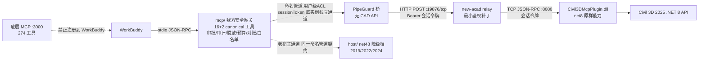
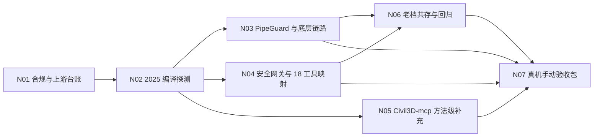

# 08 底层接入架构设计：new-acad / Civil3D-mcp 作为能力底座的纠偏方案

- 文档版本：**v2.0（宿主前提变更后的重新评估）**
- v1.0 → v2.0 变更触发：用户以自定义回答 **「已经安装2025版本」** 作答。team-lead 13:12 后实测确认 Civil 3D **2025（R25.0，net8）** 已安装，v1.0 中「本机无 2025/2026/2027」这一核心前提**已失效**。同时用户**明确批准新增** `read_civil_object` / `read_civil_list` 两个只读工具。
- 触发原因（不变）：用户明确「new-acad 和 Civil3D-mcp 这两个是**底层**，功能是基于这两个实现的」。此前 M0 走「零第三方依赖、全自研」，与用户意图不一致。
- 本文**不改动**：`docs/00`、`docs/04`、`docs/05`（QA 独有）、`docs/06`（冻结）、`docs/07`、`host/`、`mcp/`、`protocol/`。本轮只修订本文自身，不写任何实现代码。
- 铁律：**全程不启动 `acad.exe`**（含 `Start-Process`、COM 激活、`accoreconsole.exe`、脚本间接拉起）。真机项一律用户手动执行。当前 `acad.exe` 进程数 0【已核实：team-lead 实测】，本轮所有核实均为**只读文件/注册表/网络源码**操作，未改变该状态。
- 结论分级：每条关键事实标注 **【已核实】**（附来源）/ **【推断】** / **【待核实】**。
- 态度说明：用户表态**只解除了 A 的宿主障碍，不等于明确选定 A**。本文不预设结论，按「整体/原样基于底层」重新评估 A，保留 B 作 fallback，并给出专业判断。

---

## 1. 事实基线（v2.0 重写）

### 1.1 本机版本矩阵

| 宿主 | 版本 / 平台 | 状态 | 来源 |
|---|---|---|---|
| **Civil 3D 2025** | **R25.0，.NET 8**，`<AUTOCAD_2025_ROOT>\`；注册表 `HKLM\SOFTWARE\Autodesk\AutoCAD\R25.0\ACAD-8100:804` | **本机最新主线宿主，今天 13:12 装好**；`acad.exe` 5,702,944 B | 【已核实】team-lead 实测 |
| Civil 3D 2025 托管程序集 | 根目录 `accoremgd.dll` / `AcDbMgd.dll` / `acmgd.dll` / `acdbmgdbrep.dll`；**`ACA\AecBaseMgd.dll`**；**`C3D\AeccDbMgd.dll`** / `C3D\AeccPressurePipesMgd.dll`；`C3D\` 下共 137 个 DLL | **齐全，可作 net8 编译引用**；布局与 2024 不同 | 【已核实】team-lead 实测 + 本次逐文件确认 |
| Civil 3D 2025 运行时世代 | `acdbmgd.runtimeconfig.json` 实测 `"tfm": "net8.0"`、`Microsoft.NETCore.App 8.0.0`、`Microsoft.WindowsDesktop.App 8.0.0` | 与 net8 插件同代 | 【已核实】本次读取该文件 |
| Civil 3D 2024 | R24.3，**net48**，`<AUTOCAD_2024_ROOT>`；`AecBaseMgd.dll` 在**根目录**，`Aecc*` 在 `C3D\` | 老宿主降级档；程序集齐全 | 【已核实】team-lead 实测 + 本次逐文件确认 |
| Civil 3D 2019 | R23.0，net48，`<AUTOCAD_2019_ROOT>` | 更老降级档 | 【已核实】team-lead 实测 |
| 纯 AutoCAD 2022 | R24.1，net48，`C:\Program Files\Autodesk\AutoCAD 2022`，无 `C3D` 子目录 | M0 当前验证宿主 | 【已核实】 |
| AutoCAD 2014/2017/2018/2020 | net48 | 仅兼容参考 | 【已核实】team-lead 实测 |
| **R25.1 注册项** | 注册表存在 R25.1，但 `<AUTOCAD_ROOT>\` 下**未见 2026 目录**（只有 `2025`、`AutoCAD 2024`、Vehicle Tracking 2024、Civil 3D 2024 Object Enabler） | **【待核实】不能当作已装 2026**；可能是残留注册、Object Enabler 或安装未完成 | 【已核实：注册项存在 + 目录缺失；结论待核实】 |
| 2025 / 2026 / 2027 可用性 | **2025 已装；2026/2027 未确认安装** | 版本断层从「无 net8 宿主」变为「**有 2025，但无 2026**」 | 【已核实 + 待核实】 |
| .NET SDK / 运行时 | SDK 8.0.419 + 10.0.302；运行时 NETCore.App 8.0.11 / 8.0.25 / 10.0.10；**WindowsDesktop.App 8.0.25**（无 8.0.10） | 满足 net8 构建与运行 | 【已核实】team-lead 实测 + 本次列目录 |
| Node.js | v22.22.2 / npm 10.9.7 | 满足两底层 Node ≥18 | 【已核实】 |

> 纠偏补充：M0 文档 `00` 写「Civil 3D 本体未安装」，是只看了 `C:\Program Files\Autodesk\AutoCAD 2022` 的结论。本机实际有 Civil 3D 2019/2024/2025，且 2024 与 2025 的 Civil 托管程序集都完整。**Civil 能力缺口只存在于纯 AutoCAD 2022 宿主**。【已核实】

### 1.2 2025 引用布局差异（构建成败关键）

| 程序集 | 2024 位置 | **2025 位置** | new-acad 构建脚本映射 |
|---|---|---|---|
| `AecBaseMgd.dll` | 安装根目录 | **`ACA\AecBaseMgd.dll`** | `build-plugin.ps1` 明确写「DLL 位置映射（AutoCAD 2025 布局）：`AecBaseMgd.dll → <installDir>\ACA\`」【已核实】 |
| `AeccDbMgd.dll` / `AeccPressurePipesMgd.dll` | `C3D\` | `C3D\` | 同上 |
| `accoremgd.dll` / `AcDbMgd.dll` / `acmgd.dll` / `acdbmgdbrep.dll` | 根目录 | 根目录 | 同上 |
| `Subassembly.*.dll`（3 个） | — | **`C3D\SACRuntime\`** | new-acad csproj **硬编码** `D:\Program Files\Autodesk\AutoCAD 2025\C3D\SACRuntime\`，与本机路径不符，必须适配【已核实】 |
| `PresentationCore/WindowsBase/System.IO.Packaging` | — | `C:\Program Files\dotnet\shared\Microsoft.WindowsDesktop.App\8.0.25\` | new-acad csproj **硬编码** `8.0.10`，本机不存在该版本，必须适配【已核实】 |

本次逐文件确认：上述 10 个 2025 引用文件**在本机全部存在**（含 `C3D\SACRuntime\Subassembly.API.dll`、8.0.25 下三个 WPF 程序集）。【已核实】

### 1.3 Civil3D-mcp 核实结果

来源：README 原文、仓库源码树（216 项，53 个 `.cs`）、源码 zip 抽取的 **50 个插件源文件 / 20,570 行**、`Civil3DMcpPlugin.csproj`、`LICENSE`、`RpcTcpServer.cs`。

| 项 | 内容 | 分级 |
|---|---|---|
| 架构 | `MCP client ←stdio→ civil3d-mcp(Node/TS) ←JSON-RPC/TCP :8080→ Civil3DMcpPlugin.dll → Civil 3D 2026 API`；另有 HTTP `:3000` | 【已核实】README 架构图 |
| 插件 TFM | `net8.0-windows`；`Nullable=enable`；`ImplicitUsings=enable`；`EnableDynamicLoading=true` | 【已核实】csproj |
| 版本要求 | Requirements：`Civil 3D 2026 (live validated)`、`.NET SDK 8.0`、Node 18+；构建示例引用 `C:\Program Files\Autodesk\AutoCAD 2026\C3D` | 【已核实】README |
| **2025 状态** | README **只声明 2026 已验证**，未声明 2025；**2025 属「未验证」而非「不支持」** | 【已核实：无声明；结论为保守判定】 |
| 工具面 | 默认 34 个公共工具 / 内部 219 条路由；`CIVIL3D_ENABLE_TOOL_ALIASES=true` 暴露别名；`action` 选操作 | 【已核实】README |
| 审批流 | `civil3d_preview_action` → `civil3d_request_approval`（短时、单次、绑定当前图纸与精确参数的 token）→ 带 `approvalToken` 重试 | 【已核实】README |
| 执行门禁 | `CivilExecution.cs`：`SemaphoreSlim HostExecutionGate(1,1)` + `ExecuteAsync<T>(..., bool write)` + 文档锁/事务/命令上下文 | 【已核实】源码 |
| 队列与取消 | `PluginRuntime.cs`：`QueueHostOperation/StartHostOperation/CancelQueuedHostOperation/CompleteHostOperation/GetCurrentRequestCancellationToken` | 【已核实】源码 |
| 反射兼容 | `Civil3DCompatibility.cs`：`TrySetProperty/TryInvokeMethod/TryInvokeStaticMethod/TryInvokeStaticOverloads/TryInvokeLoadedStaticMethod` | 【已核实】源码 |
| Civil 工具方法 | `CivilObjectUtils.cs`：`GetHandle/ToObjectIds/LinearUnits/AngularUnits/VolumeUnits/FindAlignmentByName/FindProfileByName/FindSurfaceByName/FindCorridorByName/...` | 【已核实】源码 |
| **2026 字样扫描** | 50 个插件源文件中共 **32 处** `2026` 标记；逐条核对**全部是错误提示/文档注释**，内容为「Civil 3D 2026 不暴露/不支持某 API、因此不创建任何对象」（如 `CreateWideningAlignment`、`AddFitting`、`GetMaterials`），**不是 2026 专属类型引用，也没有条件编译或 2026 专属程序集名** | 【已核实】本次全量源码扫描 |
| 类型面 | `using` 集中在 `Autodesk.Civil.DatabaseServices / ApplicationServices / DatabaseServices.Styles / Settings`；抽查 25 个关键类型名（`Alignment/Profile/ProfileView/Surface/TinSurface/Corridor/PipeNetwork/PressurePipeNetwork/SampleLineGroup/SectionViewGroup/GradingGroup/FeatureLine/Parcel/Catchment/CivilDocument/Intersection/ViewFrameGroup/SurveyNetwork/PointGroup/MassHaulLine/Superelevation/QuantityTakeoff/AlignmentWidening/LabelSet/CorridorSurface`）**在 2025 `AeccDbMgd.dll` 元数据字符串中全部存在**；而源码声称 2026 缺失的 4 个方法名在 2025 也不存在 | 【已核实：二进制元数据字符串检索】；方法级签名仍需编译验证 |
| TCP 绑定 | `RpcTcpServer.cs`：`new TcpListener(IPAddress.Loopback, _port)`，默认 8080 | 【已核实】源码（v1.0 的「待核实」已收口） |
| TCP 认证 | 该文件 `auth/session/approval/ACL/secret/whitelist` 命中 **0**；`token` 命中 22 处全是 `CancellationToken` | 【已核实】源码 → **底层 TCP 无认证** |
| 许可证 | MIT，`Copyright (c) 2025 lisiting01` | 【已核实】LICENSE |
| Autodesk 程序集 | 不入库不分发；csproj `ValidateCivil3DReferences` 要求 6 个 DLL 集中在单一 `Civil3DReferencesPath` 目录 | 【已核实】csproj |

### 1.4 new-acad 核实结果（v2.0 增补构建层）

来源：README、源码树（460 项，99 个 `.cs`）、源码 zip、`LICENSE`、`THIRD-PARTY-NOTICES.md`、`Civil3DMcpPlugin.csproj`、`GeneratedVersion.props`、两个 `runtimeconfig.json`、`build-plugin.ps1`、`find-civil3d.ps1`、`switch-runtime.ps1`、`check-supported-hosts.js`、`ONBOARDING.md`、`panel-relay.js`、`RpcTcpServer.cs`。

| 项 | 内容 | 分级 |
|---|---|---|
| 架构 | C# 插件 `plugin/AcBridge-v24/`（TCP JSON-RPC `:8080`）+ relay/面板 `:19876` + MCP server `:3000` | 【已核实】README / ONBOARDING |
| 插件 TFM | `net8.0-windows`；`Nullable/ImplicitUsings/EnableDynamicLoading=true`；`UseWindowsForms=true`；版本 `1.15.0` | 【已核实】csproj + GeneratedVersion.props |
| 运行时 | `Civil3DMcpPlugin.runtimeconfig.json`：`tfm=net8.0`、`Microsoft.NETCore.App 8.0.0`、`Microsoft.WindowsDesktop.App 8.0.0`、`rollForward=LatestMinor`；另有 `net10/` 版 | 【已核实】两个 runtimeconfig |
| 版本要求 | README：**AutoCAD 2025 / 2026 / 2027**；原文「2024 及更早不支持…仍跑在 .NET Framework 4.8 上，与插件的 .NET 程序集不兼容」；v1.15.0 按 R25.x→net8、R26.0+→net10 自动选 | 【已核实】README + switch-runtime.ps1 |
| **2025 支持证据** | `find-civil3d.ps1` 注释「支持范围：2025 / 2026（R25.x，.NET 8）」，筛选 `year >= 2025`；`build-plugin.ps1` 明确按 **2025 布局**收集 7 个引用 DLL（`AecBaseMgd → ACA\`，`Aecc* → C3D\`，`acdbmgdbrep → 根目录`），并「自动检测 C3D 版本并编译插件（P2 跨版本适配）」 | 【已核实】两个脚本原文 |
| 宿主证据缺口 | `check-supported-hosts.js` 依赖 `docs/audit/supported-hosts.json` 中 `status=verified` 的宿主证据，但**该文件不在 main 分支源码 zip 中**（仓库树只有 2 个 audit 相关 js） | 【已核实：文件缺失；「2025 已被上游真机验证」待核实】 |
| 硬编码路径（必须适配） | csproj 中 3 个 `Subassembly.*` 指向 `D:\Program Files\Autodesk\AutoCAD 2025\C3D\SACRuntime\`；3 个 WPF 程序集指向 `...\Microsoft.WindowsDesktop.App\8.0.10\` | 【已核实】csproj + 本机路径比对 |
| NuGet 依赖 | `UglyToad.PdfPig 1.7.0-custom-5`、`SixLabors.ImageSharp 2.1.9`（Apache-2.0） | 【已核实】csproj + THIRD-PARTY-NOTICES |
| relay `/tcp` 桥 | `POST :19876/tcp` 把 JSON-RPC 原样转发到插件 `:8080`；本次源码逐行核对：该分支**无任何鉴权**（只在别处用 `RELAY_TOKEN` 做 OpenClaw 网关模式） | 【已核实】panel-relay.js 源码 |
| 链路纪律 | `ONBOARDING.md`：「必须走 /tcp 桥」「**禁止**直接 HTTP 打 8080（会把队列卡死）」「禁止用 `executeCommand` 传交互命令（白名单拦截）」；优先级 TCP 方法 > MCP 工具 > `executeCommand` | 【已核实】ONBOARDING.md |
| TCP 绑定 | `RpcTcpServer.cs` 同样 `IPAddress.Loopback`；默认 8080 | 【已核实】源码 |
| 工具/方法面 | 274 个 MCP 工具（默认 35 canonical）/ 430 个插件方法；内置 LLM 大脑对模型只暴露 2 个工具 | 【已核实】README |
| 任意 Civil 对象读取 / 预算画像 / 破坏性门禁 / 反射兼容 | `CivilObjectReaders.cs`（`Enumerate/DumpScalars/Enrich*/...`）、`SummarizeCommands.cs`（`budgetBytes` 逐级裁剪 + `result.trimmed[]`）、`ResultSummarizer.ApplyIfOversized`、`DestructiveGuard`（`IsArmed/Request/Reset`）、`Civil3DCompatibility.cs`（517 行） | 【已核实】源码 |
| 命令通道限制 | 14 个方法走命令通道，其中 10 个投递即返回、拿不到同步结果；廊道再生 30 s–10 min，期间 `HOST_BUSY` 排队 | 【已核实】README |
| 许可证 | MIT，`Copyright (c) 2025-2026 Jjo 阿飞`；`server/mcp/LICENSE` 保留上游 Civil3D-mcp MIT 原文 | 【已核实】LICENSE + THIRD-PARTY-NOTICES |

### 1.5 两个底层在 2025 上的可行性（回答「2025 ≠ 2026」）

#### 1.5.1 new-acad：**可构建，高概率可加载**

| 判据 | 结论 |
|---|---|
| TFM 与运行时 | net8.0-windows + `rollForward=LatestMinor`，本机 `WindowsDesktop.App 8.0.25` / `NETCore.App 8.0.25` 满足 →【已核实，可直接构建】 |
| 宿主年份 | `find-civil3d.ps1` 明确支持 R25.x / `year>=2025`；本机 R25.0 注册项存在 →【已核实脚本逻辑；实际输出待实跑（只读注册表，不启 CAD）】 |
| 引用布局 | `build-plugin.ps1` 的 2025 映射与本机 2025 文件位置**完全一致**，7 个引用 DLL 全部存在 →【已核实】 |
| 必需的最小改动 | ① 3 个 `Subassembly.*` HintPath 改指本机 `<AUTOCAD_2025_ROOT>\C3D\SACRuntime\`；② 3 个 WPF HintPath 从 `8.0.10` 改 `8.0.25`（或改 `$(NetCoreSharedPath)` 参数）；③ 建议把 `Civil3DReferencesPath` 参数化。**均为机器相关路径适配，不改能力实现** →【已核实必要性】 |
| 是否「原样」 | 除上述路径适配外，插件/relay/MCP server 代码无需改动即可构建 →【推断，需 `build-plugin.ps1` 实跑确认】 |
| 能否加载 | 编译通过 ≠ 运行时可用；必须用户手动 `NETLOAD` 验证 →【待核实，列入 §8 真机项】 |

#### 1.5.2 Civil3D-mcp：**2025 未验证；源码层面高概率可编译，但必须用编译探测证实**

| 判据 | 结论 |
|---|---|
| 官方声明 | 只写 `Civil 3D 2026 (live validated)`；2025 **未验证**，不是「明确不支持」 →【已核实】 |
| 是否用 2026 专属 API 类型 | 32 处 `2026` 字样全是「该 API 在 2026 也不存在/不支持」的错误文本与注释；未见 2026 专属程序集名、条件编译或新类型 →【已核实全量扫描】 |
| 类型面 | 使用的命名空间均为长期稳定的 `Autodesk.Civil.DatabaseServices/ApplicationServices/Styles/Settings`；抽查 25 个关键类型名在 2025 `AeccDbMgd.dll` 中全部可检索到，且源码声称 2026 缺失的 4 个方法在 2025 也不存在（不构成新增依赖） →【已核实二进制元数据字符串检索】 |
| 编译判断 | **【推断】在 2025 引用下编译通过概率高**，但方法重载/只读属性等**编译期差异无法靠字符串检索排除**，必须以实跑 `dotnet build` 为准；禁止仅凭本判断就宣布「支持 2025」 |
| csproj 引用障碍 | 要求 6 个 DLL 集中在**单一目录**；本机 2025 的 `AecBaseMgd.dll` 在 `ACA\`、`Aecc*` 在 `C3D\`，需**仓库外暂存目录**归集 →【已核实】 |
| 运行时差异 | 编译通过不代表行为一致；Civil 3D 2025 与 2026 的托管 API 行为差异需用户手动真机验证 →【推断 + 待核实】 |

#### 1.5.3 不启动 CAD 的验证方法（N02 的验收判据）

> 全部操作只涉及**注册表读取、文件复制/链接、`dotnet build`、程序集元数据读取**，**不启动 acad.exe**。

1. **引用暂存（仓库外）**：在 `%LOCALAPPDATA%\EngineeringPlatform\refs\c3d2025\` 归集 Civil3D-mcp 需要的 6 个 DLL（根目录 3 个、`ACA\AecBaseMgd.dll`、`C3D\AeccDbMgd.dll`、`C3D\AeccPressurePipesMgd.dll`）。用符号链接/硬链接/只读拷贝均可，**不得复制进本仓库**，并在 `.gitignore` 排除。
2. **Civil3D-mcp 编译探测**：
   ```
   dotnet build Civil3D-MCP-Plugin\Civil3DMcpPlugin.csproj -c Release ^
     /p:Civil3DReferencesPath=%LOCALAPPDATA%\EngineeringPlatform\refs\c3d2025
   ```
   判据：`0 error`。若出现 `CS0246`（类型/命名空间不存在）、`CS1061`（成员不存在）、`CS0012`（程序集引用不匹配）、`CS0117`（成员不存在）→ 逐条记入 `docs/evidence/api-diff-2025.md`，判定「反射降级 / 条件编译 / 该方法在 2025 不可用」三种处置。
3. **元数据比对（可选增强）**：用 .NET 8 SDK 自带的 `System.Reflection.Metadata`（无需 NuGet）读取编译产物的 `AssemblyRef` / `MemberRef` 与 2025 程序集公开类型表比对，输出差异清单。仍不启动 CAD。
4. **new-acad 编译探测**：先单独跑 `tools/find-civil3d.ps1`（只读注册表）确认 `year=2025 / kind=civil3d / installDir=...`；按 §1.5.1 三处路径适配后用 `build-plugin.ps1` 构建（脚本会把 7 个 DLL 复制到 `plugin/AcBridge-v24/C_References`，该目录已 gitignore）。判据：产出非 4 KB 的 `Civil3DMcpPlugin.dll` + `deps.json` + `runtimeconfig.json`。
5. **明确边界**：以上只验证**编译期 API 可解析**；**运行时正确性必须用户手动 NETLOAD**（§8）。禁止把「编译通过」写成「2025 已验证」。

#### 1.5.4 两底层不能同时作为进程内插件（新增关键约束）

- 两者插件产物都叫 **`Civil3DMcpPlugin.dll`**（csproj 同名），且 `RpcTcpServer` 都默认绑定 **回环 :8080**。【已核实】
- 同一 CAD 进程同时 NETLOAD 两套 → **程序集标识冲突 + 端口争用**。【推断，基于同名与同端口的直接推论】
- **结论：新基线只能选一套作为进程内插件。** 推荐 **new-acad**（明确支持 2025、430 方法覆盖更广、自带 2025 引用布局脚本）；**Civil3D-mcp 只作方法级补充源**（把其独有领域方法按需移植/适配到网关或插件），不整体加载。【已核实事实 + 设计判断】

### 1.6 由事实直接推出的结论（v1.0 §1.4 作废）

1. **v1.0 的「两个底层都无法在本机运行」已失效**：new-acad 明文支持 2025 且本机 2025 程序集齐全、net8 运行时齐备 → A 的宿主障碍消失。【已核实】
2. 但 **2025 ≠ 2026**：Civil3D-mcp 只验证 2026，2025 属「未验证/高概率可编译」；不能把「装了 2025」等同于「两个底层都能原样跑」。【已核实 + 推断】
3. 「基于这两个实现」现在有三种可执行口径：
   - **A0 全面替换**：WorkBuddy 直连底层 Node MCP server（274/34 工具）→ **安全倒退**，不推荐（§3.1）。
   - **A′ 原样底层 + 我方安全网关（推荐）**：底层插件/方法库原样承担专业执行，我方 `mcp/` 保留为唯一模型出口与审批/审计/预算/对账网关（§3.2）。
   - **B 能力级移植到 net48**：作为 2019/2022/2024 老宿主**降级档**与 A′ 的 fallback（§3.3）。
4. 用户对口径的回答只说明「宿主已具备」，**不足以判定用户已选定 A**；本文按事实推荐 A′，并把 B 保留为 fallback。【判断】
5. **底层 TCP:8080 / relay :19876 均无认证**（均绑定 127.0.0.1 但本机任意进程可连）→ 若原样接入，必须加最小安全补丁或放弃写通道，否则审批执行、写通道门禁形同虚设。【已核实 + 设计判断，见 §5 / §9 D6】

---

## 2. 底层定位澄清：谁承担哪一层

### 2.1 与我方五层架构的对应（v2.0 决策列已更新）

| 我方层 | 职责 | Civil3D-mcp 可提供 | new-acad 可提供 | **A′ 接入决策** |
|---|---|---|---|---|
| 智能交互层 | WorkBuddy 对话、意图理解、规划、确认 | 无（智能在外部客户端） | 内置 LLM 大脑 + 记忆 + 上下文压缩 | **不接入**。再引入大脑会形成双智能体，绕过审批与数据策略 |
| 能力连接层 | MCP 出口、工具编目、传输、握手、会话、ACL、实例发现 | Node MCP server（34/219）+ TCP:8080 | Node MCP server（274/35 canonical）+ relay:19876 + TCP:8080 | **底层作为内部方法出口；我方 `mcp/` 仍是 WorkBuddy 唯一 MCP 出口**。底层 MCP server **不注册进 WorkBuddy**；传输经 PipeGuard 适配（§4.2） |
| 工程运行层 | 主线程调度、有界队列、取消、超时、状态机、对账 | `CivilExecution` 串行门禁、`PluginRuntime` 队列/取消 | `JobRegistry`、`DestructiveGuard`、`OperationTrace`、`DocumentLifecycle` | **底层原样承担 CAD 侧队列/门禁**；**我方网关承担状态机、unknown 对账、审批执行与写门禁**（不可下放） |
| 技能资产层 | 技能库、映射表、知识库、工作流记录 | `civil3d_help` 本地帮助检索 | `user-knowledge/`、工作流 dry-run 回放 | **本期不接**；工作流回放列为后续 QA 候选 |
| 专业执行层 | Civil/AutoCAD 真实 API 调用、属性读取、计算、出图 | 50 个插件源文件覆盖曲面/路线/纵断面/廊道/管网/放坡/水文/图纸出版/QC/工程量 | 99 个插件源文件，含任意 Civil 对象读取、预算画像、土方专项 | **new-acad 插件原样承担主线**；Civil3D-mcp 只作方法级补充源（§1.5.4） |

### 2.2 一句话定位（v2.0）

- **new-acad = 新基线的进程内专业执行层 + 工程化机制库**（2025 明确支持，430 方法，含任意 Civil 对象反射读取、版本兼容层、预算画像、破坏性门禁）；其 Node relay 是**内部 JSON-RPC 桥**，不是我方 MCP 出口。
- **Civil3D-mcp = 第二方法来源与审批流范式**（领域覆盖最全、三步审批与 `approvalToken` 同构），但 2025 未验证且插件产物/端口与 new-acad 冲突，**不整体加载**。
- **我方 `mcp/` = 唯一模型出口与安全网关**；`protocol/` = 唯一对外契约；`host/` net48 = 老宿主降级档（§6）。
- 两者均 MIT，允许移植/修改/再分发，条件是保留版权声明与许可证原文（§7）。

### 2.3 A′ 目标链路



---

## 3. 宿主前提变更后的路径重评

### 3.1 路径 A0：WorkBuddy 直连底层 Node MCP server（全面替换）

| 维度 | 评估 |
|---|---|
| 做法 | 把底层 `server/mcp`（274 工具 / 34 工具）注册进 WorkBuddy，弃用我方 `mcp/`、`protocol/`、`host/` |
| 与用户意图 | 「原样基于底层」最字面，但**把安全层也一起替换掉了** |
| 后果 | 模型可直接调用底层写工具；无我方 `approvalToken` 绑定、无 E/C/W 错误码、无脱敏、无「日志不记图纸内容」、无 unknown 不自动重放对账、无路径白名单、无写通道 `E2003` 门禁 → **方案 13/14/15 章安全要求整体倒退**【已核实底层无同等机制 + 设计判断】 |
| 工作量 | 最低（0.5–1 人日注册配置），但**返工风险最高** |
| 结论 | **不推荐**。除非用户明确要求「先做一次性演示、不接任何真实图纸」，否则不得采用 |

### 3.2 路径 A′：原样底层插件 + 我方安全网关（**主选重新评估 / 推荐**）

| 维度 | 评估 |
|---|---|
| 做法 | 2025 上以 **new-acad 插件原样**承担专业执行；经 `relay :19876/tcp` 调方法；我方 `mcp/` 保留为唯一 MCP 出口与安全网关；新增 `PipeGuard` 把命名管道契约桥接到 relay；Civil3D-mcp 作方法级补充 |
| 与用户意图对齐 | **高**：底层能力实现「原样」运行，不是移植重写；仅有 ① 机器路径适配 ② 最小传输鉴权补丁 ③ 网关契约映射三类改动，**不改能力实现** |
| 前置条件（已解除） | 2025 已装、net8 运行时齐备、10 个引用 DLL 齐全 →【已核实】 |
| 工作量 | **14–16 人日**（§9 N01–N07），含合规、编译探测、PipeGuard、网关映射、老档共存、真机验收包 |
| 风险 | ① **底层 TCP/relay 无认证** → 必须最小补丁（§9 D6）；② 两底层插件同名同端口 → 只能选一套（§1.5.4）；③ Civil3D-mcp 2025 编译差异需探测；④ new-acad 2025 运行时正确性需用户手动真机；⑤ 引入 Node relay 进程，增加运维面（但不启动 CAD） |
| 对既有资产 | `protocol/` 四契约与 16+2 工具**保留为唯一对外契约**；`mcp/` 升级为网关（不废弃）；`host/` net48 **共存为降级档**（§6）；784+566 断言保留为老档回归门槛；`docs/05/06/07` 不动 |
| 何时合理 | 用户希望「功能基于底层」、同时不愿丢失已通过验收的安全与审计体系 → **当前最优** |

### 3.3 路径 B：保留 net48 宿主，逐项移植（**降级档 / fallback**，v1.0 主选已降级）

| 维度 | 评估 |
|---|---|
| 做法 | `host/` net48 仍作为 2019/2022/2024 的运行线，按 §4.3 从两底层移植方法与机制 |
| 定位变化 | 从「唯一主线」降为「**老宿主降级档 + A′ 失败时的 fallback**」；不再是回答用户「基于底层」的主答案 |
| 工作量 | 6–9 人日（v1.0 估算不变），可与 A′ 的 N05 方法级补充复用同一份移植台账 |
| 风险 | net8→C#7.3 / System.Text.Json→`Protocol/Json.cs` 适配；2024 与 2026 API 差异【推断】；上游跟踪成本 |
| 对既有资产 | **影响最小**；16+2 工具契约不变；784+566 全绿；QA 文档不动 |
| 何时升级为主线 | ① A′ 的 2025 真机验证失败且无法修复；② 用户明确拒绝引入 Node relay / 底层插件；③ 用户主力图纸必须在 2024 及更早宿主上处理 |

### 3.4 路径 C：两套完整能力连接层双主并存（不推荐）

| 维度 | 评估 |
|---|---|
| 做法 | 新 baseline 与我方 net48 **各自维护完整 MCP 出口、工具目录、审批与审计**，仅共享 `protocol/` |
| 与 A′ 区别 | A′ 是「一个网关 + 两个宿主档」；C 是「两个网关 + 两套安全实现」 |
| 工作量 | 18–24 人日 + 持续双线维护 |
| 风险 | 契约漂移、审批语义分叉、测试矩阵翻倍；new-acad 自己都靠「按宿主版本选两套插件」维持，成本真实存在【已核实其机制】 |
| 结论 | **不推荐**。A′ 已通过「单一网关 + transport 选择」拿到双宿主收益，无需两套网关 |

### 3.5 对比总表

| 路径 | 与「基于底层」对齐 | 工作量 | 安全倒退风险 | 对 784+566 / 16+2 契约 | 结论 |
|---|---|---|---|---|---|
| A0 全面替换 | 最字面 | 0.5–1 人日 | **高（不可接受）** | 全部失效 | 不推荐 |
| **A′ 原样底层 + 我方网关** | **高** | **14–16 人日** | **可控（需最小补丁）** | **保留** | **推荐主选** |
| B 逐项移植 net48 | 能力级 | 6–9 人日 | 低 | 保留 | **降级档 / fallback** |
| C 双主并存 | 中 | 18–24 人日 | 中 | 契约漂移 | 不推荐 |

### 3.6 推荐结论（不预设用户已选 A）

> **专业判断：推荐 A′（2025 新基线 = new-acad 插件原样 + 我方安全网关），并把 B 保留为「2019/2022/2024 老宿主降级档 + A′ 的 fallback」。**
>
> 理由：
> 1. 用户已装 2025，A 的宿主障碍消失；new-acad 明文支持 2025，构建脚本与本机的 2025 引用布局一致，10 个引用 DLL 全部存在 → **A 从「不可行」变为「可行」**。【已核实】
> 2. 但「原样」若理解成 A0（WorkBuddy 直连底层 274 工具），会丢掉审批执行、审计脱敏、语义预算、写通道 E2003、unknown 对账不自动重放——**这五项丢了就是安全倒退**。因此必须保留我方 `mcp/` 作为唯一模型出口。
> 3. Civil3D-mcp 只验证 2026、且与 new-acad 插件同名同端口，不能整体加载 → A′ 采用「new-acad 原样 + Civil3D-mcp 方法级补充」，这是「基于两个底层」在 2025 上唯一无冲突的落地方式。
> 4. B 不再是主答案，但不能退役：用户机器上仍有 2019/2022/2024 三代 net48 宿主，且 784+566 断言与已 CLOSED 的 D1–D8 都绑定在这条线上（§6）。
> 5. 用户表态只说明宿主已具备，**并未明确选定 A**；若用户拒绝引入 Node relay / 底层插件，或 2025 真机验证失败，则平滑回退到 B，无需重做协议与测试。

---

## 4. 接入方式决策与首批能力清单（定稿）

### 4.1 明确结论

**逐项移植不再是主线；主线是「原样运行 new-acad 插件 + 我方安全网关 + Civil3D-mcp 方法级补充」。B 的移植工作保留为老宿主降级档与 fallback。**

| 考量 | A0 全面替换 | **A′（选定）** | B 降级档 |
|---|---|---|---|
| 底层能力实现 | 原样 | **原样** | 移植重写 |
| 我方 MCP 层 | 被替换 | **保留为唯一出口 + 安全网关** | 保留 |
| 模型可见工具 | 274 / 34 | **16 + 已批准的 2 个 = 18 个 canonical** | 18 个 canonical |
| 审批/审计/脱敏/预算/对账 | 丢失 | **全部保留** | 全部保留 |
| 真机宿主 | 2025 | **2025 主线 + 2019/2022/2024 老档** | 2019/2022/2024 |
| 写通道 | 底层直接开放 | **仍 `E2003`；开放前须过审批门禁** | 仍 `E2003` |

### 4.2 Node MCP server 与端口体系取舍（明确回答「原样接入是否替换我方 MCP 层」）

| 组件 / 端口 | 处置 | 理由 |
|---|---|---|
| 底层 MCP server `:3000`（new-acad 274 工具 / Civil3D-mcp 34 工具） | **保留运行、但不注册进 WorkBuddy**；仅供本地调试/其他客户端 | 一旦注册，模型可绕过我方网关直调写工具，审批与审计失效【已核实底层无同等机制】 |
| new-acad relay `:19876` 的 `/tcp` 桥 | **接入，作为我方网关到插件的唯一方法通道** | `ONBOARDING.md` 明确「必须走 /tcp 桥」「禁止直接 HTTP 打 8080」【已核实】 |
| 插件 TCP `:8080` | **不由我方网关直连**；只允许 relay 访问，并加会话令牌校验补丁 | 直连会绕过 relay、且该端口无认证【已核实】 |
| 我方命名管道 + 每实例通道 + 用户 ACL + `sessionToken` | **保留，通过 `PipeGuard` 前置** | 见下 |
| `executeCommand` 万能通道 | **禁用** | `ONBOARDING.md` 明示白名单拦截交互命令；我方不允许无参数校验的旁路【已核实】 |

**PipeGuard 设计（新增适配层，不含任何 CAD API）**

```
WorkBuddy ↔ stdio ↔ mcp/ 网关
   ↔ 命名管道（我方原有 ACL / userHash8 / 实例发现 / sessionToken）
   ↔ PipeGuard（按 hostInstanceId 映射到 relay 端口，注入 Bearer 会话令牌）
   ↔ HTTP POST :19876/tcp  →  relay  →  TCP :8080  →  new-acad 插件
```

- **必须的最小安全补丁**（否则 A′ 不成立）：
  1. `panel-relay.js` 的 `POST /tcp` 分支增加 `Authorization: Bearer <sessionToken>` 校验（约 10 行），令牌由网关在启动 relay 时通过 `RELAY_TOKEN` 环境变量注入；【已核实该分支当前无鉴权】
  2. `RpcTcpServer.cs` 在解析每条 JSON-RPC 请求时校验同一令牌（约 15 行），防止本机其它进程直连 8080 绕过 relay；【已核实当前无鉴权】
  3. 端口改为**每实例随机高端口**，由 `PipeGuard` 通过实例发现文件维护映射；禁用固定 8080 的共享语义。
- 上述补丁**只改传输入口，不改任何 CAD 能力实现**，因此仍属「原样基于底层」。【设计判断】
- **若用户拒绝任何补丁**：则 8080/19876 的无认证面无法消除 → **写通道必须保持 `E2003` 且不得开放**，A′ 只能作为只读演示基线，不能作为生产基线（§9 D6）。

### 4.3 首批能力清单（P0，**定稿**）

> **用户已批准新增 `read_civil_object` / `read_civil_list`，本表为定稿，不再是待定项。**
> 「A′ 主线」= 调用底层原样方法并做契约映射；「B 降级档」= 移植到 net48。两档对外**同一套 18 工具契约**。

| # | 目标能力 / 工具 | 来源（项目 → 文件 → 方法） | A′ 主线实现 | B 降级档实现 | 验证方式 |
|---|---|---|---|---|---|
| 1 | `sys_capabilities` / `sys_health` 增强：Civil 三态（可用/缺程序集/纯 AutoCAD）+ `runtime: net8\|net48` | new-acad `CivilSupport.cs`（`HostProduct`/`IsMissingCivilAssembly`/`RequireDocument`）、`Civil3DCompatibility.IsCivilAssemblyLoadable`；`find-civil3d.ps1` 的年份识别 | 网关读取实例发现文件 + 底层 health 方法 | 移植到 `host/Semantic/CivilApiProbe.cs` | 单测 + 用户手动在 2025 / 2022 各跑一次回填输出 |
| 2 | **新增 `read_civil_object`（已批准）**：任意 Civil 对象属性级读取 | new-acad `CivilObjectReaders.cs`（`Enumerate/DumpScalars/Enrich/EnrichByTypeName/EnrichAlignment/Profile/Corridor/SampleLines`） | 网关映射为 canonical 工具，调用底层方法；结果过 `Redactor`、置信度与 `basis` | 移植到 net48（反射 + `Protocol/Json.cs`） | 反射桩单测；用户手动对 5 类 Civil 对象调用并回填 JSON |
| 3 | **新增 `read_civil_list`（已批准）**：按类型/名称枚举 Civil 对象并给句柄 | Civil3D-mcp `CivilObjectUtils.cs`（`FindAlignment/Surface/Profile/CorridorByName`、`GetHandle/ToObjectIds`）+ new-acad `CivilObjectReaders.Enumerate` | 网关映射；句柄化，不跨命令持有 ObjectId | 移植到 net48 | 单测 + 用户手动枚举曲面/路线/廊道回填 |
| 4 | `read_overview` / `read_layers` 增强：预算化画像 + 宿主侧硬裁剪 | new-acad `SummarizeCommands.cs`（`budgetBytes` 逐级裁剪、`result.trimmed[]`）、`ResultSummarizer.ApplyIfOversized` | 底层原样产出 + 网关再过 `mcp/budget.py` 语义预算（双层互补） | 移植（该文件用 `System.Text.Json` → 改走 `Protocol/Json.cs`） | `ENG_DEVFIXTURE` 大图断言输出字节 ≤ 预算、`trimmed[]` 非空；784+566 全绿 |
| 5 | 串行执行门禁 / 有界队列 / 取消 | Civil3D-mcp `CivilExecution.cs`（`SemaphoreSlim(1,1)`）、`PluginRuntime.cs`（队列/取消）；new-acad `JobRegistry.cs` | **底层原样承担 CAD 侧门禁**；网关负责状态机与 `E1003/E3002/cancelled` 映射 | 移植并与 `MainThreadDispatcher` 合并 | 并发/队列满/超时/取消单测；写工具仍 `E2003` |
| 6 | 单位与量纲口径 | Civil3D-mcp `LinearUnits/AngularUnits/VolumeUnits`；new-acad `UnitSystem.cs` | 网关在契约映射时显式化 `units` | 移植 | 单位映射单测 + 用户手动回填 `INSUNITS` |
| 7 | 反射兼容调用层（多版本底座） | new-acad `Civil3DCompatibility.cs`（517 行）、Civil3D-mcp 同名（405 行） | 底层原样可用；网关侧只保留错误映射 | 移植（去 `Nullable`/隐式 using） | 方法不存在/参数不匹配/目标异常三类桩单测 |
| 8 | 16 个既有只读工具契约保持 | 我方 `protocol/tools.schema.json` | **全部经网关映射到 `16+2` canonical，不暴露 274/34 工具** | 保持不变 | 契约一致性测试 + 784+566 回归 |

**P1（登记不实现）**：三步审批状态机与 `approvalToken` 绑定（Civil3D-mcp README + new-acad `DestructiveGuard`）、`FileBoundary` 用例交叉校验、`OperationTrace`/`AssertCommands` 回放、canonical + action + 别名编目。**写通道继续 `E2003`，非空 `approvalToken` 继续 `E1006`。**

### 4.4 接入 / 移植代码规约

- **A′ 侧**：上游源码以固定 commit 放入 `third_party/new-acad/`（MIT 原文随附）；所有机器相关改动集中在 `third_party/patches/` 的 patch 文件与一份 `PATCHES.md`，**不改上游文件内的能力实现**。
- **B 侧**：移植代码放 `host/Upstream/Civil3dMcp/`、`host/Upstream/NewAcad/`，命名空间 `EngineeringPlatform.Host.Upstream.*`，禁止被 `Pipe/`、`Session/` 反向依赖。
- 两侧共用：每个文件头部固定注释（来源仓库/原路径/上游 commit/许可证/改动摘要，模板见 §7.4）；错误**一律映射到我方 E/C/W 码**，不得把底层异常文本直接抛给模型；C# 7.3 约束只约束 B 侧。

---

## 5. 15 项增值层逐项「保留 / 替换 / 适配」结论

> 判定口径：**保留** = 机制与实现都不动；**适配** = 机制保留、增加一层映射/桥接；**替换** = 由底层实现接管（本节结论：**0 项替换**，因为任何一项被替换都会造成 §3.1 所述安全倒退）。

| # | 增值层 | 位置 | 结论 | 具体处置 |
|---|---|---|---|---|
| 1 | 协议四契约（信封/握手/工具目录/错误码） | `protocol/` | **保留（对外）+ 适配（对内）** | 对 WorkBuddy 仍是唯一契约；对底层新增「我方封套 ↔ JSON-RPC」映射表，底层错误文本映射到 E/C/W |
| 2 | 命名管道 + 用户级 ACL + 每实例通道 + `userHash8` | `host/Pipe/`、`host/Session/` | **适配** | 通过 `PipeGuard` 保留管道与 ACL 作为**我方网关前置通道**；PipeGuard 之后才是 relay/TCP。绝不把 TCP 直接暴露给 WorkBuddy |
| 3 | 实例发现文件与活性探测 | `host/Session/`、`mcp/instances.py` | **适配** | 增加 `runtime: net8\|net48`、`relayPort`、`pluginPort` 三个字段；活性探测对 net8 档改为「管道 + relay `/health` + 插件 health」三段式 |
| 4 | 信封 11 字段 | `protocol/envelope.schema.json` | **保留 + 适配** | 11 字段全部保留；`sessionToken` 由网关签发并透传为 relay 的 Bearer 令牌；`paramsDigest`/`targetFingerprint` 由网关计算，不依赖底层；`approvalToken` 继续由网关把守 |
| 5 | 任务状态机含 `unknown` 与对账（**不自动重放**） | `host/Tools/`、`mcp/reconcile.py` | **保留（不可下放）** | 底层只有 job/取消，无「结果不明」语义。超时/断线一律由网关标 `unknown` → `task_reconcile` 查一次 → 由模型用**新 opId** 显式重试；底层 job 状态只作证据，不做裁决 |
| 6 | 错误码 E/C/W 与缺口显式化 | `protocol/errors.json` | **保留 + 适配** | 建立 `CIVIL3D.*` / `HOST_BUSY` / relay 错误 → `E1001/E1003/E1004/E1005/E2001/E2003/E3002/E4001/E5001` 映射表；Civil 缺口继续显式回报，不得静默 |
| 7 | 审计与「日志不记图纸内容」 | `mcp/audit.py`、`host/Diagnostics/` | **保留（不可下放）** | 每次 `tools/call` 由网关落 `tasks`+`audit`；底层插件日志可作排障证据但**不进模型上下文、不进项目库**；参数只记摘要/数量/错误码 |
| 8 | 脱敏（路径/用户名/文字长度） | `host/Semantic/Redactor.cs` | **保留 + 适配** | 在网关出口统一执行（覆盖 A′ 与 B 两档）；底层返回的 Civil 属性、块属性、文字一律先过脱敏再进摘要 |
| 9 | 响应预算与下钻建议 | `mcp/budget.py` | **保留（双层互补）** | 底层 `budgetBytes`/`ApplyIfOversized` 是**宿主侧硬字节上限**；我方 `budget.py` 是**模型侧语义预算 + `drilldown`**；两者串联，不互相替代 |
| 10 | 路径白名单与禁止写用户原图 | `mcp/config.py` | **保留（不可下放）** | 底层 `FileBoundary` 仅作用例参考；所有文件通道路径仍由网关校验（UNC/ADS/符号链接/前缀逃逸），用户原图只读 |
| 11 | SQLite 项目库与「对话不是数据源」 | `mcp/store.py` | **保留** | 底层无此概念；`objects/attributes/relations/results/tasks/evidence/skills_used/audit` 仍由网关落库 |
| 12 | 降级面板（只含状态/任务/取消/日志导出） | `host/LocalPanel/` | **保留** | 老宿主档继续使用；A′ 档的面板状态由网关提供数据，**不引入 new-acad 含 AI 的面板** |
| 13 | **16 工具只读契约 + 已批准 2 工具 + 写通道 `E2003`** | `protocol/tools.schema.json` | **保留（对外）+ 适配（对内）** | 对外恒为 18 个 canonical；底层 274/34 工具**不注册进 WorkBuddy**；所有写域调用在网关直接 `E2003 write_channel_disabled_m0`，非空 `approvalToken` 仍 `E1006`，绝不转发到底层 |
| 14 | 784 + 566 项断言与 QA 验收记录 | `tests/`、`docs/05` | **保留** | 作为 net48 老档回归门槛；A′ 新增链路另建测试集，不删改既有断言；`docs/05/06/07` 不动 |
| 15 | 「agent 不启动 acad.exe」纪律 | 团队约定 | **保留** | 编译探测、PipeGuard、relay 启动脚本均不得含 `Start-Process acad.exe` / COM 激活 / `accoreconsole.exe`；真机项写用户手动四段式（§8） |

**五项高危项的底线（丢任一即为安全倒退）**：#5 unknown 对账不自动重放、#7 审计不记图纸内容、#8 脱敏、#9 语义预算、#13 审批执行与写通道 `E2003`。A0 会同时丢掉这五项，故被否决。

---

## 6. 现有 net48 M0 的处置（明确建议）

> **结论：共存，定位为「2019/2022/2024 老宿主降级档」；不退役、不双主、不再新增能力。**

| 资产 | 处置 | 理由 |
|---|---|---|
| `host/` 38 个 .cs（net48 / C#7.3） | **冻结为老档**，仅允许缺陷修复与引用路径参数化，不再新增工具 | 用户机器仍有三代 net48 宿主；退役会让旧图纸无法工作 |
| `mcp/` 11 个 .py | **升级为唯一安全网关**，新增 transport 选择：按实例发现文件的 `runtime` 字段走「命名管道直连老档」或「PipeGuard → relay → 2025 插件」 | 单网关双宿主，避免 C 路径的两套安全实现 |
| `protocol/` 四契约 | **保持为唯一对外契约**，只做**新增**（2 个已批准工具 + 可选 `trimmed` + 实例发现字段），不改 16 个既有工具语义 | 契约不分裂，784+566 与 QA 文档继续有效 |
| 784 + 566 项断言 | **保留为老档回归门槛**，A′ 新增链路另建测试 | 已 CLOSED 的 D1–D8 不被重新打开 |
| `docs/05`（QA 独有）/ `06` / `07` | **不动**，继续作为 M0/老档的权威记录 | 团队约束 |
| 16 工具 → 18 工具 | 两档**同一套** canonical；新增 2 工具在两档分别实现（A′ 映射 / B 移植） | 用户已批准新增，不需再拍板 |
| 降级面板 | 老档沿用；A′ 档由网关供数 | 不引入含 AI 的底层面板 |

**命名规范**：`2025 新基线（A′ 主线）` / `net48 老宿主降级档（B）`。实例发现文件新增 `runtime` 字段做路由，不改管道名生成规则（避免 v1.0 契约漂移）。

---

## 7. 许可证与第三方声明处置（v2.0 增补）

### 7.1 义务来源

- 两项目 MIT：允许使用/复制/修改/合并/发布/分发/再授权/销售；条件是**在所有副本或实质性部分中保留版权声明与许可声明**。【已核实】两份 LICENSE 原文
- 版权：`Civil3D-mcp` → `Copyright (c) 2025 lisiting01`；`new-acad` → `Copyright (c) 2025-2026 Jjo 阿飞`；new-acad 的 `server/mcp/LICENSE` 另保留上游 MIT 原文。【已核实】
- **A′ 会整体引入 new-acad 仓库** → 其 NuGet 依赖 `UglyToad.PdfPig 1.7.0-custom-5`、`SixLabors.ImageSharp 2.1.9`（Apache-2.0）以及 `server/mcp/` 的 npm 依赖许可证**都必须登记**；v1.0 写的「我方不引入这些组件」已失效。【已核实 csproj + THIRD-PARTY-NOTICES】
- Autodesk 托管程序集：不入库、不分发，仅本机编译引用（`Private=false`）。（对应方案 553/560 行）【已核实】

### 7.2 需新建的文件（本轮只设计，不创建）

| 文件 | 内容 | 责任任务 |
|---|---|---|
| `THIRD-PARTY-NOTICES.md`（仓库根） | 两底层项目、new-acad 内嵌的上游 MIT、PdfPig / ImageSharp（Apache-2.0）、npm 依赖来源与许可证索引 | N01 |
| `third_party/civil3d-mcp/LICENSE` | MIT 原文，`Copyright (c) 2025 lisiting01`，不修改一字 | N01 |
| `third_party/new-acad/LICENSE` | MIT 原文，`Copyright (c) 2025-2026 Jjo 阿飞` | N01 |
| `third_party/new-acad/server/mcp/LICENSE` | 随 vendored 源码保留的上游 MIT 原文（不删） | N01 |
| `third_party/PATCHES.md` | A′ 的 3 类最小改动逐条登记：机器路径适配、relay 鉴权、插件令牌校验；注明「未改能力实现」 | N01 起持续维护 |
| `third_party/UPSTREAM.md` | 台账：仓库 → 固定 commit → 原文件 → 本仓库文件/补丁 → 改动摘要 → 验证状态 | N01 起持续维护 |
| `LICENSE`（本项目自身） | 建议 MIT 与上游一致；**是否对外发布及许可证选择仍需用户拍板**（§10 D1） | N01 |
| `.gitignore` 增补 | `C_References/`、`%LOCALAPPDATA%` 暂存目录映射、`**/Autodesk*.dll`、`third_party/**/bin`、`node_modules/`、`build/` 策略 | N01 |

### 7.3 Autodesk 程序集分发约束

- 仓库内**不得出现**任何 Autodesk 二进制；`C_References/` 与 `%LOCALAPPDATA%` 暂存目录只是**本机编译引用**。
- 编译引用参数化：`Civil3DReferencesPath` / `ACARefPath` / `SACRuntimePath` / `WindowsDesktopRefPath`，默认值按 2025 布局（§1.2），且构建前校验缺件即报错（借鉴两底层 csproj 做法）。
- 分发物只含我方编译产物 + 许可证/声明；安装文档写「需用户自行安装并授权正版 AutoCAD/Civil 3D」；声明非 Autodesk 官方产品、无隶属或背书关系。

### 7.4 文件头部注释模板（B 侧移植 / A′ 侧补丁通用）

```csharp
// Upstream: new-acad (MIT) — https://github.com/Jjo37/new-acad
// Source  : plugin/AcBridge-v24/src/CivilObjectReaders.cs @ <upstream-commit>
// License : Copyright (c) 2025-2026 Jjo 阿飞 — see third_party/new-acad/LICENSE
// Change  : <port to net48/C#7.3 | minimal transport auth patch | path adaptation>
// Notes   : System.Text.Json -> Protocol/Json.cs; errors mapped to protocol/errors.json;
//           all text passed through Semantic/Redactor; no capability implementation changed.
```

---

## 8. 真机验证策略（铁律：agent 不启动 acad.exe）

### 8.1 禁止事项

- 禁止 `Start-Process acad.exe`、`accoreconsole.exe`、COM `CreateObject("AutoCAD.Application")` 及任何等价间接拉起。
- 禁止未经用户确认写入自加载注册表键 / `acad.lsp` / `Hank.lsp`（会改变用户下次启动行为并可能弹窗）。
- 禁止为「自动验收」循环调用会触发 CAD 弹窗的工具。
- **允许但需用户执行**：启动 Node relay / 加载插件 DLL；agent 只运行构建、静态检查、单元测试、我们自己的 Python 网关与 PipeGuard（不含 CAD API）。

### 8.2 分工

| 内容 | 执行者 | 产物 |
|---|---|---|
| 引用暂存、`dotnet build` 编译探测、`System.Reflection.Metadata` 比对 | agent / CI（不启 CAD） | `docs/evidence/api-diff-2025.md`、构建日志 |
| `find-civil3d.ps1` 只读注册表探测、`build-plugin.ps1` 构建 | agent / CI（不启 CAD） | 注册表输出、DLL 产物清单 |
| 协议/契约/映射/鉴权/预算/对账单测、回归 784+566、mockhost 链路 | agent / CI | 测试输出 |
| **启动 Civil 3D 2025、NETLOAD `Civil3DMcpPlugin.dll`、打开图纸** | **用户手动** | 截图 + 命令行文本 |
| **启动 relay / 在 WorkBuddy 中提问并确认摘要、预览图、Civil 属性** | **用户手动** | 对话导出 + PNG + 宿主/网关日志片段 |
| 产物收集 | `tools/collect_evidence.ps1`（只读，不启动 CAD） | `docs/evidence/<日期>/` |

### 8.3 每个真机项四段式

```
步骤（用户操作，逐条可复制） → 判据（可观察的确定输出） → 产物（docs/evidence/ 文件名） → 失败怎么办（查哪份日志 / 对应错误码）
```

**示例（2025 主线，N07）**

- 步骤：用户启动 Civil 3D 2025 → `NETLOAD` 加载构建产物 `Civil3DMcpPlugin.dll` → 按清单启动 relay（Bearer 令牌由网关注入）→ 打开一张含路线与曲面的图 → 在 WorkBuddy 中问「列出这张图的 Civil 对象，给我看第一条路线的属性和预览图」。
- 判据：`read_civil_list` 非空、`read_civil_object` 返回带 `confidence`/`basis` 的属性表、`read_preview` 返回 PNG；`sys_capabilities` 中 `runtime=net8` 且 Civil 三态为「可用」；**无 `E2001` / `E2003` / `E4001`**；所有写域调用仍 `E2003`；非空 `approvalToken` 仍 `E1006`。
- 产物：`docs/evidence/<日期>/civil-object-read.json`、`preview.png`、`sys-capabilities.json`、宿主/网关日志片段。
- 失败怎么办：`E4001` 查会话令牌注入；`E1004` 关闭 CAD 模态框；`E1003` 查底层队列 `HOST_BUSY`；`E2001` 查网关工具映射表；Civil 三态为「缺程序集」则查 `ACA\AecBaseMgd.dll` / `C3D\AeccDbMgd.dll` 加载路径。

---

## 9. 增量任务分解（v2.0 重写，N01–N07）

> 统一底线：`tests/run_all.py` 784/0 与 `tests/qa/qa_run_all.py` 566/0 保持全绿；真机项一律用户手动；**原 v1.0 的 8.5 人日估算基于 B 单线，已作废**。

| 任务 | 内容 | 依赖 | 涉及文件（设计，不含实现） | 验证方式 | 人日 |
|---|---|---|---|---|---|
| **N01 合规与上游资产登记** | vendored 源码固定 commit、四份 LICENSE / NOTICES、`PATCHES.md`、`UPSTREAM.md`、`.gitignore`、本项目 LICENSE 草案 | 无 | `THIRD-PARTY-NOTICES.md`、`third_party/**/LICENSE`、`third_party/PATCHES.md`、`third_party/UPSTREAM.md`、`LICENSE`、`.gitignore` | 许可证原文与上游逐字一致（hash）；`git status` 无 Autodesk DLL；补丁台账与 §4.2 三类改动一一对应 | 0.5 |
| **N02 2025 编译/引用探测（不启 CAD）** | 引用暂存、new-acad 三处路径适配、`find-civil3d.ps1` + `build-plugin.ps1` 实跑、Civil3D-mcp 对 2025 引用的 `dotnet build` 编译探测、`api-diff-2025` 报告 | N01 | `third_party/patches/paths.patch`、`tools/probe-2025-refs.ps1`、`docs/evidence/api-diff-2025.md`、两项目 csproj 的机器路径参数化 | 两个插件均 `0 error`；new-acad 产物非 4 KB 空壳；差异清单逐条给出「反射降级/条件编译/不可用」结论；**全过程 0 个 acad.exe 进程** | 2.0 |
| **N03 底层运行链路接入与 PipeGuard** | vendored new-acad 插件/relay 启动、relay `/tcp` 与 `RpcTcpServer` 最小令牌补丁、每实例随机端口、命名管道 ↔ relay 桥、实例发现 `runtime` 路由 | N02 | `bridge/pipeguard.py`、`third_party/patches/relay-auth.patch`、`third_party/patches/plugin-token.patch`、`mcp/instances.py`（新增字段）、`config/config.json` | 无 CAD 端到端（mock 插件）：会话令牌缺失 → `E4001`；令牌有效 → 方法透传；端口映射正确；静态扫描无 `acad.exe` 启动；不注册底层 MCP 到 WorkBuddy | 3.5 |
| **N04 安全网关与 18 工具契约映射** | `mcp/` 升级为唯一出口；16+2 canonical 映射；E/C/W 错误映射；审批执行、审计、脱敏、语义预算、白名单、unknown 对账、写通道 `E2003` 全部在网关落地 | N02 | `mcp/engineering_mcp.py`、`mcp/jsonrpc.py`、`mcp/tools_catalog.py`、`mcp/audit.py`、`mcp/store.py`、`mcp/budget.py`、`mcp/reconcile.py`、`mcp/preview.py`、`protocol/tools.schema.json`（仅新增 2 工具 + 可选 `trimmed`） | 18 工具契约一致性测试；写域一律 `E2003`、非空 token 一律 `E1006`；超时→`unknown`→`task_reconcile` 且不自动重放；大结果 `drilldown` 可执行；784+566 全绿 | 3.5 |
| **N05 Civil3D-mcp 方法级补充与 2026→2025 差异处置** | 依 N02 差异清单，把 new-acad 未覆盖的领域方法（水文/QC/图纸出版等）按需适配；**不整体加载第二插件**（同名同端口冲突） | N02、N04 | `third_party/UPSTREAM.md`（补充条目）、`bridge/method_supplement.py` 或 B 侧 `host/Upstream/Civil3dMcp/*.cs`、`docs/evidence/api-diff-2025.md` | 每个补充方法有单测 + 契约映射；不引入第二个 `Civil3DMcpPlugin.dll`；不占用 8080 第二实例 | 2.0–4.0 |
| **N06 老宿主 net48 降级档共存与回归** | transport 选择、实例发现 `runtime` 路由、老档冻结、两套宿主共用同一 18 工具契约、QA 文档不动 | N03、N04 | `mcp/config.py`、`mcp/instances.py`、`host/Directory.Build.props`（仅引用参数化）、`docs/09-老宿主降级档说明.md` | 2022/2024 老档链路 784+566 全绿；2025 新档与老档切换不改变任何工具语义；`docs/05/06/07` 无 diff | 1.5 |
| **N07 真机手动验收包** | 2025 新档 + 老档两套用户手动步骤、判据、产物回填模板、只读证据收集脚本 | N03–N06 | `docs/09-底层接入真机验收清单.md`、`tools/collect_evidence.ps1`、`docs/evidence/<日期>/` | 脚本静态扫描不含 `acad.exe` 启动；用户按四段式执行并回填；QA 复核产物；编译探测与真机判据分离标注 | 1.0 |

**合计：14–16 人日**（N05 按差异多寡浮动）。若只做「2025 上摘要 + 预览图 + 两个已批准 Civil 工具」的最小可演示链路，可压缩为 **N01 → N02 → N03 → N04（只读子集）→ N07，约 10–11 人日**。

### 依赖图



---

## 10. 风险与待拍板（v2.0）

| 编号 | 事项 | 状态 / 建议默认 | 影响 |
|---|---|---|---|
| D1 | 本项目自身许可证与是否对外发布 | **仍待拍板**：建议 MIT 与上游一致 | 决定 `LICENSE` 内容与分发义务范围 |
| D2 | 「基于底层」的口径 | **已收敛为事实判断**：用户答复「已装 2025」解除了 A 的宿主障碍，**但未明确选定 A**；本文按事实推荐 **A′**，B 保留为降级档/fallback。若用户明确「必须原样引用底层 DLL 且不要我方网关」→ 只能 A0，本文不推荐（安全倒退） | 决定主线是 A′ 还是 B |
| D3 | 新增 `read_civil_object` / `read_civil_list` | **用户已批准，已写入 §4.3 定稿清单，不再是待定项** | 契约由 16 → 18 工具；QA 需同步新增契约校验用例 |
| D4 | Civil3D-mcp 在 2025 的编译期/运行时 API 差异 | 【推断】高概率可编译；**必须 N02 编译探测证实**；运行时差异【待核实】，只能用户手动真机 | 影响 N05 工作量；未证实前不得宣称「支持 2025」 |
| D5 | `ExecuteInCommandContextAsync` 在老宿主 2022/2024 的可用性 | 【待核实，优先级降低】不可用则维持 `Application.Idle` 泵送 | 只影响 B 降级档 |
| **D6** | **底层 TCP:8080 / relay :19876 无认证**（均已核实绑定回环但本机任意进程可连） | **强烈建议批准 §4.2 的最小鉴权补丁**。若拒绝任何补丁：写通道必须永久保持 `E2003`、A′ 只能作为只读演示基线，不得作为生产基线 | **决定 A′ 能否成立**，是本次最大安全决策 |
| **D7** | 两底层插件同名 `Civil3DMcpPlugin.dll` 且都占用 8080 | 【已核实】必须选唯一主插件：推荐 new-acad；Civil3D-mcp 只作方法级补充 | 决定 N05 的形态 |
| **D8** | R25.1 注册项存在但 2026 目录缺失 | 【待核实】不得当作已装 2026；由用户确认是否为残留/Enabler | 若确有 2026，Civil3D-mcp 可升级为原样验证对象，A′ 可简化 |
| **D9** | new-acad 的「2025 已 verified」仓库证据文件 `docs/audit/supported-hosts.json` 不在 main 分支 | 【已核实文件缺失；结论待核实】不得引用「上游已真机验证 2025」作为判据；必须由用户手动 NETLOAD 验证 | 影响 §8 真机项必做性 |
| D10 | 是否允许引入 Node relay 进程 | 建议允许（不违反「不启动 acad.exe」铁律，但增加运维面）；由用户/安装脚本启动 | 拒绝则回退 B |
| 上游跟踪 | 固定 commit + 台账，不跟随 main 自动升级 | 升级需重过 N02 编译探测与回归 | 长期维护成本 |

---

## 11. 证据索引（v2.0）

| 事实 | 来源 |
|---|---|
| Civil3D-mcp 架构/端口/2026 验证/34+219 工具/审批三步流 | `https://raw.githubusercontent.com/Sacred-G/Civil3D-mcp/main/README.md` |
| Civil3D-mcp net8 目标、6 个引用 DLL 校验 | `Civil3D-MCP-Plugin/Civil3DMcpPlugin.csproj` |
| Civil3D-mcp 32 处 2026 字样性质、50 个插件源文件 20,570 行、类型面、`IPAddress.Loopback`、无认证 | 本次下载源码 zip（codeload）后全量扫描：`Civil3D-MCP-Plugin/*.cs`、`RpcTcpServer.cs` |
| Civil3D-mcp 执行门禁/队列/反射/Civil 工具方法 | `CivilExecution.cs`、`PluginRuntime.cs`、`Civil3DCompatibility.cs`、`CivilObjectUtils.cs` |
| Civil3D-mcp MIT 版权 | `LICENSE`：`Copyright (c) 2025 lisiting01` |
| new-acad 版本限制/双运行时/274 工具/430 方法/2 工具大脑 | `https://raw.githubusercontent.com/Jjo37/new-acad/main/README.md` |
| **new-acad 2025 支持与引用布局** | `tools/find-civil3d.ps1`、`build-plugin.ps1`（原文「DLL 位置映射（AutoCAD 2025 布局）」）、`plugin/AcBridge-v24/src/Civil3DMcpPlugin.csproj`、`GeneratedVersion.props`、两个 `runtimeconfig.json`、`tools/switch-runtime.ps1` |
| **new-acad `/tcp` 无鉴权、必须走桥** | `server/panel-relay.js`（`POST /tcp` 分支逐行）、`ONBOARDING.md` |
| new-acad 宿主证据文件缺失 | main 分支源码 zip 中 `docs/audit/supported-hosts.json` 不存在；`tools/check-supported-hosts.js` 依赖它 |
| new-acad Apache-2.0 组件 | csproj `PackageReference`、`THIRD-PARTY-NOTICES.md` |
| new-acad MIT 版权 | `LICENSE`：`Copyright (c) 2025-2026 Jjo 阿飞` |
| **本机 2025 版本矩阵、注册表、程序集布局、runtimeconfig、0 个 acad.exe** | team-lead 13:12 后实测（本设计直接采用）；本次补充逐文件存在性核验与 `acdbmgd.runtimeconfig.json` 读取 |
| 本机 2024 程序集齐全 | 本地逐文件确认 |
| .NET / Node / WindowsDesktop 8.0.25 | team-lead 实测 + 本次列 `C:\Program Files\dotnet\shared\Microsoft.WindowsDesktop.App` |
